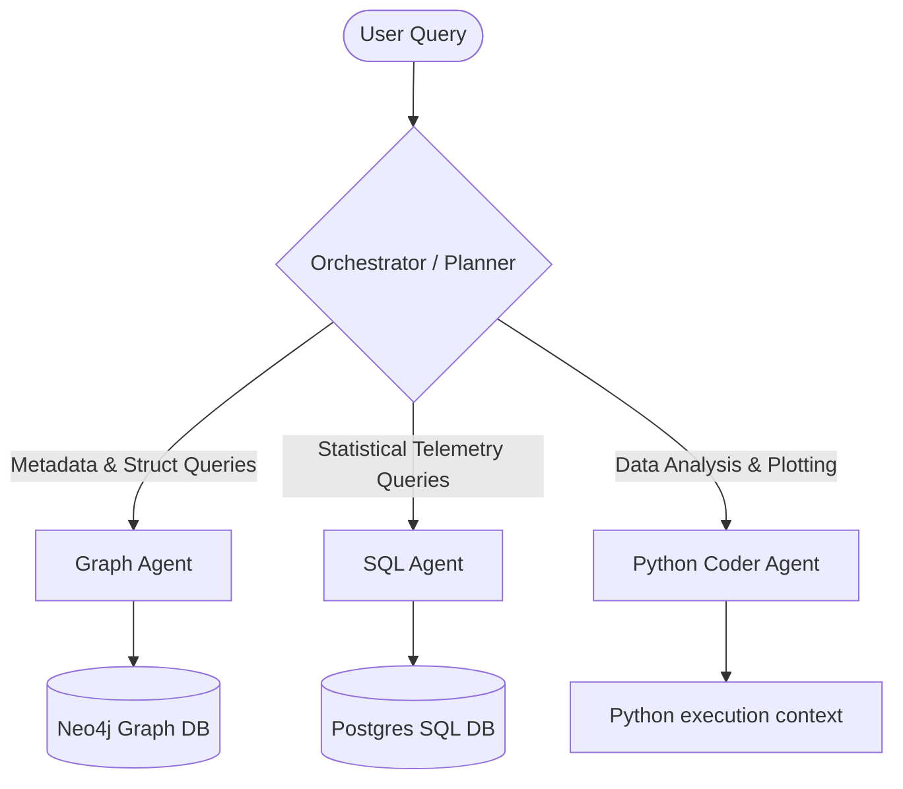

# Case Study Assignment: Multi-Agent Systems for Industrial Asset Analytics
**Duration:** 7 Days  
**Objective:** Design and implement a deterministic, multi-agent orchestration system that processes natural language queries to extract, query, analyze, and visualize industrial equipment telemetry and maintenance metadata.

---

## 1. Architecture Overview
You are expected to design and build a multi-agent system controlled by a central orchestrator. The orchestrator's job is to take a user's natural language query, determine which specialized agents to invoke, and sequence the agent execution flow to solve the query.

---

## 2. Database Design & Setup

You must write scripts to spin up and populate both a PostgreSQL database and a Neo4j database with mock data matching the following specifications:

### A. PostgreSQL Schema (Sensor Telemetry)
The database must contain the following **5 tables**, representing physical industrial pump and turbine systems. **Each table must contain 100 to 200 sensor columns or records** representing time-series measurements (such as pressure, temperature, flow rate, vibration, etc.) collected over the last 30 days.

1. **`bfpa`** (Boiler Feed Pump A telemetry)
2. **`bfpb`** (Boiler Feed Pump B telemetry)
3. **`cepa`** (Condensate Extraction Pump A telemetry)
4. **`cepb`** (Condensate Extraction Pump B telemetry)
5. **`turbine`** (Steam Turbine telemetry)

---

### B. Neo4j Graph Database (Asset Relationships & Logs)
To model the asset ontology, your graph database must contain the following **5 node types** and follow these relationships. 

> [!IMPORTANT]
> **Data Separation Rule:** The Neo4j graph database must only store metadata (relationships, structural hierarchies, sensor associations). Do **NOT** store any time-series telemetry or sensor reading values in Neo4j. PostgreSQL is the sole source of truth for all time-series measurements.

#### Node Types:
1. **`System`**: Corresponds to the physical assets modeled in the SQL database (`bfpa`, `bfpb`, `cepa`, `cepb`, `turbine`).
2. **`Tag`**: Tag metadata representing sensors or measurement channels associated with the SQL tables (e.g., tag name like `bearing_temp_1`, measurement unit, description). 
3. **`MaintenanceLog`**: Log records for maintenance events, categorized per system.
4. **`Item`**: Spare parts or consumables used during maintenance activities (e.g., bearings, seals, filters).
5. **`Alert`**: System alerts triggered by anomalous conditions (e.g., temperature threshold exceedance), categorized per system.

#### Relationships:
- **Alert to System:** `(Alert)-[:GENERATED_ON]->(System)`
- **Maintenance to System:** `(MaintenanceLog)-[:PERFORMED_ON]->(System)`
- **Tags to System:** `(Tag)-[:MEASURED_AT]->(System)`
- **Items to Maintenance:** `(MaintenanceLog)-[:CONSUMED]->(Item)` *(Note: One maintenance activity can request/consume multiple item nodes).*

---

## 3. Specialized Agent Capabilities

You will design the following agents, each exposing deterministic capabilities to the orchestrator:

### 1. SQL Agent
- **Capability:** Queries the PostgreSQL database to retrieve stats (e.g., average, minimum, maximum values) or perform comparison queries.
- **Example Queries:**
  - *Single System:* *"What was the maximum bearing temperature recorded on Boiler Feed Pump A (bfpa) yesterday?"*
  - *Comparison:* *"Which Boiler Feed Pump (BFP) bearing temperature was higher on average in the last 7 days, Pump A (bfpa) or Pump B (bfpb)?"* (requires comparing telemetry in the `bfpa` and `bfpb` tables).

### 2. Graph Agent
- **Capability:** Queries the Neo4j database to answer questions about system structure, metadata, history, and parts consumption.
- **Example Queries:**
  - *"How many sensors (tags) are present in Boiler Feed Pump A?"*
  - *"How many maintenance activities have been performed on the Turbine, and what were the total item costs associated with them?"*
  - *"Which spare parts (Items) were consumed the most during the latest maintenance activity on CEP-A?"*

### 3. Python Coder Agent
- **Capability:** Writes and executes Python code dynamically to perform analytics, statistical modeling, and data visualization on retrieved tables.
- **Example Operations:**
  - Generating line charts, bar charts, and correlation plots.
  - Fitting regression curves or clustering telemetry data to identify different operating regions.

### 4. Multi-Agent Scenarios (Orchestrator Execution)
- **Example Query:** *"What is the latest alert generated on BFP-A, and can you plot the bearing temperature sensor readings during that alert window?"*
  - *Expected Flow:*
    1. **Graph Agent** queries Neo4j to find the latest `Alert` node generated on `System {name: 'bfpa'}` and retrieves its start and end timestamps.
    2. **Python Coder Agent** uses these timestamps to query PostgreSQL directly for the relevant bearing temperature sensor readings during that alert window, then generates and outputs the time-series plot.

---

## 4. Submission & Evaluation Criteria

You are free to design the system architecture, code organization, and multi-agent coordination logic as you see fit. Your submission will be evaluated on:

1. **System Completeness & Data Quality:** High-fidelity generation of mock SQL telemetry and graph nodes matching the schema.
2. **Orchestrator Sequencing Logic:** The orchestrator's ability to plan, route, and sequence agent execution dynamically without hardcoded pathways.
3. **Agent Determinism & Accuracy:** Generating correct, executable SQL and Cypher queries, and writing clean, sandboxed Python code.
4. **Demonstration Notebook:** A Jupyter notebook demonstrating the end-to-end execution of the example queries and plotting tasks.
