# The Data & Its Story

**A guided tour of the synthetic dataset: what it represents, how it is generated,
and how every hierarchy, group, and relationship is held together across the two
databases.**

> Companion to [01-problem-analysis.md](01-problem-analysis.md) (design brief),
> [02-data-design.md](02-data-design.md) (data-layer spec), and
> [03-data-dictionary.md](03-data-dictionary.md) (generated tag reference).

---

## 1. What this data is

It is 30 days of high-fidelity operating data for the **feedwater / condensate /
steam train of a ~250 MW thermal power unit** — five physically connected assets,
their sensors, their alarms, and their maintenance history.

| Volume | Value |
|---|---|
| Systems (physical assets) | 5 |
| Sensor tags (Postgres columns) | **636** |
| Telemetry rows per table | 43,200 (30 days @ 60 s) |
| Scalar telemetry values | **~27.5 million** |
| Spare-part items | 94 |
| Alerts | 65 (9 inside the telemetry window) |
| Maintenance logs | 107 |
| Consumption edges | 373 |

Two databases hold it, with a strict division of labour:

- **PostgreSQL** — the sole source of truth for all time-series telemetry (the 5 wide tables).
- **Neo4j** — the asset *ontology*: relationships, tags, alerts, maintenance, spare parts. **No telemetry values ever live here.**

---

## 2. The plant: a physical hierarchy

The five assets are not independent — they form a closed process loop. Condensate
is drawn from the condenser under vacuum, pushed through the deaerator, pressurised
by the boiler feed pumps, boiled, expanded through the turbine, and condensed again.

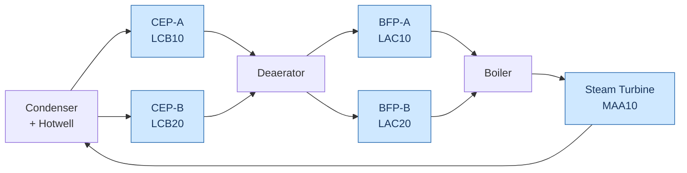

The five blue nodes are exactly the five assets backed by a Postgres table. Because
they share one physical loop, they share **one latent driver — plant load** — which
is why the sensor data across all five systems is genuinely cross-correlated rather
than five separate noise streams.

| Asset | KKS | Type | Rating |
|---|---|---|---|
| `turbine` | `MAA10` | Reheat condensing steam turbine + generator | 3000 rpm, 250 MW |
| `bfpa` / `bfpb` | `LAC10 / LAC20 AP001` | Boiler feed pump — multistage centrifugal + hydraulic coupling | ~5200 rpm, 9 MW |
| `cepa` / `cepb` | `LCB10 / LCB20 AP001` | Condensate extraction pump — vertical can pump under vacuum | 1480 rpm |

---

## 3. How the data is born: one timeline, two databases

The single most important design idea: **everything derives from one shared
timeline.** Alerts and maintenance are not sampled independently — they are
*consequences* of the same events that shape the telemetry.

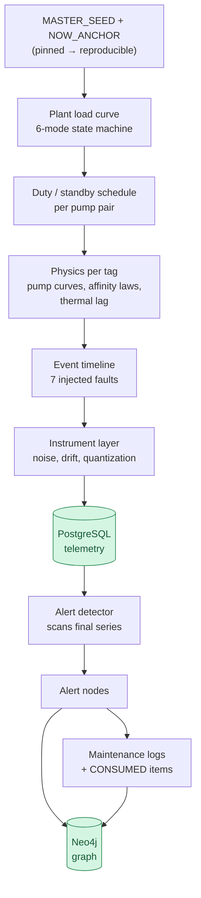

1. **One latent driver — plant load.** A 30-day, 60-second load curve from a 6-state machine (`OFFLINE → STARTUP → LOW_LOAD → BASE_LOAD → PEAK_LOAD → SHUTDOWN`), a diurnal shape, and weekday modulation, smoothed so ramps are gradual.
2. **Duty / standby.** The pump pairs alternate; each pump's load = `plant_load × duty share`.
3. **Physics, not noise.** Every one of the 636 tags is a *function* of load through real relationships (pump curve `H = H₀ − aQ²`, affinity laws `Q∝N, H∝N², P∝N³`, efficiency peaking at BEP, bearing temperature via thermal lag).
4. **Events shape the telemetry** (§5), then **the instrument layer** adds realistic imperfection.
5. **The graph is derived from the finished telemetry** — the detector rediscovers each event as an alert, and maintenance links to those alerts.

That is why the two databases can never disagree: they come out of the same run.

---

## 4. The dataset's top-level structure

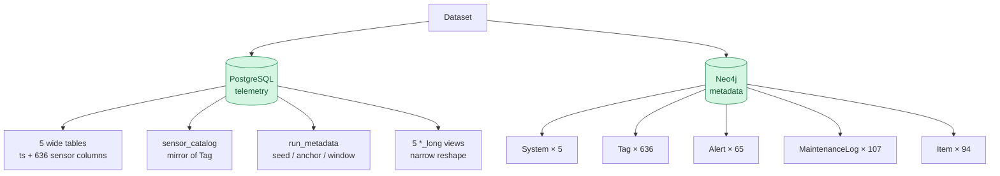

The Postgres `sensor_catalog` is a deliberate mirror of the Neo4j `Tag` nodes — both
are projected from the same in-code catalog, which is what makes the cross-database
checks pass by construction.

---

## 5. The 30-day story

The window runs **2026-08-08 → 2026-09-07** (anchor pinned at 2026-09-07). Seven
physical events are scheduled first; the telemetry, alarms, and work orders all
follow from them. Each event is placed when the affected machine is actually on duty.

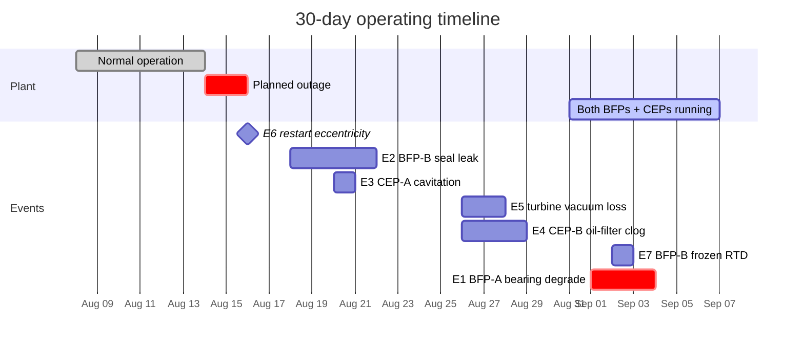

| Event | System | Telemetry signature | Downstream in the graph |
|---|---|---|---|
| **E6** restart eccentricity | turbine | `eccentricity` spike at low speed after the outage | critical Alert (no work order) |
| **E2** seal leakage | bfpb | `seal_leakage_rate` rises, gland pressure decays | Alert → corrective WO (seal set + O-rings + gasket) |
| **E3** cavitation | cepa | `npsh_margin` → 0, broadband vibration | Alert → predictive WO (strainer + gasket + O-rings) |
| **E5** vacuum deterioration | turbine | `condenser_vacuum` degrades, `heat_rate` rises | Alert → corrective WO (air-ingress) |
| **E4** oil-filter clogging | cepb | `lube_oil_filter_dp` ramps to setpoint | Alert → preventive WO (2× filter elements) |
| **E7** sensor fault | bfpb | `bearing_temp_3` frozen while siblings move | data_quality Alert → instrument WO (RTD) |
| **E1** bearing degradation | bfpa | `bearing_temp_1` ramps **+42 °C to 105.7**, vibration crosses ISO Zone D | Alert `ALM-BFPA-0009` → corrective WO (bearing + seal + oil) |

**E1 is the headline.** The bearing crosses its setpoint *after* the vibration does,
so the bearing alarm is the **latest** BFP-A alert in the window — which guarantees
the flagship query *"latest alert on BFP-A, plot the bearing temperature during that
window"* lands on a real, visible excursion. After the repair, the degradation resets
to zero, so the recovery step is visible in the data too.

---

## 6. Hierarchy #1 — the tag catalog (inheritance of groups)

The 636 tags are not authored asset-by-asset. They inherit from shared cores, which
is what makes cross-system comparison (BFP-A vs BFP-B) well-posed *by construction*.

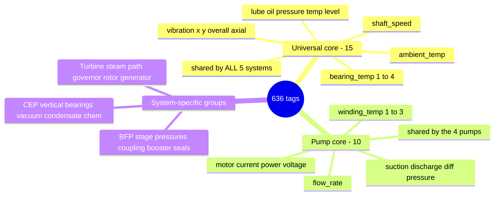

Every system carries the **universal core** (15 identical tags — same names, same
units, everywhere). The four pumps additionally carry the **pump core** (10). On top
of that, each asset adds its own groups:

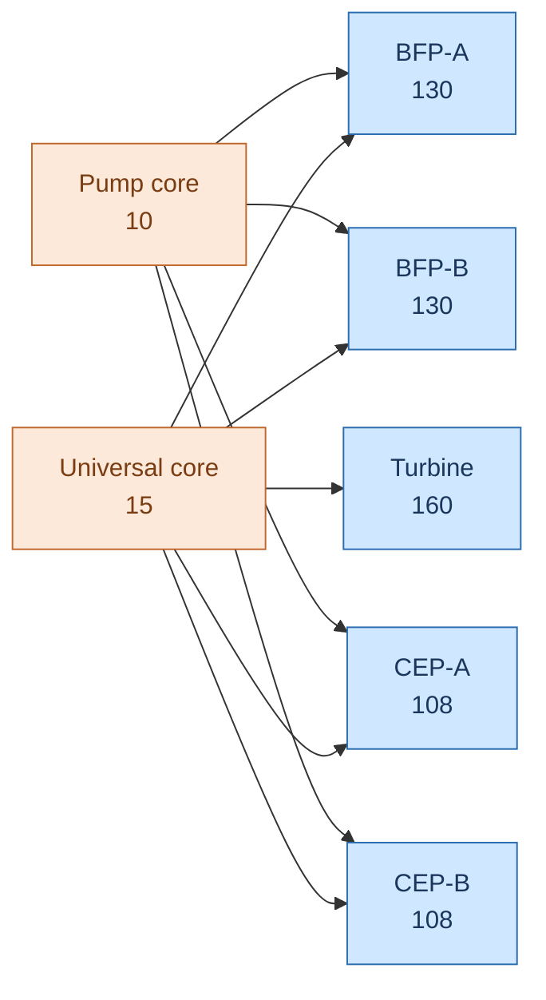

The per-asset groups (doc 02 §5.2) reflect the real machine:

- **BFP-A/B** — extended bearings, 8 stage pressures, hydraulic coupling, booster pump, motor, seals, water chemistry.
- **CEP-A/B** — vertical guide bearings, condenser/vacuum group, condensate chemistry.
- **Turbine** — steam path (HP/IP/LP), governor valves, rotor/expansion, 8-pedestal bearings, generator (stator/rotor/H₂), performance.

---

## 7. Hierarchy #2 — sensor families (the categories)

Every tag belongs to exactly one of **10 families**. The spec's required four —
pressure, temperature, flow, vibration — are guaranteed on every table (gate G-04);
in fact all ten appear on every table.

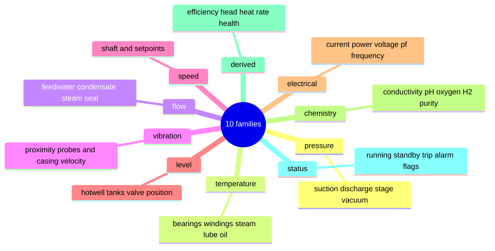

Tag counts per system per family:

| family | bfpa | bfpb | cepa | cepb | turbine |
|---|---:|---:|---:|---:|---:|
| temperature | 35 | 35 | 25 | 25 | 52 |
| pressure | 21 | 21 | 16 | 16 | 29 |
| vibration | 18 | 18 | 14 | 14 | 27 |
| electrical | 13 | 13 | 13 | 13 | 13 |
| derived | 13 | 13 | 14 | 14 | 7 |
| flow | 7 | 7 | 5 | 5 | 7 |
| chemistry | 7 | 7 | 8 | 8 | 1 |
| status | 7 | 7 | 7 | 7 | 8 |
| level | 6 | 6 | 5 | 5 | 13 |
| speed | 3 | 3 | 1 | 1 | 3 |
| **total** | **130** | **130** | **108** | **108** | **160** |

Naming convention (MOD-01): tags are `measurement_qualifier_index` with **no unit in
the name** (`bearing_temp_1`, not `bearing_temp_1_c`) — the unit lives in
`Tag.unit` / `sensor_catalog.unit`. The spare-part catalog is grouped into 14
categories (bearing, seal, filter, gasket, o_ring, lubricant, coupling, impeller,
wear_ring, sleeve, valve, instrument, fastener, electrical) with INR costs from ~₹700
(an O-ring) to ~₹7,05,000 (a turbine journal bearing).

---

## 8. Hierarchy #3 — the Neo4j asset ontology

The graph is a **hub-and-spoke star around each `System`** — deliberately flat:
exactly 5 node labels and 4 relationship types, **no `Component` node and no
`System→System` tree** (enforced by build-failing gates G-05/G-06).

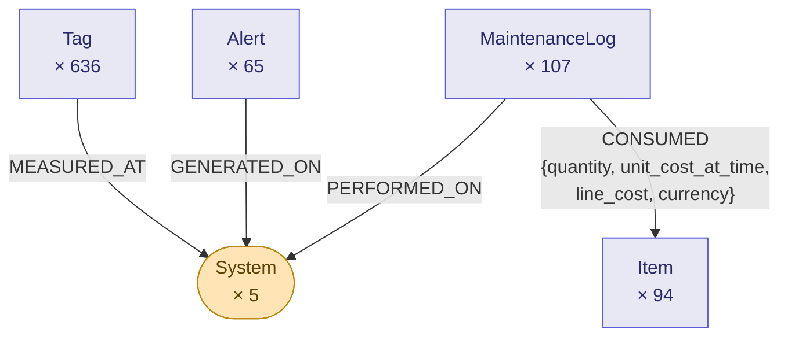

Integrity is held by **uniqueness constraints**: `System.name`, composite
`(Tag.system, Tag.tag_name)`, `Item.item_code`, `MaintenanceLog.work_order_id`,
`Alert.alert_id`. `CONSUMED` is the only edge that carries properties — because
*"which spare parts were consumed the most"* is unanswerable without `quantity` on
the relationship.

A second hierarchy lives in the **KKS identifiers** themselves — a coding tree that
nests system → sub-system → unit:

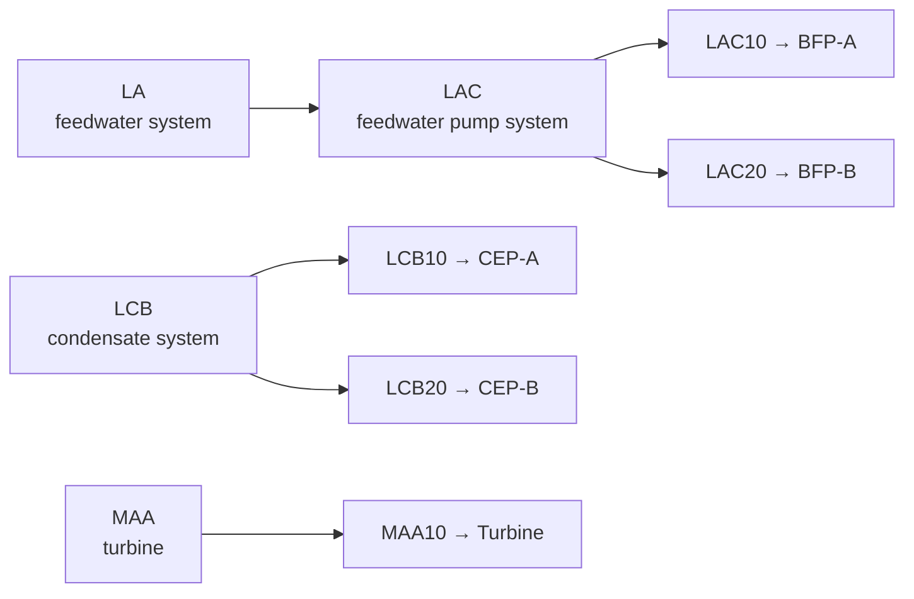

Each tag's KKS (`LAC10 CT001` = a temperature transmitter on BFP-A) extends this with
an ISA-5.1 instrument letter and an index.

---

## 9. Relation mapping — the cross-database bridge

The two databases are separate engines, so there are **no foreign keys**. They are
joined by **shared string keys**, which is exactly what lets the (future) orchestrator
resolve a graph answer into a SQL target with no hardcoded dictionary.

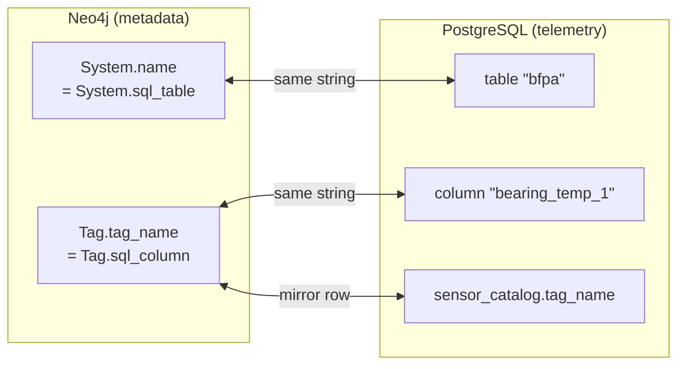

| Neo4j property | Postgres counterpart | Purpose |
|---|---|---|
| `System.name` = `System.sql_table` | table name (`bfpa` …) | resolve graph → SQL table, no hardcoded map |
| `Tag.tag_name` = `Tag.sql_column` | column name = `sensor_catalog.tag_name` | one string in three places — the join key |
| `System.tag_count` | `COUNT(columns) − 1` | the cross-DB invariant (gate **G-15**) |
| `System.aliases` | — | resolve "BFP-A" / "Boiler Feed Pump A" → `bfpa` |
| `Alert.tag_name` + `start_ts` / `end_ts` | slice into the wide table | the alert → plot handoff |

---

## 10. The thread that ties it together: event → alert → work order → telemetry

Everything the graph knows can be traced back to a telemetry excursion and forward to
a cost — one continuous loop. Using E1 as the example:

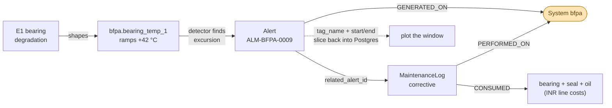

Cost roll-ups are enforced so both natural Cypher formulations agree (gate **G-16**):

```
line_cost         == quantity × unit_cost_at_time
unit_cost_at_time == Item.unit_cost
total_item_cost   == Σ line_cost
total_cost        == total_item_cost + labor_cost
```

---

## 11. Why it is trustworthy: guarantees & reproducibility

The data is engineered so every spec example query has a guaranteed, interesting
answer — each one asserted by a build-failing gate (all **22/22 green**):

| Guarantee | Meaning |
|---|---|
| **DG-1** | The latest BFP-A alert is the bearing-temperature excursion (peak 105.7 °C vs 100 setpoint) → the flagship plot shows a real anomaly |
| **DG-2** | BFP-A runs ≥ 90 % of the day before the anchor → "max bearing temp yesterday" is operational |
| **DG-3** | Both BFPs run all of the last 7 days; A's average bearing temp is 7.6 °C above B → the A-vs-B comparison is meaningful |
| **DG-4** | CEP-A has ≥ 2 in-window work orders; the latest consumes 3 distinct items with distinct quantities |
| **DG-5** | The turbine has 23 work orders with non-zero item cost (₹9.7 M total) |

**Reproducibility.** Every random stream derives from one `MASTER_SEED` via a
`SeedSequence` keyed by `(system, tag_name, …)`, so adding a tag never perturbs an
existing one. The resolved anchor/seed are persisted to `run_metadata`, and gate
**G-22** proves two seeds produce byte-identical content. The **Data Separation
Rule** (gate G-07) proves no telemetry ever leaks into Neo4j.

---

## 12. Reading the data — example queries the story supports

```sql
-- SQL: max bearing temperature on BFP-A yesterday  → 65.8 degC
SELECT max(bearing_temp_1) FROM bfpa WHERE ts >= (SELECT value::timestamptz
  FROM run_metadata WHERE key='now_anchor') - interval '1 day';

-- SQL: 7-day average bearing temp, BFP-A vs BFP-B  → 71.8 vs 64.2
SELECT 'bfpa' s, avg(bearing_temp_1) FROM bfpa WHERE ts >= now_anchor - 7d
UNION ALL SELECT 'bfpb', avg(bearing_temp_1) FROM bfpb WHERE ts >= now_anchor - 7d;
```

```cypher
// Cypher: how many sensors on BFP-A?  → 130 (== Postgres column count)
MATCH (t:Tag {system:'bfpa'}) RETURN count(t);

// Cypher: latest alert on BFP-A + its window  → bearing_temp_1, 2026-09-03
MATCH (a:Alert {system:'bfpa'}) WHERE a.has_telemetry
RETURN a ORDER BY a.start_ts DESC LIMIT 1;

// Cypher: turbine maintenance count + total item cost  → 23 logs, ₹9,749,780
MATCH (m:MaintenanceLog {system:'turbine'})
RETURN count(m), sum(m.total_item_cost);

// Cypher: most-consumed items in the latest CEP-A work order
MATCH (m:MaintenanceLog {system:'cepa'}) WITH m ORDER BY m.start_ts DESC LIMIT 1
MATCH (m)-[c:CONSUMED]->(i:Item) RETURN i.name, c.quantity ORDER BY c.quantity DESC;
```
