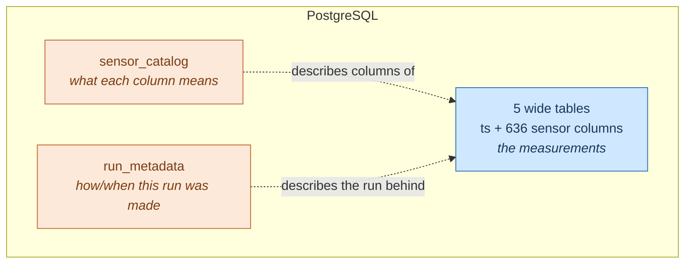
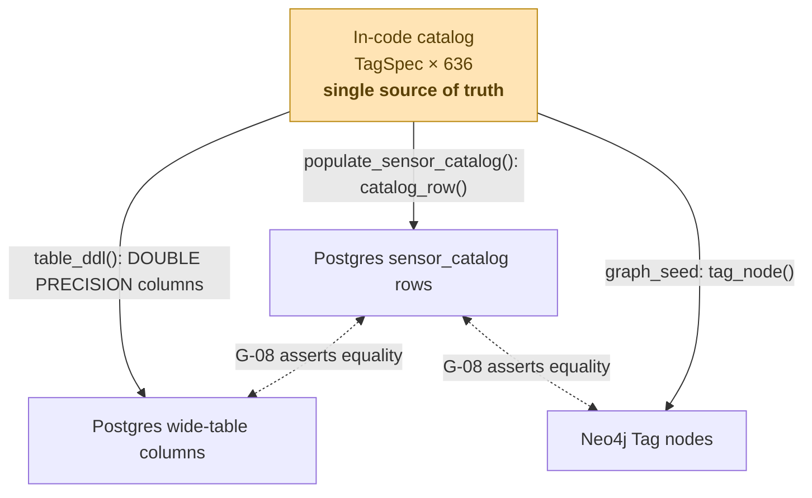
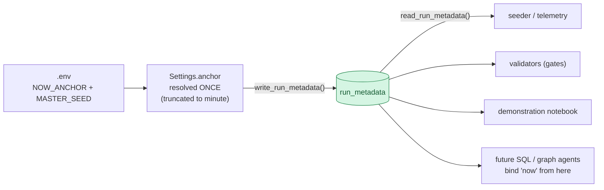
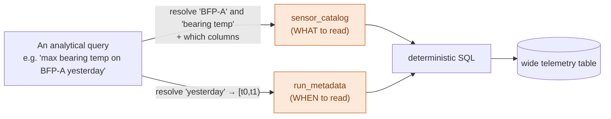

# The Supporting Tables: `sensor_catalog` and `run_metadata`

**Why the two databases need more than telemetry and a graph — the design,
purpose, and architecture of the two metadata tables that make the wide tables
self-describing and the whole dataset reproducible.**

> Companion to [02-data-design.md](02-data-design.md) and
> [04-data-story.md](04-data-story.md). Source: [../src/mas/db/ddl.py](../src/mas/db/ddl.py),
> [../src/mas/config.py](../src/mas/config.py).

---

## 1. The gap these tables fill

The five telemetry tables are deliberately **dumb**: a `ts` primary key plus 108–160
`DOUBLE PRECISION` columns. That is by design (MOD-01) — the unit, meaning, and
alarm limits are kept *out* of the column name so the schema-linking path is actually
exercised. But it leaves two things unanswered that the wide tables alone cannot express:

| Question | Answered by |
|---|---|
| *What is `bearing_temp_1`? What unit, what normal range, what family, what alarms?* — **static, per-tag metadata** | `sensor_catalog` |
| *What does "yesterday" mean? What seed produced this data? What is the sampling rate and currency?* — **global, per-run metadata** | `run_metadata` |

So the two tables cover the two axes of metadata the telemetry omits:
**`sensor_catalog` is spatial/structural** (one row per tag), **`run_metadata` is
temporal/provenance** (one row per parameter of the generation run). Neither holds a
single measurement, so neither is a store of telemetry — a distinction that matters
for the Data Separation Rule (§5).



---

## 2. `sensor_catalog` — turning schema into data

### 2.1 Definition

```sql
CREATE TABLE sensor_catalog (
  system            TEXT NOT NULL,
  tag_name          TEXT NOT NULL,
  family            TEXT NOT NULL,       -- pressure|temperature|flow|vibration|…
  unit              TEXT,                -- degC, bar, mm/s, …  (NOT in the column name)
  description       TEXT,                -- "BFP-A bearing #1 metal temperature"
  kks_tag           TEXT,                -- "LAC10 CT001"
  location          TEXT,                -- drive_end, …
  sensor_type       TEXT,                -- RTD_PT100, accelerometer, …
  precision         DOUBLE PRECISION,    -- ADC quantization step
  normal_min        DOUBLE PRECISION,
  normal_max        DOUBLE PRECISION,
  alarm_lolo        DOUBLE PRECISION,
  alarm_lo          DOUBLE PRECISION,
  alarm_hi          DOUBLE PRECISION,
  alarm_hihi        DOUBLE PRECISION,
  is_derived        BOOLEAN NOT NULL DEFAULT FALSE,
  PRIMARY KEY (system, tag_name)
);
```

The composite primary key `(system, tag_name)` mirrors the uniqueness constraint on
the Neo4j `Tag` node exactly.

### 2.2 Why it exists

**(a) It makes text-to-SQL tractable and deterministic.** 636 columns will not fit
usefully in a prompt. The future SQL agent cannot dump the whole schema; it *retrieves*
the handful of relevant columns from `sensor_catalog` by lexical/embedding match on
`tag_name`, `description`, and `family`, then generates SQL against those. This
"schema linking" step is the single biggest lever on text-to-SQL accuracy and token
cost (doc 01 §4.2). `sensor_catalog` is what makes that step a **SQL query**, not a
prompt-engineering problem:

```sql
-- "temperature sensors on BFP-A"  → the agent's candidate columns
SELECT tag_name, unit, description, normal_min, normal_max, alarm_hi
FROM sensor_catalog
WHERE system = 'bfpa' AND family = 'temperature';
```

**(b) It restores the meaning the column name deliberately drops.** Because the wide
table is just `bearing_temp_1 DOUBLE PRECISION`, the agent *cannot* infer that the unit
is °C or that 90 is the alarm threshold from the column alone — it must consult the
catalog. That is intentional: it forces schema-linking to be load-bearing rather than
decorative, and it means a query like "how close is the bearing to its alarm limit?"
is answerable by joining telemetry to catalog setpoints.

**(c) It is the Postgres mirror of the Neo4j `Tag` node — the cross-DB invariant.**
Both `sensor_catalog` rows and `Tag` nodes are projected from the *same* in-code
catalog, so they cannot drift. This is what makes the cross-database consistency
**checkable within Postgres** and against the graph (gate G-08, both directions;
gate G-04 reads family coverage from `sensor_catalog`).

### 2.3 Architecture: three projections, one source of truth

`sensor_catalog` is never hand-maintained. It is one of **three projections of the
same in-code catalog** (`src/mas/catalog/`), which is why the column names, the
`Tag` nodes, and the catalog rows are guaranteed identical — "one string, three
places" (design principle #4).



- **Populated by** `populate_sensor_catalog(conn)` in [ddl.py](../src/mas/db/ddl.py): `TRUNCATE`, then `COPY` from `catalog.all_tags()` → `TagSpec.catalog_row()`.
- **Read by** the (future) SQL agent's schema-linking retrieval, the validators (G-04, G-08), and the data dictionary.
- **Access:** the read-only `mas_reader` role has `SELECT` on it, so the agent reads catalog *and* telemetry over one guarded connection.

Making metadata a **first-class table** (rather than Postgres `COMMENT ON COLUMN`) is
the key move: comments can't be joined, filtered, or ranked. As a table, the schema
becomes *data* the agent can query, embed, and reason over.

---

## 3. `run_metadata` — the frozen-clock contract

### 3.1 Definition

```sql
CREATE TABLE run_metadata (key TEXT PRIMARY KEY, value TEXT NOT NULL);
```

A deliberately schemaless key/value table. Its rows, written once per seed:

| key | example | why it matters |
|---|---|---|
| `now_anchor` | `2026-09-07T00:00:00+00:00` | **the frozen "now"** every temporal query resolves against |
| `window_start` / `window_end` | `2026-08-08…` / `2026-09-07…` | exact telemetry bounds — no recomputation |
| `master_seed` | `20260907` | the seed every RNG derived from |
| `sample_seconds` | `60` | sampling cadence |
| `window_days` | `30` | horizon |
| `maintenance_history_months` | `24` | maintenance history depth |
| `currency` | `INR` | so no query has to assume it |
| `generator_version` | `1.0.0` | which generation logic produced this data |

### 3.2 Why it exists — the "never call `now()` twice" rule

This is the linchpin of the whole determinism story (MOD-05, AMB-3). The spec's
example queries say *"yesterday"* and *"last 7 days"*. If the SQL agent resolved
those against the wall clock **at query time**, it would target a different window
than the one the data was built for — the answer would drift run-to-run and the demo
guarantees (e.g. DG-2, "max bearing temp yesterday") would break.

The fix: temporal reasoning is resolved **in code, once, against a single frozen
anchor** — never by the model, never twice. The anchor is resolved at seed time
(`Settings.anchor` in [config.py](../src/mas/config.py), cached), **persisted to
`run_metadata`**, and read back by every later consumer so they all agree on what
"now" and "yesterday" mean.



This especially matters across **processes and time**: the seeder may run today and an
agent query hours later. In `NOW_ANCHOR=live` mode the anchor is a wall-clock value
captured at seed time — a fresh `now()` in the agent's process would be *different*,
so the agent must read the persisted anchor from `run_metadata` rather than
re-resolving it. `run_metadata` is that cross-process contract.

**(b) It is the reproducibility record.** `master_seed` + `now_anchor` fully determine
the dataset (gate G-22 proves two seeds give byte-identical content). `run_metadata`
records exactly what produced *this* dataset, so any run is auditable and replayable —
pin those two values in `.env` and you regenerate the same 27.5M points.

**(c) It is config provenance.** Consumers read `sample_seconds`, `currency`,
`window_days`, etc. from the data rather than assuming them — the agent knows the
cadence is 60 s and the currency is INR because the dataset says so.

### 3.3 Architecture

- **Written by** `write_run_metadata(conn, meta)` in [ddl.py](../src/mas/db/ddl.py) at the start of loading (`TRUNCATE` then upsert via `ON CONFLICT`), from `Settings.run_metadata(generator_version)`.
- **Read by** `read_run_metadata(conn)` → a plain `dict`.
- **Shape:** key/value (EAV) on purpose — adding a new run parameter is a one-line data change, never a schema migration. It is tiny (one row per key) and lives in Postgres because that is where telemetry consumers already connect.

---

## 4. How the two work together

They are complementary halves of "everything about the data that is not a
measurement":



- `sensor_catalog` answers **what** to read (which columns, their units and limits).
- `run_metadata` answers **when** to read (the frozen window bounds).

Together they turn a wide, semantics-free telemetry table into something an agent can
query deterministically — and turn the whole dataset into something reproducible and
auditable.

---

## 5. Design decisions & rationale

| Decision | Why |
|---|---|
| **Metadata tables live in Postgres, not Neo4j** | `sensor_catalog` is mirrored as `Tag` in Neo4j, but the SQL agent needs it *in its own database* for schema-linking without a cross-DB call; `run_metadata` is about the telemetry run, and telemetry consumers already connect to Postgres. |
| **Not a Data Separation Rule violation** (AMB-5) | The rule forbids *time-series values in Neo4j*. These tables hold only static per-tag metadata and per-run parameters — **zero measurements** — so metadata in Postgres is unconstrained. |
| **`sensor_catalog` as a table, not column comments** | A table can be queried, filtered by family, ranked by relevance, and embedded — schema becomes data. Comments cannot. |
| **`run_metadata` as key/value** | New parameters are data changes, not migrations; the table stays a stable contract as the generator evolves (`generator_version` tracks that evolution). |
| **Both projected from one source of truth** | `sensor_catalog` and `Tag` come from the same in-code catalog; the anchor comes from the same `Settings` — so nothing can disagree, and the disagreement checks (G-04, G-08, G-15, G-22) hold by construction. |

---

## 6. Which quality gates depend on them

| Gate | Depends on |
|---|---|
| **G-02** | column count consistency (catalog ↔ wide table ↔ `System.tag_count`) |
| **G-04** | family coverage read from `sensor_catalog` |
| **G-08** | `Tag.unit` / ranges match `sensor_catalog` and the in-code catalog, both directions |
| **G-13 / G-14 / G-19** | temporal windows ("yesterday", "last 7 days", the alert window) resolved against the frozen anchor |
| **G-22** | reproducibility — `master_seed` + `now_anchor` produce identical content |

Remove `sensor_catalog` and the SQL agent has no way to find the right columns among
636; remove `run_metadata` and "yesterday" becomes non-deterministic. They are small
tables, but they are what make the large one *usable* and the whole dataset
*reproducible*.
