# Presentation Notes — Multi-Agent Industrial Asset Analytics

> **What this is:** detailed speaker/prep notes for building the final PPT. Each section maps
> to one topic (usually 1–3 slides). Each section opens with **Slide takeaway** (the one line
> the audience should remember), then the facts, diagrams and examples to draw from.
>
> **Every number here was checked against the code or the seeded databases (2026-09-14).**
> Deeper references: `docs/Data_design/02–05` (data), `docs/agentic_design/10` (why the design is
> what it is), `docs/agentic_design/11` (every agent term explained).

---

## Contents

1. [Agenda](#1-agenda)
2. [The problem in hand](#2-the-problem-in-hand)
3. [Understanding the problem — the thermal power plant story](#3-understanding-the-problem--the-thermal-power-plant-story)
4. [Data design and generation — physics, events, alerts, maintenance](#4-data-design-and-generation--physics-events-alerts-maintenance)
5. [Relevant parameters and reproducibility](#5-relevant-parameters-and-reproducibility)
6. [How a multi-agent system solves this problem](#6-how-a-multi-agent-system-solves-this-problem)
7. [Our solution — deep dive into the MAS](#7-our-solution--deep-dive-into-the-mas)
8. [Each agent: technical details, tools and the story behind them](#8-each-agent-technical-details-tools-and-the-story-behind-them)
9. [Glossary mapping, context management, slots, set_plan, ledger, dependencies — with payloads](#9-glossary-mapping-context-management-slots-set_plan-ledger-dependencies--with-payloads)
10. [Task delegation criteria and specialist report mapping](#10-task-delegation-criteria-and-specialist-report-mapping)
11. [Large data handling, role/catalog corrections and slot statuses](#11-large-data-handling-rolecatalog-corrections-and-slot-statuses)
12. [Artifact management — tables, figures, in-memory store](#12-artifact-management--tables-figures-in-memory-store)
13. [Cross-process artifact transfer — the coder sandbox layers](#13-cross-process-artifact-transfer--the-coder-sandbox-layers)
14. [Execution guardrails and how they are managed](#14-execution-guardrails-and-how-they-are-managed)
15. [Harness utilities — digests, clock, briefs, and other reproducible code](#15-harness-utilities--digests-clock-briefs-and-other-reproducible-code)
16. [Appendix A — Local setup: models, sandbox, API keys, databases](#appendix-a--local-setup-models-sandbox-api-keys-databases)
17. [Appendix B — Numbers cheat-sheet](#appendix-b--numbers-cheat-sheet)
18. [Appendix C — Suggested slide flow and demo script](#appendix-c--suggested-slide-flow-and-demo-script)

---

## 1. Agenda

**Slide takeaway:** *From a realistic plant dataset to a team of AI agents that plans, queries,
analyses and plots — with code checking every step.*

Suggested agenda slide (maps to the sections below):

| # | Block | Sections | Time guide |
|---|---|---|---|
| 1 | The problem and the plant story | 2, 3 | 3 min |
| 2 | Building the data: physics, events, alerts, reproducibility | 4, 5 | 6 min |
| 3 | Why multi-agent, and our architecture | 6, 7 | 5 min |
| 4 | The agents and their tools | 8 | 5 min |
| 5 | How agents talk: slots, ledger, payloads, delegation | 9, 10 | 7 min |
| 6 | Data handling: large data, artifacts, sandbox | 11, 12, 13 | 5 min |
| 7 | Guardrails and deterministic harness | 14, 15 | 4 min |
| 8 | Live demo + Q&A | Appendix C | 10 min |

---

## 2. The problem in hand

**Slide takeaway:** *Turn plain-English engineering questions into correct SQL, Cypher and
Python, across two databases, in a way that is dynamic and repeatable.*

### 2.1 The assignment (from `Problem.md`)

- **Objective:** a *deterministic* multi-agent orchestration system that:
  - takes natural-language queries;
  - extracts, queries, analyses and visualises equipment telemetry and maintenance metadata.
- **Duration:** 7 days.

**Required components**

| Component | Requirement |
|---|---|
| **PostgreSQL** | 5 tables — `bfpa`, `bfpb`, `cepa`, `cepb`, `turbine` — each with **100–200 sensor columns**, 30 days of time-series |
| **Neo4j** | exactly 5 node types — `System`, `Tag`, `MaintenanceLog`, `Item`, `Alert` — and 4 relationships: `GENERATED_ON`, `PERFORMED_ON`, `MEASURED_AT`, `CONSUMED` |
| **Data Separation Rule** | Neo4j stores **only metadata** — never telemetry values. Postgres is the sole source of time-series truth |
| **SQL Agent** | stats (avg/min/max) and comparisons over telemetry |
| **Graph Agent** | structure, metadata, history, parts consumption |
| **Python Coder Agent** | dynamic analytics, regression, clustering, charts |
| **Orchestrator** | plans, routes and sequences agents **without hard-coded pathways** |
| **Notebook** | end-to-end demonstration of the example queries |

**Example queries the system must handle**
- *SQL:* "What was the maximum bearing temperature on BFP-A yesterday?"
- *SQL:* "Which BFP had the higher average bearing temperature in the last 7 days?"
- *Graph:* "How many sensors are in BFP-A?"
- *Graph:* "How many maintenance activities on the Turbine, and their total item costs?"
- *Graph:* "Which spare parts were consumed most in the latest CEP-A maintenance?"
- *Multi-agent:* "What is the latest alert on BFP-A, and plot the bearing temperature during
  that alert window."

### 2.2 Evaluation criteria (what the jury scores)

1. **System completeness & data quality** — high-fidelity mock telemetry and graph.
2. **Orchestrator sequencing logic** — dynamic plan / route / sequence.
3. **Agent determinism & accuracy** — correct executable SQL/Cypher, clean sandboxed Python.
4. **Demonstration notebook.**

### 2.3 The hard parts (why this is not a toy)

| Challenge | Why it is hard |
|---|---|
| **Scale** | 636 sensor columns × 43,200 rows ≈ **27.5 million values**. An LLM cannot "read" the data |
| **Two databases** | Answers often need Neo4j (what/when) then Postgres (how much) |
| **Ambiguous language** | "BFP-A", "pump A", "bearing temps", "yesterday", "load" must map to exact tables, columns and times |
| **Hallucination** | LLMs invent column names, dates and numbers |
| **Determinism** | Same question + same data should give the same facts, run after run |
| **Safety** | Generated SQL, Cypher and Python must never write, leak or hang |

---

## 3. Understanding the problem — the thermal power plant story

**Slide takeaway:** *We did not generate random numbers — we simulated one connected
power-plant unit, where one timeline drives sensors, alarms and repairs.*

### 3.1 The plant

- 30 days of operating data for the **feedwater / condensate / steam train** of a
  **~250 MW thermal unit**.
- The five assets form **one closed process loop**.

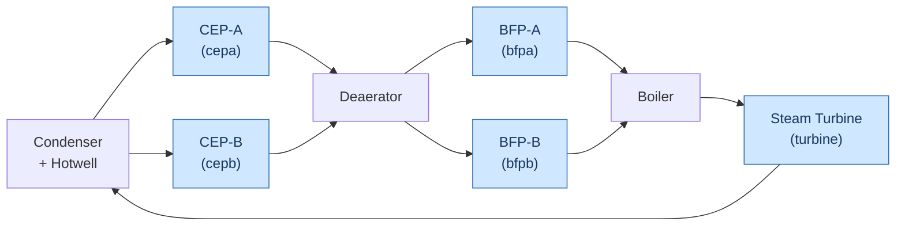

| Asset | Table | What it is | Rating | KKS | Criticality |
|---|---|---|---|---|---|
| Boiler Feed Pump A/B | `bfpa`, `bfpb` | multistage centrifugal + hydraulic coupling | ~5,200 rpm, 9 MW | LAC10 / LAC20 | high |
| Condensate Extraction Pump A/B | `cepa`, `cepb` | vertical can pump under condenser vacuum | 1,480 rpm | LCB10 / LCB20 | medium |
| Steam Turbine | `turbine` | reheat condensing turbine + generator | 3,000 rpm, 250 MW | MAA10 | critical |

**Why a connected loop matters:**
- All five assets share **one latent driver: plant load**, so their sensors are genuinely
  cross-correlated.
- That makes correlation, regression and clustering meaningful, not decorative.

### 3.2 The story we crafted — 30 days, 7 faults

- **Window:** 2026-08-08 → 2026-09-07.
- **"Now"** is frozen at 2026-09-07 00:00 UTC.
- **Faults are scheduled first**; telemetry, alarms and work orders all follow from them.

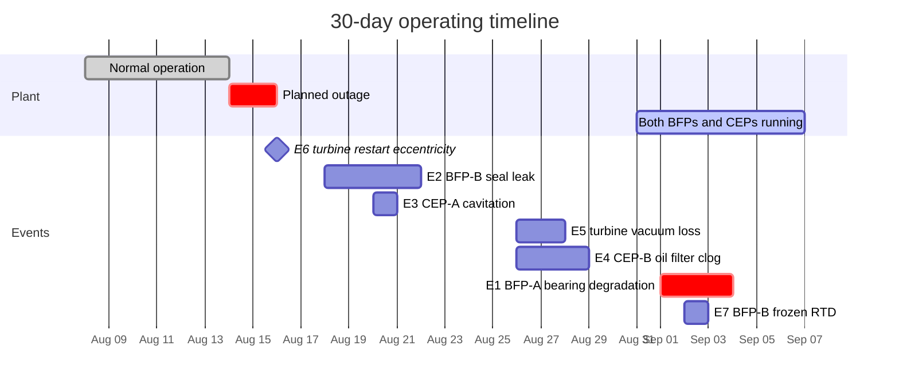

| Event | System | What the sensors show | What the graph records |
|---|---|---|---|
| **E1** bearing degradation | bfpa | `vibration_overall` +6 mm/s, then `bearing_temp_1` ramps **+42 °C to 105.7 °C** | Alert `ALM-BFPA-0009` (hi_hi) → corrective WO: bearing + seal + lube oil |
| **E2** seal leakage | bfpb | `seal_leakage_rate` rises, `gland_seal_pressure` decays | Alert → corrective WO: seal set, O-rings, gaskets |
| **E3** cavitation | cepa | `npsh_margin` falls, vibration + `cavitation_index` rise | Alert → predictive WO: strainer, gaskets, O-rings |
| **E4** oil-filter clog | cepb | `lube_oil_filter_dp` ramps to setpoint | Alert → preventive WO: 2 filter elements |
| **E5** vacuum deterioration | turbine | `condenser_vacuum` degrades, `heat_rate` +1,800 | Alert → corrective WO: air-ingress repair |
| **E6** restart eccentricity | turbine | short `eccentricity` spike after the outage | Critical alert, **no** WO |
| **E7** sensor fault | bfpb | `bearing_temp_3` **frozen** while siblings move | Data-quality alert → instrument WO (RTD) |

**The headline — E1:**
- The bearing crosses its alarm **after** the vibration does, so the bearing alarm is the
  **latest** BFP-A alert.
- That guarantees the flagship query ("latest BFP-A alert → plot bearing temperature")
  lands on a real, visible excursion.
- After the repair the degradation resets, so **recovery is visible in the data**.

### 3.3 The one thread that ties both databases

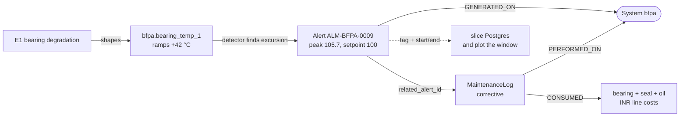

---

## 4. Data design and generation — physics, events, alerts, maintenance

**Slide takeaway:** *One seeded timeline → physics per tag → injected faults → realistic
instruments → alerts detected from the final data → maintenance linked to those alerts.*

### 4.1 Design principles

1. **One timeline, two databases.** Nothing in the graph is sampled independently of the
   telemetry.
2. **Physics before noise.** Every tag is a function of a latent driver + lag + noise, never
   a random draw.
3. **The graph describes; Postgres measures.** Enforced by a build-failing gate.
4. **Names are the join.** `Tag.tag_name` = Postgres column = `sensor_catalog.tag_name`.
5. **The catalog is the source of truth.** One in-code catalog (`src/mas/catalog/`) projects
   both databases.
6. **Every demo query has a guaranteed, interesting answer** (demo guarantees DG-1..DG-5).

### 4.2 Volumes (verified in the databases)

| Item | Value |
|---|---|
| Sensor tags | **636** — bfpa 130, bfpb 130, cepa 108, cepb 108, turbine 160 |
| Rows per table | **43,200** (30 days × 1,440 min) |
| Telemetry values | **~27.5 million** |
| Neo4j nodes | System 5 · Tag 636 · Alert 65 · MaintenanceLog 107 · Item 94 |
| Neo4j relationships | MEASURED_AT 636 · GENERATED_ON 65 · PERFORMED_ON 107 · CONSUMED 373 |
| Alerts | 9 inside the telemetry window + 56 historical (`ALH-*`, no telemetry) |
| Spare-part categories | 14, costs ₹520 → ₹7,05,000 |

### 4.3 Tag catalog — inheritance of groups

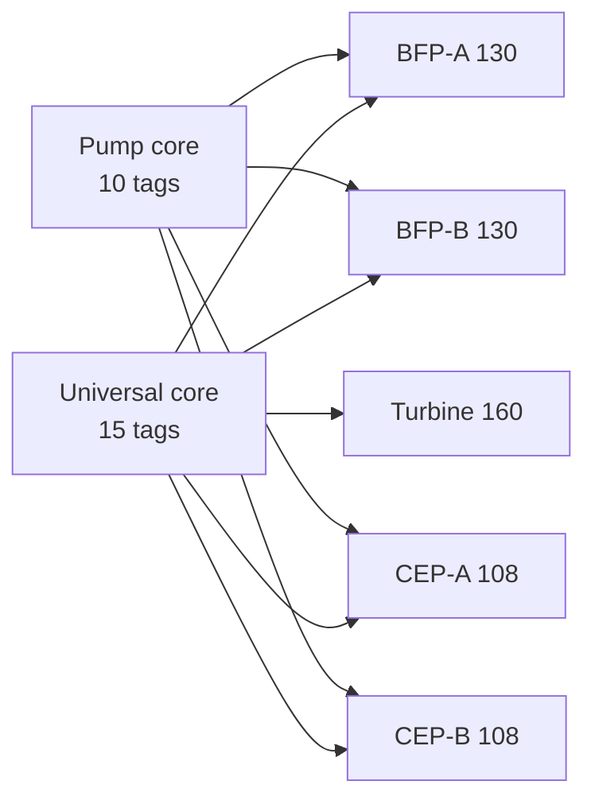

- **Universal core (15, all systems, identical names):**
  - `bearing_temp_1..4`
  - `vibration_x_1`, `vibration_y_1`, `vibration_x_2`, `vibration_y_2`, `vibration_overall`
  - `shaft_speed`, `lube_oil_pressure`, `lube_oil_temp`, `lube_oil_level`, `ambient_temp`
- **Pump core (10):**
  - `suction_pressure`, `discharge_pressure`, `differential_pressure`, `flow_rate`
  - `motor_current`, `motor_power`, `motor_voltage`, `winding_temp_1..3`
- **System-specific groups:**
  - BFPs: stage pressures, coupling, booster, seals, feedwater chemistry
  - CEPs: vertical guide bearings, condenser/vacuum, condensate chemistry
  - Turbine: steam path, governor, rotor expansion, generator, performance
- **10 families on every table:** pressure, temperature, flow, vibration, speed, level,
  electrical, chemistry, derived, status.
- **Naming standard:** `measurement_qualifier_index`, **no unit in the name**
  (`bearing_temp_1`, not `bearing_temp_1_c`). Units live in `Tag.unit` / `sensor_catalog.unit`,
  which makes schema lookup an essential step for the agents.
- **Each tag record (`TagSpec`)** carries:
  - family, unit, description, KKS tag, location, sensor type
  - precision, noise σ
  - normal min/max, alarm lo/lolo/hi/hihi
  - **physics driver + parameters**

### 4.4 Schemas

**PostgreSQL**
- 5 **wide** tables: `ts TIMESTAMPTZ PRIMARY KEY` + one `DOUBLE PRECISION` column per tag.
- 5 **long views** `<system>_long(ts, tag_name, value)`. They satisfy the "records" reading
  of the spec and make multi-tag queries easy.
- `sensor_catalog` — primary key `(system, tag_name)`; units and setpoints.
- `run_metadata` — anchor, seed, window, currency, generator version.
- Roles:
  - `mas` — seeder;
  - `mas_reader` — the agents: SELECT-only, read-only transactions, `statement_timeout = 15s`.

**Neo4j** — hub-and-spoke star around each `System`

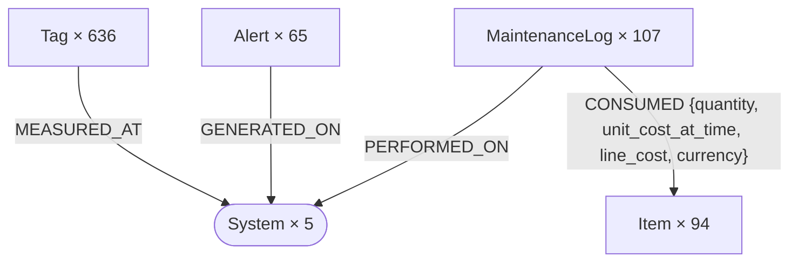

- **Uniqueness constraints:** `System.name`, `(Tag.system, Tag.tag_name)`, `Item.item_code`,
  `MaintenanceLog.work_order_id`, `Alert.alert_id`.
- **Cross-DB bridge:** `System.name` = `System.sql_table` = table name;
  `Tag.tag_name` = `Tag.sql_column` = column name; `System.tag_count` = column count.

### 4.5 The generation pipeline

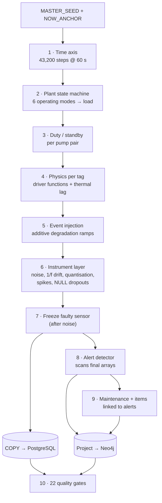

Per system, the order is `physics → events → instrument → freeze`
(`datagen/build_telemetry.py`). The final in-memory arrays are exactly what lands in
Postgres, and the alert detector runs on those same arrays.

#### Stage 2 — Plant operating modes (`datagen/modes.py`)

| Mode | Target load | When |
|---|---|---|
| OFFLINE | 0 % | planned outage, days 6–8 (Aug 14–16) |
| SHUTDOWN | 15 % | 6 h before the outage |
| STARTUP | 30 % | 12 h after the outage |
| LOW_LOAD | 50 % | nights (23:00–05:00) on alternate days, before day 23 |
| BASE_LOAD | 82 % | default |
| PEAK_LOAD | 96 % | 10:00–20:00 on days 2, 5, 9, 13, 17, 20, 24, 28 |

- **Target load** = mode level + a diurnal sine (peak 14:00, ±8 % base/low, ±4 % peak), with
  weekend base load × 0.94.
- Then a **first-order lag, τ = 30 min**, so ramps are smooth.
- **Why:** a smooth single curve would make one blob when clustered. Discrete modes create
  **genuinely separable operating regions** (gate G-18: KMeans k=4, silhouette ≥ 0.45).

#### Stage 3 — Duty / standby schedule

| Days | BFP-A | BFP-B | CEP-A | CEP-B |
|---|---|---|---|---|
| 0–8 | duty | standby | duty | standby |
| 8–16 | standby | duty | duty | standby |
| 16–23 | duty | standby | standby | duty |
| 23–30 | duty | duty (shared ~55 % each) | duty | duty |

- A standby pump is **not dead data**:
  - speed ≈ 0, `standby_mode = 1`;
  - bearings cool toward ambient with a thermal lag;
  - the aux oil pump keeps lube oil pressure alive.
- Both BFPs run in the last 7 days, so "which BFP ran hotter" has a real answer.

#### Stage 4 — Physics (`datagen/physics.py`)

Each tag has a **driver** (e.g. `thermal_lag`, `discharge_pressure`, `vibration_velocity`,
`chem_walk`). Key relationships:

| Quantity | Model |
|---|---|
| Effective load | plant load × duty share; normalised `nf = load / 0.96` |
| Shaft speed (pumps) | `0.55 + 0.45·nf` of rated when running, through a lag (hydraulic coupling / VFD behaviour) |
| Flow | `load × rated_flow`, lagged; `q = flow / rated_flow` |
| Efficiency curve | `η = η_max − 1.1·(q − 0.8)²` — peaks at best efficiency point q≈0.8; η_max 0.85 pumps, 0.42 turbine |
| Pump head | `rated_head × (1.15 − 0.4·q²)` — the pump curve (head falls with flow²) |
| Discharge pressure | `0.35 + 0.6·nf − 0.15·q²` across the normal band |
| Hydraulic power | `rated_kW × 0.9·q·(1.1 − 0.3·q²)` |
| Bearing / winding temperature | target in normal band by load → **first-order lag τ = tau_min (≈25 min)** so temperature never jumps |
| Vibration (velocity) | `1.0 + 1.7·nf` mm/s running; low residual on standby |
| Recirculation valve | opens as `100·(0.6 − q)` at low flow |
| Heat rate (turbine) | falls with load: `hi − (hi−lo)·(0.2 + 0.6·load)` |
| Chemistry | bounded random walk, mean shifts with load |
| Oil water / particle count | drift upward over the window |
| Counters | running hours integrate running time; start count increments on starts |
| Differential expansion | integral of load change during ramps |
| Status flags | 0/1: running, standby, alarm_active (set during events) |

- **The thermal-lag model** (`dsp.first_order_lag`):
  `y[i] = y[i−1] + α·(x[i] − y[i−1])`, with `α = 1 − e^(−1/τ)`.
- **This is the single detail that most separates plausible telemetry from synthetic noise.**

#### Stage 5 — Event injection (`datagen/events.py`)

- Each event is a list of **additive degradation ramps**: 0 before the start, linear up to
  the magnitude at the end, **reset to 0 after** (the repair).
- During the event window the `alarm_active` status tag is set.
- Events are placed only when the machine is on duty.

| Event | Tag · days · magnitude |
|---|---|
| E1 | `vibration_overall` 24.0→26.5, +6.0 · `bearing_temp_1` 24.5→27.0, +42 |
| E2 | `seal_leakage_rate` 10→14, +7.5 · `gland_seal_pressure` 10→14, −1.6 |
| E3 | `npsh_margin` 12→13, −6 · `vibration_overall` +4.5 · `cavitation_index` +60 |
| E4 | `lube_oil_filter_dp` 18→21, +1.6 |
| E5 | `condenser_vacuum` 18→20, +40 · `heat_rate` +1,800 |
| E6 | `eccentricity` 8.15→8.35, +90 |
| E7 | `bearing_temp_3` frozen days 25→26 |

#### Stage 6 — Instrument layer (`datagen/instrument.py`)

| Effect | Detail |
|---|---|
| Gaussian noise | per tag `noise_sigma` |
| 1/f drift | detrended cumulative noise × 0.3 σ (physical sensors only) |
| Quantisation | round to the tag's `precision` (ADC step) |
| Physical floor | non-negative quantities clipped at 0 |
| Status tags | rounded to 0/1 |
| Spikes | 6 tags per system, 1–3 single-sample spikes of ±0.8 × normal span |
| NULL dropouts | 4 tags per system, 3–14 minutes of NULL |
| Protection | event tags are never given pathologies, so demo guarantees hold |
| Frozen sensor | applied **after** noise, so the value is truly constant |

- **Loading:** every table is streamed with Postgres `COPY` (NaN → SQL NULL).

### 4.6 Alert derivation — detected, not invented (`datagen/alerts.py`)

**Invariant:** alerts are found by a deterministic detector scanning the **final**
telemetry, so **no alert exists that the data does not support**.

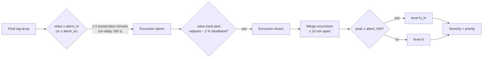

| Rule | Value |
|---|---|
| Deadband on clear | 2 % of setpoint |
| On-delay | 180 s (suppresses single-sample instrument spikes) |
| Off-delay | 60 s |
| Merge gap | 10 min |
| Promotion | `hi → hi_hi` (or `lo → lo_lo`) when the peak crosses the extreme setpoint |
| Vibration severity | ISO 20816-3 velocity zones: ≥ 7.1 critical, ≥ 4.5 high, ≥ 2.8 medium |
| Other severity | hi_hi / lo_lo on a critical or high system → critical; hi / lo → high or medium |
| Frozen sensor | taken from the event record → `alert_type = data_quality`, severity low (scanning for "flat" would false-trigger on standby zeros) |
| Status | `active` if still open at the anchor, else `cleared`; high/critical alerts acknowledged by an operator 8 min after start |
| IDs | `ALM-<SYSTEM>-<seq>` ordered by start time; historical `ALH-<SYSTEM>-<n>` |
| Historical alerts | 12 bfpa, 12 bfpb, 8 cepa, 8 cepb, 16 turbine — randomly 31 days to 24 months before the window; `has_telemetry = false` |

**The 9 in-window alerts (verified):**
- **bfpa:** `ALM-BFPA-0008` vibration_overall hi_hi, then `ALM-BFPA-0009` bearing_temp_1
  hi_hi — 2026-09-03 02:26 → 23:59, peak 105.7 vs 100.
- **bfpb:** `ALM-BFPB-0002` seal_leakage_rate hi_hi · `ALM-BFPB-0007` bearing_temp_3 frozen.
- **cepa:** `ALM-CEPA-0003` vibration_overall hi · `ALM-CEPA-0004` npsh_margin lo_lo.
- **cepb:** `ALM-CEPB-0005` lube_oil_filter_dp hi_hi.
- **turbine:** `ALM-TURBINE-0001` eccentricity hi · `ALM-TURBINE-0006` condenser_vacuum hi.

### 4.7 Maintenance, items and costs (`datagen/maintenance.py`)

- **Event-driven work orders (E1–E5, E7):**
  - linked through `related_alert_id`;
  - they start *after* their alert (a work order never precedes its trigger);
  - they consume the event's item plan.
- **Historical work orders** populate 24 months: 20 bfpa, 20 bfpb, 18 cepa, 20 cepb,
  22 turbine. Items are chosen from system-appropriate categories.
- **Total today:** 107 work orders.
- **Vocabulary (ISO 14224-style):**
  - `maintenance_class` ∈ preventive / corrective / predictive / modification;
  - `failure_mode` ∈ vibration, overheating, external_leakage, plugged_choked,
    abnormal_instrument_reading, …;
  - `detection_method` ∈ condition_monitoring / periodic_inspection / alarm / operator_report.
- **Labour rate:** ₹1,200 per hour.
- **Cost identities** (enforced, so any natural Cypher returns the same number):

```
line_cost          = quantity × unit_cost_at_time
unit_cost_at_time  = Item.unit_cost
total_item_cost    = Σ line_cost over the work order's CONSUMED edges
total_cost         = total_item_cost + labor_cost
```

### 4.8 Demo guarantees and the 22 quality gates

**Demo guarantees** (each asserted by a build-failing gate):

| ID | Guarantee | Verified value |
|---|---|---|
| DG-1 | The latest BFP-A alert is the bearing-temperature excursion, inside the telemetry window | `ALM-BFPA-0009`, peak 105.7 vs setpoint 100 |
| DG-2 | BFP-A runs ≥ 90 % of the day before the anchor | "max bearing temp yesterday" is operational: 65.8 °C |
| DG-3 | Both BFPs run in the last 7 days; A's bearing temp higher | the A-vs-B comparison is meaningful |
| DG-4 | CEP-A has ≥ 2 work orders; the latest uses ≥ 3 distinct items with distinct quantities | "most consumed part" has a unique winner |
| DG-5 | Turbine has ≥ 8 work orders with item cost | 23 work orders, total item cost ₹9,749,780 |

**Quality gates** (`python scripts/validate.py` → **22/22 green**):

| Gate | Checks |
|---|---|
| G-01 · G-02 · G-03 | 5 tables; 100–200 columns each; exact 30-day axis, no gaps or duplicates |
| G-04 | every table has all required families |
| G-05 · G-06 | exactly 5 labels, 4 relationship types, correct directions |
| **G-07** | **Data Separation Rule** — no numeric arrays or reading-like properties in Neo4j |
| G-08 · G-15 | tag names/units identical in both databases; graph tag count = column count |
| G-09 · G-10 · G-11 · G-12 | each work order on one system; no orphan items; each alert on one system with a real tag; ≥ 40 % of work orders consume ≥ 3 items |
| G-13 · G-14 · G-17 · G-19 | DG-2, DG-3, DG-4, DG-1 |
| G-16 | cost identities + DG-5 |
| G-18 | operating regions separable: KMeans k=4, silhouette ≥ 0.45 |
| G-20 | corrective repairs visible in telemetry (post-repair mean below pre-repair) |
| G-21 | NULL fraction ≤ 0.15 %; no dead or constant columns (except status) |
| G-22 | re-seeding reproduces identical content hashes |

---

## 5. Relevant parameters and reproducibility

**Slide takeaway:** *One seed and one frozen clock make the data byte-identical, and the same
discipline — code resolves anything exact — carries into the agents.*

### 5.1 Data-generation parameters (`.env`, `src/mas/config.py`)

| Parameter | Default | Effect |
|---|---|---|
| `MASTER_SEED` | 20260907 | every random stream derives from it |
| `NOW_ANCHOR` | `2026-09-07T00:00:00+00:00` | frozen "now"; `live` = wall-clock |
| `SAMPLE_SECONDS` | 60 | one row per minute |
| `WINDOW_DAYS` | 30 | telemetry window → 43,200 rows |
| `MAINTENANCE_HISTORY_MONTHS` | 24 | work-order and alert history depth |
| `CURRENCY` | INR | on Items, CONSUMED and work orders |
| `generator_version` | 1.0.0 | stored in `run_metadata` |

### 5.2 How reproducibility is achieved in the data

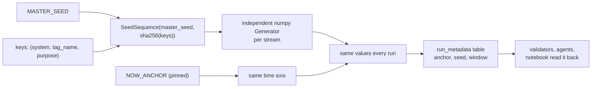

- **Keyed random streams.**
  - `Settings.rng(*keys)` builds `SeedSequence([master_seed, sha256("mas", *keys)])`.
  - SHA-256 is used because Python's `hash()` is salted per process.
  - **Adding a new tag never changes an existing tag's values.**
- **Frozen anchor.**
  - Resolved once, truncated to the minute.
  - The window is `[anchor − 30 d, anchor)`; the last row is 23:59 on Sep 6.
- **Persisted.** The anchor, seed and window are written to `run_metadata`, so nothing ever
  calls `now()` twice.
- **Proven.** Gate G-22 re-seeds and compares content hashes.

### 5.3 Reproducibility in the agent layer (determinism)

Definition we used:
- **Same data + same question ⇒ the same information.**
- Wording and execution path may differ; the facts may not.

| Source of variation | How it is removed |
|---|---|
| Date arithmetic ("yesterday") | resolved in code against the frozen anchor (§15.2) |
| Which columns mean "bearing temperature" | concept glossary resolves to the same tags every run (§9.1) |
| Event windows | fixed rule: alert start − 2 h → end + 2 h |
| Repeated or drifting work | ledger fingerprints + strict code-only progress rules (§9.5) |
| Invented numbers in answers | answer guard checks every number with a unit (§14.5) |
| Random ML methods | `random_state=0` required by the Python validator; seeds fixed in the sandbox |
| Model sampling | `GEMINI_TEMPERATURE=0.0` (an experiment knob) |
| Measuring it | golden eval: **pass^k** + fact / answer-number / window determinism across k runs |

---

## 6. How a multi-agent system solves this problem

**Slide takeaway:** *One agent with every tool drowns in 27 M values and 636 columns;
specialists with isolated contexts and a code-kept plan stay accurate.*

### 6.1 Why not one big agent?

| Single agent | Multi-agent |
|---|---|
| One prompt must know Neo4j, SQL, Python, plant physics | Each specialist has a focused prompt and focused tools |
| Every intermediate query result piles into one context (cost grows ~N²) | Each specialist has its **own conversation**; only a checked report returns |
| Hard to see which step went wrong | Each delegation is a traceable unit with a brief, status, tokens and time |
| Tool list grows → mis-selection | 1–2 tools per specialist |
| No natural place to check work | Code checks every handoff between agents |

### 6.2 The key idea — "graph narrows, SQL retrieves, Python analyses"

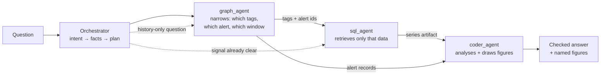

- **Narrowing** turns 636 columns × 43,200 rows into a handful of tags in one window.
  Postgres never needs a full scan.
- **Stages are skipped when not needed.** "Max bearing temp yesterday" goes straight to
  sql_agent, because the glossary already names the tags.

### 6.3 Principle: "the model decides, code checks"

- **The LLM decides:**
  - what facts the question needs;
  - which specialist fills each;
  - how to write each SQL / Cypher / Python.
- **Code decides everything that can be decided exactly:**
  - dates, tag resolution;
  - refusing repeated or stalled work;
  - validating reports;
  - checking numbers in the answer;
  - safety of generated code.

---

## 7. Our solution — deep dive into the MAS

**Slide takeaway:** *An orchestrator with a code-kept ledger, three specialists with capable
tools, and a safety and harness layer underneath.*

### 7.1 Layered architecture

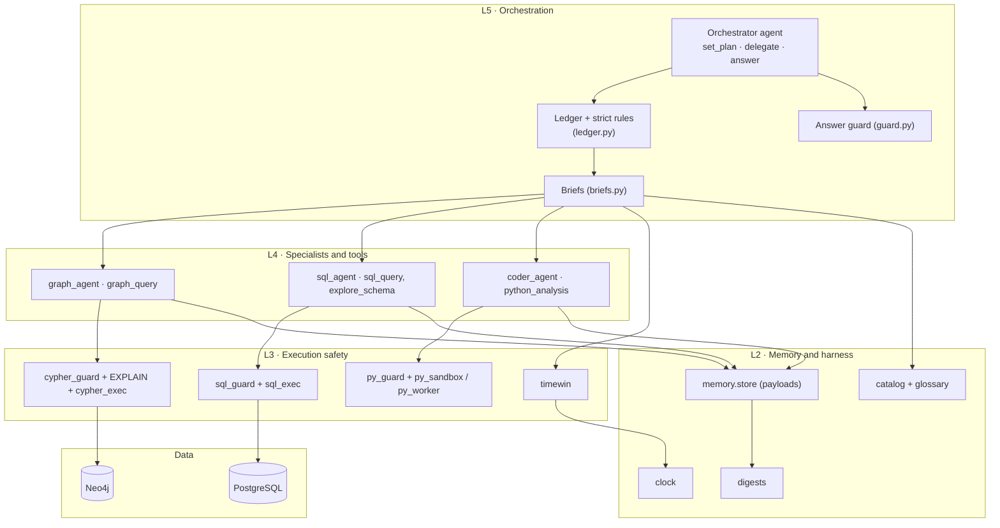

### 7.2 Built on

| Piece | Choice |
|---|---|
| Agent framework | LangChain 1.x `create_agent` on LangGraph (state graphs, reducers, streaming) |
| LLM | Google Gemini `gemini-3.7-flash` (all roles), temperature 0 |
| Specialist output | structured `SpecialistReport` via provider-native JSON schema (`ProviderStrategy`) |
| Middleware | tool-call limit, context editing (pruning old tool output), orchestrator guard, dynamic ledger view |
| Databases | PostgreSQL 16, Neo4j 5 (+APOC) in Docker |
| SQL parsing | sqlglot (PostgreSQL dialect) |
| Sandbox | separate Python process (or Docker container) per delegation |
| Observability | `tool_events` state trail, LangSmith (optional), LangGraph Studio |
| Tests | 141 unit tests + 22 data gates + 20-case golden eval |

### 7.3 End-to-end life of a multi-step question

*"What is the latest alert on BFP-A? Plot the bearing temperature during that alert window."*

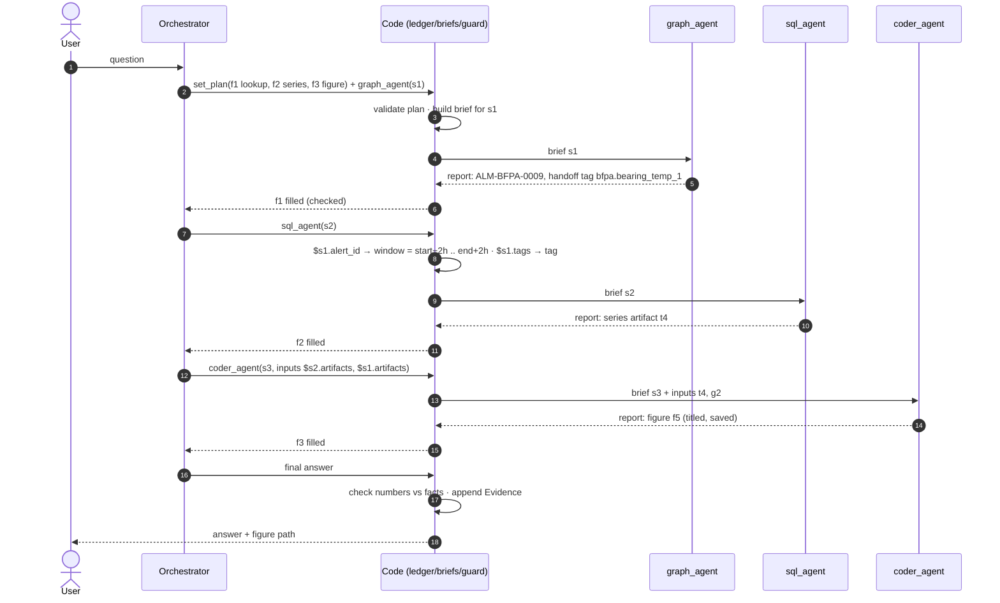

### 7.4 Budgets (derived, not guessed)

| Budget | Value | Why |
|---|---|---|
| Orchestrator model calls | 20 per question | enforced by the guard; the last call gets no tools, and over budget code writes the answer |
| Orchestrator recursion limit | 45 super-steps | 2 × (20 + 1) + 3 |
| Specialist tool calls | 12 (coder 10) | `ToolCallLimitMiddleware` — refuses gracefully so the report still gets written |
| Specialist recursion limit | 44 super-steps | 3 × 12 + 2 × 2 refused + 2 report + 2 margin |
| Context pruning | past 12,000 tokens, keep last 3 tool results | re-sent history is the main cost driver |

---

## 8. Each agent: technical details, tools and the story behind them

**Slide takeaway:** *Four capable tools, each with a "story" (its description) that teaches
the model when and how to use it — no pre-written queries.*

### 8.1 Summary table

| Agent | Role in the flow | Tools | Data | Budget |
|---|---|---|---|---|
| **orchestrator** | intent, split into slots, plan, delegate, answer | `set_plan`, `graph_agent`, `sql_agent`, `coder_agent` | none directly | 20 model calls |
| **graph_agent** | **narrows** — tags, alerts, windows, work orders, costs | `graph_query` | Neo4j (read session) | 12 tool calls |
| **sql_agent** | **retrieves** — stats, extremes, durations, series | `sql_query`, `explore_schema` | Postgres (`mas_reader`) | 12 tool calls |
| **coder_agent** | **analyses + visualises** | `python_analysis` | only artifacts it is given | 10 tool calls |

### 8.2 The story behind the tools (why "capable tools")

- **First design:** a few capable tools; the model writes real SQL, Cypher and Python.
- **Mid-project we tried "recipes":** 9 pre-written, parameterised query tools
  (`telemetry_stats`, `alert_context`, `plot_series`, …).
  - They were faster and more uniform…
  - …but live runs showed **answers took the fixed shape of the recipe**, and plots became
    bare.
  - They also **bypassed the skill being evaluated** — writing correct queries.
- **Removed on 2026-09-14.** The conventions recipes enforced (tie handling, bucketing,
  ordering, seeds) now live in **each tool's description ("story")**. Everything code
  *checks* stayed.
- **Lesson for the slide:** *guide with descriptions, verify with code — don't hard-code
  the answer shape.*

### 8.3 Orchestrator

- **Prompt order:** Intent → Split into facts → Route along the data flow.
  - graph first when data isn't pinned down;
  - SQL directly for a clear signal;
  - coder after data;
  - graph alone for history.
- **Writes the plan** (`set_plan`) in the same turn as the first delegation, which saves a
  model call.
- **Writes a precise `ask` per slot.** It is all the specialist hears about intent, e.g.
  "plot: series vs alarm_hi/hihi, alert window shaded, peak marked".
- **Middleware:**
  - `_fresh_plan` resets the ledger per question;
  - `OrchestratorGuard` handles budget, nudge, number check and footers;
  - `_ledger_view` shows SLOTS/PLAN/PROGRESS/ARTIFACTS each turn.
- **Three worked examples in its prompt:**
  1. sql only;
  2. graph → sql → coder;
  3. diagnosis: narrow → retrieve + context → analyse.

  Tests prove each example passes the real plan validator.

### 8.4 graph_agent — `graph_query(cypher)`

- **Story:** "Explore structure and history; often the first step — narrows 100+ tags to the
  few that matter."
- **Patterns taught:**
  - latest alert (`ORDER BY start_ts DESC, alert_id DESC LIMIT 1`, `has_telemetry = true`
    for plots);
  - datetime bounds with `datetime('…')`;
  - alert → work orders (`related_alert_id`, or follow-ups within 7 days);
  - maintenance totals (no date filter unless asked);
  - parts via `CONSUMED`;
  - narrowing tags by alert count and peak;
  - full ordering with id tie-breakers.
- **Domain rules in the prompt:**
  - cost identities;
  - `ALH-*` historical alerts have no telemetry;
  - hand off tags as `system.tag_name`.
- **Checks before running:**
  - write clauses rejected;
  - `EXPLAIN` finds unknown labels/properties (with suggestions);
  - datetime-vs-string trap rejected;
  - READ session.
- **Returns:** up to 50 rows inline; full records stored as an artifact (`g…`).

### 8.5 sql_agent — `sql_query(sql)`, `explore_schema(system, searches)`

- **Story:** "Measure the plant — the only place sensor values exist; one query per slot
  that returns the statistic, when, which tag, and setpoints."
- **Patterns taught:**
  - window `ts >= start AND ts < end`, verbatim;
  - many tags via `<system>_long … GROUP BY tag_name`;
  - time of extreme via `DISTINCT ON` or window functions, **ties are facts**;
  - minutes above a limit via `count(*) FILTER (WHERE value > alarm_hi)` (1 row = 1 minute);
  - series bucketed with `date_bin` (raw ≤ 2 days; 10-min or hourly beyond, keep avg + max);
  - comparisons via `UNION ALL`;
  - setpoints via `JOIN sensor_catalog ON system AND tag_name`;
  - never float equality.
- **`explore_schema`:** free catalog lookup (no DB call) — plain words → real tags with unit,
  normal range, setpoints, derived flag.
- **Checks before running:**
  - sqlglot: one SELECT, allowed tables, real columns (with suggestions), banned functions,
    LIMIT injected;
  - read-only role, 15 s timeout;
  - schema-discovery-only queries refused.
- **Returns:** all rows if ≤ 50 (and ≤ 4,500 chars), else a profile; empty results come with
  likely causes.

### 8.6 coder_agent — `python_analysis(code, artifact_ids)`

- **Story:** "Turn fetched data into insight and figures an engineer reads at a glance."
- **Analysis methods taught:**
  - descriptive and rolling statistics;
  - correlation or regression with n and r²;
  - clustering with evidence for k;
  - anomaly and change detection;
  - distributions.
- **Figure checklist:**
  - title "<system> <what> <when/event>";
  - axis labels with units, legend by tag;
  - alarm_hi amber dashed, alarm_hihi red dashed;
  - shaded event window, annotated peak;
  - subplots when units differ;
  - consistent colours.
- **No database access** — it uses only the artifacts passed in `inputs`.
- **Checks:**
  - import allowlist, no os/sys/network/files;
  - `random_state=0` on randomised estimators;
  - 60 s timeout per call.
- **Returns:** stdout (≤ 4,000 chars) and `figures: [{artifact_id, path, title}]`. Figures are
  saved as `outputs/figures/f7_bfp-a-bearing-temperatures-around-alm-bfpa-0009.png`.

---

## 9. Glossary mapping, context management, slots, set_plan, ledger, dependencies — with payloads

**Slide takeaway:** *Agents don't pass prose — they pass typed slots, tasks, references and
reports, and code resolves everything in between.*

### 9.1 Concept glossary (`catalog/glossary.py`)

Maps what people say to exact tags, **the same way every run**.

| Concept (synonyms) | Pumps resolve to | Turbine resolves to |
|---|---|---|
| bearing temperature (bearing temps) | every bearing temp tag (14 on BFP-A) | same pattern |
| load (loading) | `motor_power` | `gross_power` |
| efficiency | `pump_efficiency` | `cycle_efficiency` |
| vibration | vibration family (19 on BFP-A), primary `vibration_overall` | 28 tags, primary `vibration_overall` |
| eccentricity | `shaft_eccentricity` (BFPs only) | `eccentricity` |
| flow | `flow_rate` | `main_steam_flow` |
| motor current | `motor_current` + phases | `stator_current_1..3` |
| …21 concepts total | winding temp, lube oil temp, head, pressures, speed, condenser vacuum, health index, cavitation, heat rate, power, temperature | |

**Resolution order:**
1. Glossary name or synonym.
2. All-words search over tag names, families and units.
3. Nothing found → the plan is **refused**, with the closest concept names.

**How concepts become tags:**
- **measure slots** use **every** matching tag;
- **derive slots** use the **primary** tag (so clustering uses the same features each run);
- **explicit or narrowed tags** (`$s1.tags`) come first, and concepts **add** to them
  (narrowed vibration tags + `load` for context).

**Units:** derived tags get display units (`pump_head` m, `hydraulic_power` kW,
`pump_efficiency` %, others "index"). Unit spellings are normalised (`°C` = `degC`,
`µm` = `um`, `₹` = `INR`).

### 9.2 Slots — the facts an answer needs

| Field | Meaning | Example |
|---|---|---|
| `slot_id` | f1, f2, … | `f3` |
| `kind` | lookup (graph) · measure (sensor values) · derive (analysis/figure) | `measure` |
| `ask` | the fact in plain words (≤ 160 chars, no code) | "hourly series of the narrowed vibration tags plus load" |
| `systems` | which systems | `["turbine"]` |
| `concepts` / `tags` | glossary concepts, exact tags, or references | `tags: ["$s1.tags"], concepts: ["load"]` |
| `aggregation` | kind of fact | `series` |
| `needs` | fields the finding must carry: value, unit, time, entity, list, figure | `["entity"]` |
| `time` | only if the question names a time: phrase, start/end, or `around_alert` | `{"around_alert": "$s1.alert_id"}` |
| `threshold` | for duration_above | `"alarm_hi"` |

**Validation rules when a slot is created:**
- measure/derive slots must name concepts or tags;
- only derive slots can need a figure;
- tags must exist in the catalog;
- **time scope rule:** no `time` unless the question contains a time word. A traced run once
  added "last 24 months" to a no-time question and dropped a record.

### 9.3 `set_plan` payload (orchestrator → code)

Diagnosis example: *"Why is the turbine vibrating?"*

```json
{
  "slots": [
    {"slot_id": "f1", "kind": "lookup", "systems": ["turbine"], "concepts": ["vibration"],
     "ask": "turbine vibration tags ranked by alert count in the telemetry window, with setpoints and peaks",
     "aggregation": "rank", "needs": ["list", "entity"]},
    {"slot_id": "f2", "kind": "lookup", "systems": ["turbine"],
     "ask": "turbine work orders linked to or following those alerts: class, failure mode, dates",
     "aggregation": "list", "needs": ["list"]},
    {"slot_id": "f3", "kind": "measure", "systems": ["turbine"],
     "tags": ["$s1.tags"], "concepts": ["load"],
     "ask": "hourly series of the narrowed vibration tags plus load, for trend and correlation",
     "aggregation": "series", "needs": ["entity"]},
    {"slot_id": "f4", "kind": "derive", "systems": ["turbine"],
     "tags": ["$s1.tags"], "concepts": ["load"],
     "ask": "when vibration rose, whether it tracks load, margin to alarm_hi; figure of vibration and load with alarm lines",
     "aggregation": "analysis", "needs": ["value", "figure"]}
  ],
  "steps": [
    {"step_id": "s1", "agent": "graph_agent", "slots": ["f1", "f2"]},
    {"step_id": "s2", "agent": "sql_agent",   "slots": ["f3"], "depends_on": ["s1"]},
    {"step_id": "s3", "agent": "coder_agent", "slots": ["f4"], "depends_on": ["s1", "s2"]}
  ]
}
```

**Plan validation** (`ledger.plan_problems`) — refused plans run nothing:
- unique ids;
- every slot has a step;
- dependencies point backwards only;
- the agent can fill the slot's kind and aggregation;
- measure slots name systems or tags;
- concepts resolve on each system;
- a coder step depends on a data step;
- `$sN` references only from dependent steps;
- filled slots and done steps cannot be rewritten.

### 9.4 Task payload and dependency resolution

**Task (orchestrator → specialist)** — deliberately thin:

```json
{"step_id": "s3", "slots": ["f4"], "inputs": ["$s2.artifacts", "$s1.artifacts"], "note": null}
```

**References (resolved by code, never retyped by the model):**

| Reference | Resolves to |
|---|---|
| `$s1.alert_id` / `$s1.alert_ids` | alert ids handed over by step s1 |
| `$s1.work_order_id(s)` | work order ids handed over |
| `$s1.tags` | `system.tag_name` list handed over |
| `$s1.artifacts` | artifact ids step s1 created |

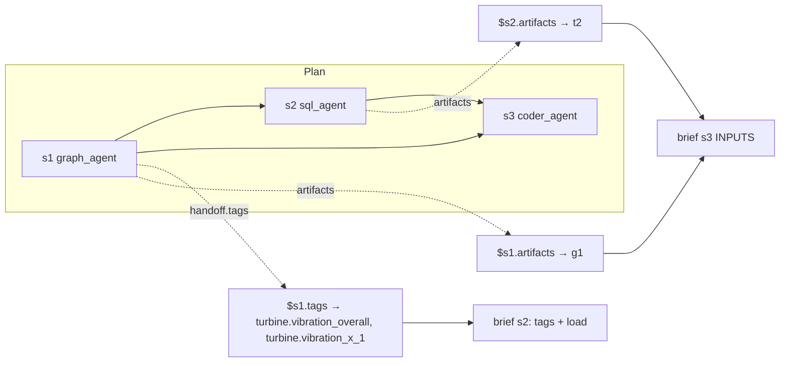

**How dependencies are enforced:**
- A step whose `depends_on` steps haven't finished is **refused**.
- A reference to an unfinished step fails: "step s1 has not finished".
- A reference to a missing handoff fails: "handed over no tags".
- **Same-turn planning:** tool calls in one turn see the pre-turn state, so a delegation
  issued alongside `set_plan` reads the pending plan straight from the same model message.

### 9.5 The ledger — state kept by code

| Channel | Holds | Written by |
|---|---|---|
| `slots` | slot definitions + status, facts, missing, attempts, linked tags, window | `set_plan`, report validation |
| `plan` | steps: agent, slots, depends_on, status, answer, artifacts, handoff | `set_plan`, report validation |
| `facts` | accepted findings keyed `s1.1`, `s1.2` | report validation |
| `rounds` | one record per delegation (fingerprint, outcome), plus replan markers | report validation, `set_plan` |
| `checks` | guard notes (nudge used) | answer guard |
| `blackboard` | artifact digests | tools |
| `tool_events` | full observability trail | every tool and delegation |

- **Reducer `merge_keyed`** merges per record, so parallel delegations don't overwrite each
  other.
- **`PLAN_RESET`** clears the ledger at the start of each question; artifacts remain.

**What the orchestrator sees each turn** (`ledger_view`):

```text
## SLOTS (the facts the answer needs; status kept by code)
  f1 [lookup·latest] filled — latest BFP-A alert with telemetry: id, tag, window, peak
      f1 ALM-BFPA-0009 peak_value = 105.7 degC @2026-09-03T02:26:00+00:00 [g2] — hi_hi bearing alarm
  f2 [measure·series] pending — series of the alert's tag in the alert window, for a plot
  f3 [derive·figure] pending — plot: the series vs alarm_hi/hihi, alert window shaded, peak marked

## PLAN
  s1 graph_agent fills ['f1'] done [g2] alert_ids=['ALM-BFPA-0009'] tags=['bfpa.bearing_temp_1']
  s2 sql_agent fills ['f2'] pending after s1
  s3 coder_agent fills ['f3'] pending after s1,s2

## PROGRESS
  delegations so far: 1; without a newly filled slot in a row: 0/2

## ARTIFACTS
  g2: records, 1 rows
```

**Strict progress rules (code only):**

| Rule | Limit |
|---|---|
| **Fingerprint** = agent + slot signatures (kind, aggregation, systems, tags, window, threshold) + inputs + note | identical task that already returned facts → refused |
| Identical failures | 2 → refused |
| Slot attempts | 2 unfilled attempts → **blocked** |
| Stall | 2 delegations in a row filling nothing → **STALLED**, delegation refused until `set_plan` revises |
| Linked tags per slot | max 60 |
| Tool-level loop guard | identical tool call refused; 3 consecutive failures → all calls refused |

*We tested an LLM "progress ledger" (Magentic-One style) against these code rules. Code
0.844, LLM 0.83, clarified LLM 0.917, hybrid 0.927. We chose strict code-only rules for
determinism and zero extra model calls.*

### 9.6 Context management

| Mechanism | What it does |
|---|---|
| **Context isolation** | each specialist runs in its own conversation; only its checked report returns |
| **Thin tasks + code-written briefs** | the orchestrator never writes long instructions; code renders tags, windows, required fields |
| **Setpoint grouping** | 14 bearing tags with identical setpoints are one brief line |
| **Artifact ids, not data** | tables and figures move by id; payloads never enter prompts |
| **Digests** | bounded summaries (5 rows, stats rounded to 4 decimals) |
| **Small results inline** | ≤ 50 rows shown whole (so the model doesn't re-query) |
| **Context editing** | past 12,000 tokens, old tool outputs are replaced by placeholders (last 3 kept) |
| **Ledger view** | the orchestrator sees a compact SLOTS/PLAN/PROGRESS/ARTIFACTS block, not raw reports |
| **ToolMessage caps** | 6,000 chars per tool message; stdout 4,000 |

---

## 10. Task delegation criteria and specialist report mapping

**Slide takeaway:** *Routing is a per-question decision by the orchestrator, but who can do
what is declared once and enforced by code.*

### 10.1 Capability registry (`agents/capabilities.py`)

| Slot kind | Only agent | Aggregations it accepts | Time policy | Needs |
|---|---|---|---|---|
| **lookup** | graph_agent | value, count, sum, latest, list, rank | full history, not clamped | — |
| **measure** | sql_agent | value, max, min, avg, sum, count, stddev, latest, series, duration_above, compare | clamped to telemetry window | systems or tags |
| **derive** | coder_agent | value, correlation, regression, cluster, anomaly, trend, distribution, compare, stddev, figure, analysis | clamped | depends on a data step (inputs) |

The same registry renders the orchestrator prompt's team section, so the prompt can never
disagree with the enforcement.

### 10.2 Delegation decision flow

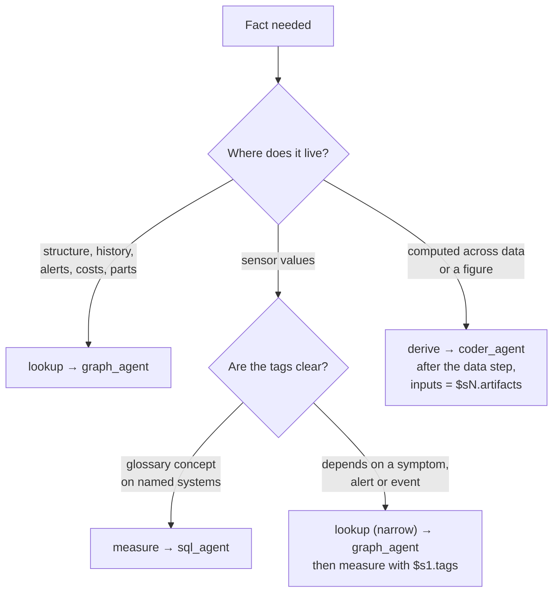

### 10.3 Pre-run refusal checks (nothing runs if any fail)

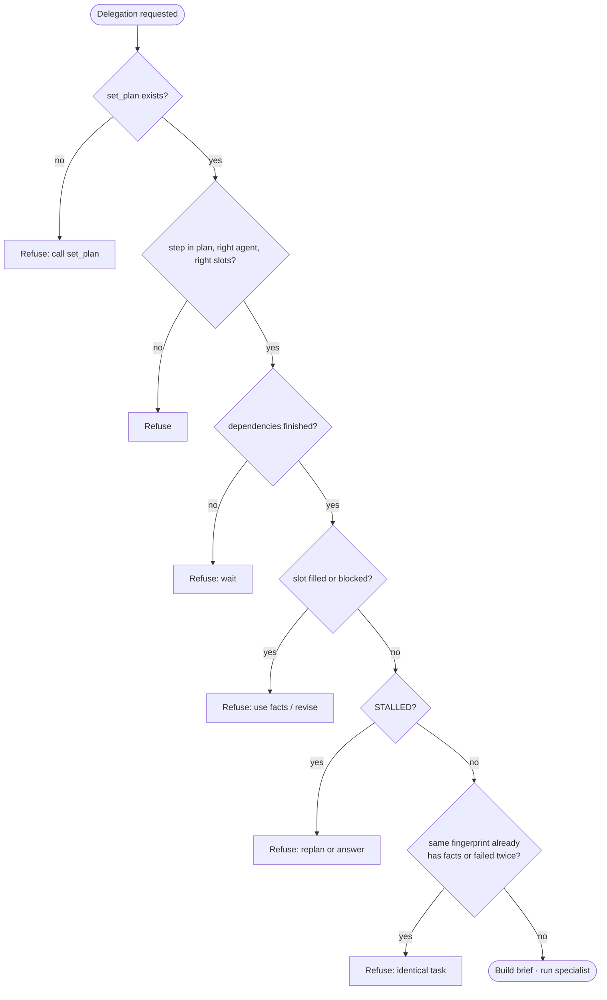

### 10.4 The brief (code → specialist)

```text
STEP s2 · sql_agent
SLOT f3 · measure · series — hourly series of the narrowed vibration tags plus load, for trend and correlation
  systems: turbine (Steam Turbine)
  tags (3; 2 given; load@turbine: 1 via glossary) — the slot is about these; add related tags only if they sharpen the answer, and say so:
    [mm/s, normal 0.5..4.5, alarm_hi 4.5, alarm_hihi 7.1] turbine.vibration_overall
    [um, normal 5..60, alarm_hi 90, alarm_hihi 150] turbine.vibration_x_1
    [MW, normal 0..250] turbine.gross_power
  window: [2026-08-08T00:00:00+00:00, 2026-09-07T00:00:00+00:00)  full telemetry coverage (no time in the question) — resolved in code; use verbatim
  the finding must carry: entity
REPORT: at least one finding per slot above, slot_id set. Numbers in value, unit in unit, event times in time, the tag / alert / work order in entity, list or rank items in items ([] when none were found). Put what else you noticed about these slots in the answer.
```

The brief contains **no SQL, Cypher or Python**: it fixes *what*; the specialist decides *how*.

### 10.5 SpecialistReport payload (specialist → code)

```json
{
  "status": "done",
  "answer": "Max 65.8 degC on bearing_temp_8 at 12:51 UTC, 24.2 degC under alarm_hi (90); 10 of 14 bearings tied at the same peak, so it is a load-wide rise, not one hot bearing.",
  "findings": [
    {"slot_id": "f1", "statement": "Maximum 65.8 degC, first reached by bearing_temp_8 at 12:51 UTC; 10 tags tied.",
     "entity": "bfpa.bearing_temp_8", "attribute": "max", "value": 65.8, "unit": "degC",
     "time": "2026-09-06T12:51:00+00:00", "items": ["bfpa.bearing_temp_8", "bfpa.bearing_temp_2"],
     "artifact_id": "t1"}
  ],
  "handoff": {"tags": ["bfpa.bearing_temp_8"], "alert_ids": [], "work_order_ids": []},
  "artifacts": ["t1"],
  "gaps": []
}
```

- **Schema limits:** `statement` ≤ 400 chars, `answer` ≤ 1,500 chars, no code.
- **Rule:** *every number worth telling the user must be a finding* — the answer guard only
  accepts numbers that arrived as findings.

### 10.6 Report → ledger mapping

| Report field | Goes to | Used for |
|---|---|---|
| `findings[].slot_id` | the slot | which fact it fills |
| `value`, `unit`, `time`, `entity`, `items` | checked against the slot's `needs` | filled / partial |
| `artifact_id` | evidence link | Evidence footer; must exist |
| `handoff.tags / alert_ids / work_order_ids` | the step record | `$sN.*` references |
| `artifacts` (actually created) | the step record | `$sN.artifacts` |
| `answer` | rendered to the orchestrator | synthesis |
| `gaps` | rendered | Gaps footer, replanning |

| "Needs" field | Satisfied when a finding has |
|---|---|
| value | a number |
| unit | a unit (filled from the catalog when the entity is a tag) |
| time | an event timestamp |
| entity | a tag, system, alert or work order |
| list | `items` (an empty list counts: "none found") |
| figure | a figure artifact created in that delegation |

**Step status:** `done` (all slots filled) · `partial` · `failed` (crash, or failed with no
findings).

---

## 11. Large data handling, role/catalog corrections and slot statuses

**Slide takeaway:** *27.5 M values never touch a prompt: databases aggregate, tools
summarise, and code corrects what agents report.*

### 11.1 How large data stays efficient

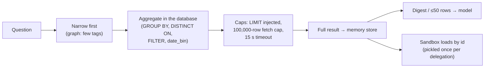

| Technique | Effect |
|---|---|
| Graph narrowing | measure a handful of tags instead of 100+ |
| Database-side aggregation | a 30-day max over 14 tags returns 14 rows, not 604,800 |
| Long views + `tag_name IN (…)` | many tags in one query |
| `date_bin` bucketing | 30 days hourly = 720 rows per tag for plots |
| Injected LIMIT + fetch cap | no runaway result sets (validator LIMIT 200,000; executor fetch cap 100,000) |
| Statement timeout 15 s | no hanging queries |
| Digests to the model | row count, columns, time range, null fraction, 5 rows, rounded stats |
| Whole small results | ≤ 50 rows inline, so the model doesn't re-query to "see the rest" |
| Payloads out-of-band | DataFrames stay in the store; state holds only digests |
| Sandbox frame reuse | each DataFrame is pickled to the worker once per delegation |
| Plot thinning guidance | bucket or thin dense series before scatter/line plots |

### 11.2 Role enforcement ("role catalogue")

| Role rule | How it is enforced |
|---|---|
| Orchestrator never touches data | it has no data tools at all |
| Each slot kind has one agent | capability registry → plan refused otherwise |
| sql_agent does not use SQL for schema discovery | queries reading only `sensor_catalog` / `run_metadata` are refused → use `explore_schema` |
| graph_agent has no sensor values | Neo4j holds none (gate G-07) |
| coder_agent cannot fetch | no database tool; a coder step must depend on a data step |
| Specialists cannot write | read-only Postgres role, READ Neo4j session, validators |

### 11.3 Catalog corrections applied to every report (`ledger.apply_report`)

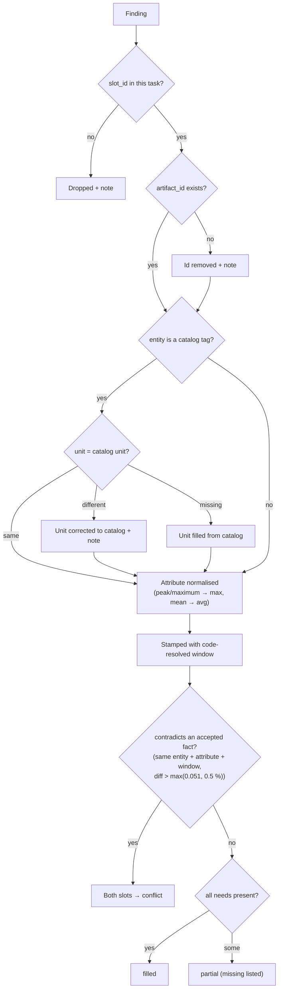

- Handoff tags that aren't real catalog tags are removed.
- A report that fails the JSON schema is kept as raw text, labelled
  "UNSTRUCTURED REPORT (not machine-checked)"; no slot is filled from it.
- The orchestrator sees all corrections as **CODE CHECKS** notes.

### 11.4 Slot statuses

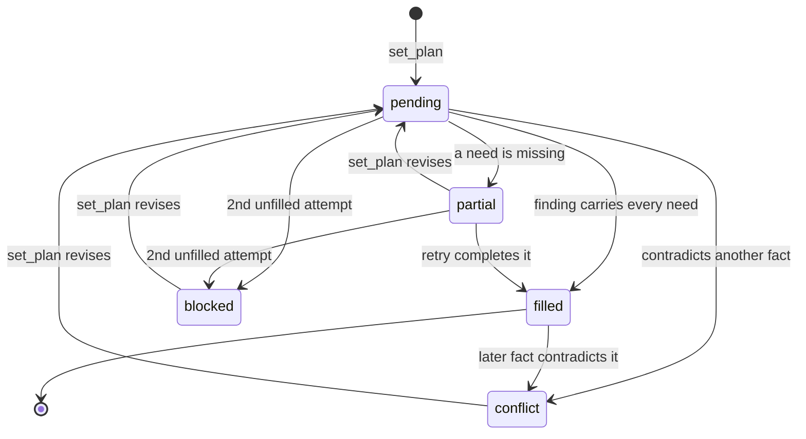

| Status | Meaning | Orchestrator action |
|---|---|---|
| pending | not yet filled | delegate |
| filled | every required field present, checked | use its facts |
| partial | some required field missing | retry with a `note`, or accept the gap |
| conflict | two facts disagree for the same thing and window | add a settling slot or report both |
| blocked | failed twice | revise with `set_plan` or answer with the gap |

---

## 12. Artifact management — tables, figures, in-memory store

**Slide takeaway:** *Data moves by id: payloads live out-of-band, graph state holds only
digests, and figures get meaningful names.*

### 12.1 Artifact types (`memory/artifacts.py`)

| Type | Payload | Digest (what state/model sees) | Id prefix |
|---|---|---|---|
| `TableArtifact` | pandas DataFrame | row count, columns:dtypes, time range, null fraction, first 5 rows, describe() stats rounded to 4 dp | `t` |
| `RecordsArtifact` | list of dicts (graph rows) | count + first 5 rows | `g` |
| `FigureArtifact` | PNG file path + caption | kind, caption (the figure title), path, n_points | `f` |
| `ScalarArtifact` | value + unit | value, unit | — |

- Every artifact carries **provenance**: the tool, the exact query and the row count.

### 12.2 The in-memory store (`memory/store.py`)

- Process-local dict `{artifact_id: Artifact}`, protected by a lock.
- **One shared counter** → ids unique across kinds (`t1`, `g2`, `f3`).
- **API:** `put(artifact, prefix) → id`, `get(id)`, `ids()`, `of_kind(cls)`, `clear()`.

**Why out-of-band:**
- LangGraph checkpoints state, and Studio serialises it over HTTP. A DataFrame doesn't
  survive that round trip.
- It is also a stronger data-separation rule: payloads **never** reach a prompt or a
  checkpoint.

**Scaling path:** swap in Redis or disk behind the same `put` / `get` interface.

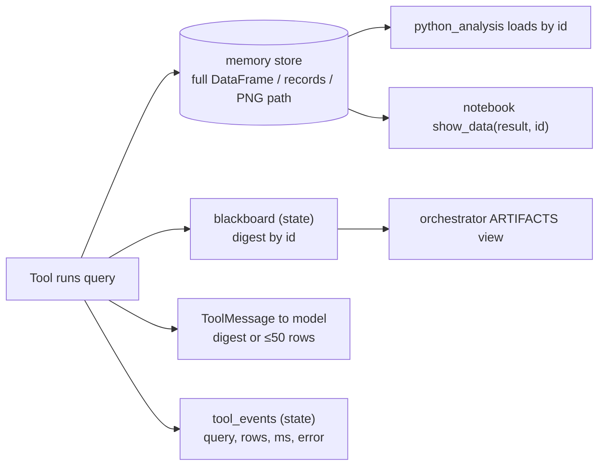

### 12.3 Blackboard in state

- `MASState.blackboard: dict[str, dict]` maps artifact id → JSON-safe digest, merged across
  agents.
- **Fix worth mentioning:** it was once annotated with the artifact classes (containing a
  DataFrame), which broke Studio's state schema. It is now typed as digests only.

### 12.4 Figures

- Every figure drawn in the sandbox is kept — saved to `OUT`, saved under any other name, or
  left open — up to 8 per call.
- Each becomes a `FigureArtifact`, with its title as caption.
- **File naming:** `outputs/figures/<id>_<title-slug>.png`, e.g.
  `f7_bfp-a-bearing-temperatures-around-alm-bfpa-0009.png`.
  - the id keeps it unique and sortable;
  - the slug is capped at 70 characters on a word boundary.
- **Untitled figures** are saved as `<id>_untitled.png`, and the tool tells the coder to add
  a title and redraw.
- **The orchestrator's final answer must name every figure** — title, what it shows, file
  path.

---

## 13. Cross-process artifact transfer — the coder sandbox layers

**Slide takeaway:** *Generated Python never runs in the app process: DataFrames cross into a
sandboxed worker once, results and figures cross back as files and JSON.*

### 13.1 Layers

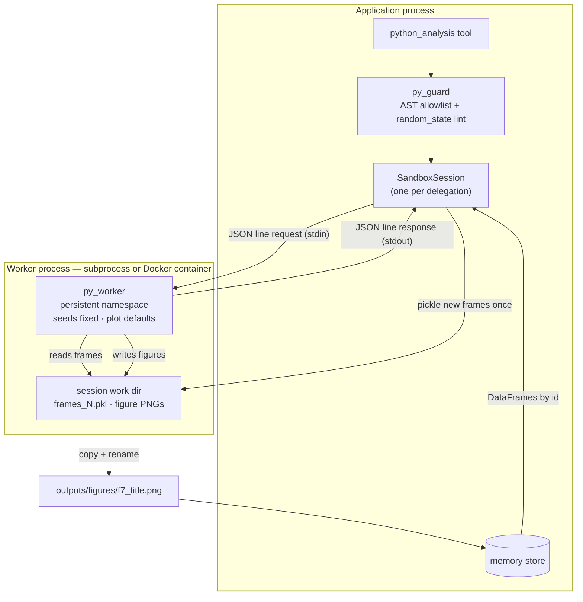

### 13.2 The protocol

**Request** (one JSON line on the worker's stdin):

```json
{"op": "run", "code": "fig, ax = plt.subplots() ...", "frames_file": "frames_1.pkl",
 "use": ["t4", "g2"], "out": "figure_6.png"}
```

**Response** (one JSON line on stdout):

```json
{"ok": true, "stdout": "peak 105.7 degC at 2026-09-03 17:40 UTC\nminutes above alarm_hi: 312",
 "error": null,
 "figures": [{"file": "figure_6.png", "title": "BFP-A bearing temperatures around ALM-BFPA-0009"}]}
```

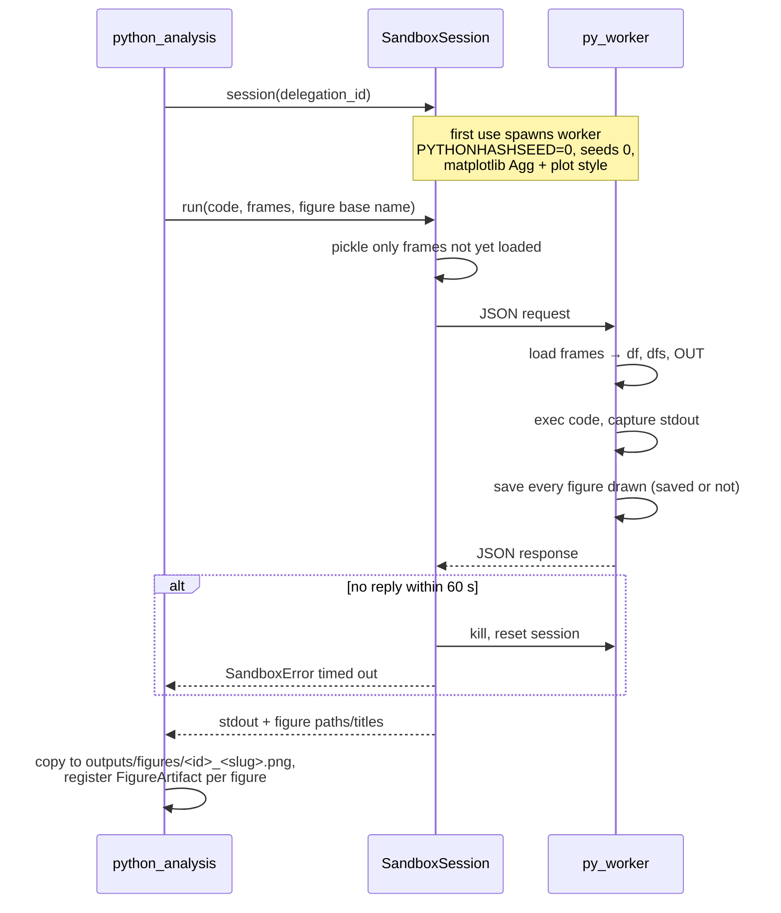

### 13.3 Details worth a slide

| Property | Value |
|---|---|
| Session scope | one per delegation (keyed by the orchestrator tool-call id); closed when the delegation ends |
| State | variables and imports **persist** across calls in the same delegation |
| Frame transfer | pickled to the session directory **once**; later calls reference ids only |
| In scope | `df` (first artifact), `dfs` {id: DataFrame}, `pd`, `np`, `plt`, `OUT` |
| Seeds | `random.seed(0)`, `np.random.seed(0)`, `PYTHONHASHSEED=0` |
| Save redirection | any `savefig` path is redirected into the session directory under a managed name |
| Figure cap | 8 per call |
| Plot defaults | 12×6 in, 150 dpi save, grid, tab10 colours, concise dates, bold titles |
| Timeout | 60 s per call (`PY_SANDBOX_TIMEOUT_S`) → process killed, session reset |
| stdout | last 4,000 chars |
| Backend `subprocess` (default) | new interpreter; CPU/memory limits on POSIX |
| Backend `docker` | `--network none --read-only --memory 1g --cpus 1 --pids-limit 128 --tmpfs /tmp`, source mounted read-only, non-root user |

*The in-process AST validator is an accident guard, not a security boundary — the separate
process (or container) is the isolation.*

---

## 14. Execution guardrails and how they are managed

**Slide takeaway:** *Defence in depth: validate before running, run with least privilege,
refuse loops, check reports, verify the final answer.*

### 14.1 The guardrail stack

```mermaid
flowchart TB
    G1["1 · Plan guard<br/>capabilities, concepts, time scope, dependencies"]
    G2["2 · Pre-run strict rules<br/>fingerprints, stalls, blocked slots"]
    G3["3 · Tool loop guard<br/>identical calls, 3-failure streak"]
    G4["4 · Query/code validators<br/>sqlglot · Cypher denylist + EXPLAIN · Python AST"]
    G5["5 · Least-privilege execution<br/>read-only role · READ session · sandbox + timeout"]
    G6["6 · Budgets<br/>tool-call limits · recursion limits · model-call budget"]
    G7["7 · Report validation<br/>stray findings, fake ids, units, conflicts"]
    G8["8 · Answer guard<br/>numbers vs facts, footers"]
    G1 --> G2 --> G3 --> G4 --> G5 --> G6 --> G7 --> G8
```

### 14.2 SQL guard (`execution/sql_guard.py`, `sql_exec.py`)

1. Parse with sqlglot (PostgreSQL dialect).
2. Exactly one statement; SELECT or UNION only.
3. No write nodes (insert/update/delete/create/drop/alter/set…).
4. No dangerous functions (`pg_read_file`, `pg_sleep`, `dblink`, …).
5. **Table allowlist:** 5 wide tables, 5 `_long` views, `sensor_catalog`, `run_metadata`.
   CTE aliases are allowed, but their bodies are still checked.
6. **Column check:**
   - qualify against the catalog schema;
   - reject columns that exist in none of the referenced tables, with suggestions
     (`bearing_temp_9` → "did you mean bearing_temp_8"; `eccentricity` on bfpa →
     `shaft_eccentricity`);
   - never block valid SQL the optimiser can't follow.
7. LIMIT injected.
8. **Executed as `mas_reader`:** read-only transaction, 15 s statement timeout, fetch cap.
9. Empty results return hints (window outside coverage, float equality, unknown tag).

### 14.3 Cypher guard (`execution/cypher_guard.py`, `cypher_exec.py`)

1. **Denylist:** CREATE, MERGE, DELETE, SET, REMOVE, DROP, DETACH, FOREACH, LOAD CSV, write
   procedures.
2. **Datetime trap:** `a.start_ts >= '2026-09-01'` is rejected with the fix
   `datetime('…')` — Neo4j would silently return zero rows.
3. **`EXPLAIN` first:** unknown labels, relationship types and property keys become errors
   with suggestions (`peak_valu` → `peak_value`).
4. Run in a **READ** session.
5. Empty results give hints (`'BFP-A'` → use `'bfpa'`).

### 14.4 Python guard (`execution/py_guard.py`)

| Rule | Detail |
|---|---|
| Import allowlist | pandas, numpy, matplotlib, scipy, sklearn, math, json, datetime, collections, itertools, statistics |
| Banned calls | eval, exec, compile, open, `__import__`, input, exit, quit, globals, locals, vars |
| Banned modules | os, sys, socket, subprocess, shutil, pathlib, importlib, ctypes, builtins |
| No dunder attributes | blocks `().__class__…` escapes |
| `random_state=0` required | KMeans, GaussianMixture, RandomForest*, train_test_split, … |

### 14.5 Answer guard (`orchestrator/guard.py`)

```mermaid
flowchart TD
    call(["Orchestrator model call"]) --> b{"calls used"}
    b -->|"≥ 20"| code["Code writes answer from facts"]
    b -->|"= 19"| last["Last turn: tools removed"]
    b -->|"< 19"| m["Model call"]
    last --> m
    m --> tc{"tool calls?"}
    tc -->|yes| pass(["continue"])
    tc -->|"no — it answered"| n{"planned slots never delegated?<br/>(nudge once)"}
    n -->|yes| nudge["Nudge: delegate or re-answer"]
    nudge --> m
    n -->|no| num{"numbers with units<br/>not supported?"}
    num -->|"yes, first time"| rep["Repair once (tools removed)"]
    rep --> m
    num -->|"no / already repaired"| foot["Append Evidence · Gaps ·<br/>Unverified lines"]
```

**A number with a unit is supported if it is:**
- an accepted fact;
- a setpoint of a tag in play;
- a number from the question;
- the 2 h event pad;
- `a ± b`, `a / b × 100`, or `(a − b) / b × 100` of those.

It is matched **at the precision it is written** (65.8 matches 65.80, not 65.9). Rupee
amounts (k / M / lakh / crore) are checked too; timestamps and ids are ignored.

**Footers written by code:**

```text
**Evidence:** f1 ← g2 (s1); f2 ← t4 (s2); f3 ← f5 (s3)
**Gaps:** (none)
```

### 14.6 How guardrails are managed

| Aspect | Approach |
|---|---|
| Single source of truth | catalog → validators' allowed tables/columns/labels; capability registry → plan checks and prompt |
| Transparent refusals | every refusal returns a reason ("Task rejected by code, nothing ran: …") so the model self-corrects in one cheap turn |
| Observability | every refusal/failure is a `tool_events` record with `error` |
| Configuration | budgets and timeouts are constants / `.env` settings |
| Tests | 141 unit tests cover validators, refusals, ledger rules, guard, sandbox, budgets, prompt examples, state schema |

---

## 15. Harness utilities — digests, clock, briefs, and other reproducible code

**Slide takeaway:** *Everything that can be computed exactly is a small, tested,
deterministic utility — not an LLM decision.*

### 15.1 Digests (`harness/digests.py`)

- The **only** path from data to a prompt.
- Fixed profile: row count, `column:dtype`, `ts` range, null fraction, `head(5)` over a
  **deterministic sort** (by `ts`), `describe()` stats rounded to **4 decimals**.
  NaN/Inf → null.
- Same frame → same bytes → same prompt.

### 15.2 Frozen clock and time windows (`harness/clock.py`, `execution/timewin.py`)

```mermaid
flowchart LR
    Q["Question names a time?"] -->|no| NT["No time: fact covers all data<br/>(measure → full coverage)"]
    Q -->|yes| TS["TimeSpec"]
    TS --> P["phrase: yesterday, last 7 days"]
    TS --> E["explicit start/end"]
    TS --> A["around_alert: $s1.alert_id"]
    P --> CL["clock.resolve_window<br/>against anchor"]
    A --> AB["Neo4j alert bounds ± 2 h"]
    E --> TW
    CL --> TW["TimeWindow [start, end)"]
    AB --> TW
    TW --> C{"telemetry agent?"}
    C -->|yes| CLAMP["clamp to 2026-08-08 .. 2026-09-07"]
    C -->|no| KEEP["keep (graph history ~2 years)"]
```

| Phrase | Window (anchor 2026-09-07 00:00 UTC) |
|---|---|
| yesterday | Sep 6 00:00 → Sep 7 00:00 |
| today | Sep 7 00:00 → now |
| last week / last 7 days | now − 7 d → now |
| last N hours / days / weeks | now − N → now |
| last N months | same instant N calendar months earlier → now |
| anything else | **refused**, with the list of supported phrases |

- **Windows are always half-open:** `[start, end)`.

### 15.3 Briefs (`orchestrator/briefs.py`)

- `prepare(task, agent, state)`:
  1. resolve inputs and references;
  2. resolve each slot's window;
  3. link tags (glossary / given);
  4. compute signatures and the fingerprint;
  5. run strict pre-run checks;
  6. render the brief.
- **Same plan in → same brief out**, so specialists' inputs are deterministic.

### 15.4 Other deterministic utilities

| Utility | Where | What it guarantees |
|---|---|---|
| Keyed RNG | `config.Settings.rng` | independent, stable random streams |
| Catalog + glossary | `catalog/` | one truth for tags, units, setpoints, concepts |
| Capability registry | `agents/capabilities.py` | routing rules declared once |
| Fingerprints | `ledger.fingerprint` | identical work recognised regardless of wording |
| Report validation | `ledger.apply_report` | facts are checked before acceptance |
| Answer check | `ledger.answer_problems` | numbers traced to evidence |
| Figure naming | `tools.figure_filename` | readable, unique file names |
| Loop guard | `tools.loop_guard` | no repeated or failure-looping tool calls |
| Trace formatting | `orchestrator/trace.py`, `mas/notebook.py` | human-readable run inspection |
| Golden eval | `eval/golden.py`, `scripts/run_eval.py` | pass^k and determinism metrics |

### 15.5 Observability and evaluation

- **`tool_events`** records, per delegation:
  - brief, status, fingerprint, windows, code notes, artifacts created;
  - inner call count, model calls, tokens, time.

  Per inner call: the exact SQL / Cypher / code, rows, artifact id, ms, error.
- **Notebook helpers** (`mas.notebook`):
  - `ask()`, `show_tool_calls()`, `show_figures()`, `show_plan()`, `show_data()`,
    `run_summary()`.
- **LangGraph Studio:** 4 assistants (orchestrator + each specialist).
- **LangSmith:** optional nested traces.
- **Golden eval:** 20 questions (paraphrases, concepts, no-time trap, explicit dates, root
  cause, out-of-scope). Metrics:
  - **pass^k** (all k runs correct);
  - fact determinism, answer-number determinism, window determinism.

---

## Appendix A — Local setup: models, sandbox, API keys, databases

### A.1 Prerequisites

- Python **3.11+**
- **Docker** + Docker Compose
- **Gemini API key** (<https://aistudio.google.com/apikey>) — only the agents need it
- Optional: LangSmith API key for tracing

### A.2 One-command setup

```bash
python scripts/setup.py
```

What it does:
1. Checks prerequisites.
2. Writes `.env` (prompts for the Gemini key).
3. `pip install -r requirements.txt`.
4. Starts Postgres + Neo4j containers.
5. Creates schemas and roles.
6. Generates and seeds the data.
7. Runs the 22 gates.

Flags: `--skip-deps`, `--skip-seed`, `--force-seed`, `--reset`, `--no-input`.

### A.3 Manual setup

```mermaid
flowchart LR
    A["cp .env.example .env<br/>add GEMINI_API_KEY"] --> B["pip install -r requirements.txt"]
    B --> C["docker compose up -d postgres neo4j"]
    C --> D["python scripts/init_databases.py"]
    D --> E["python scripts/seed_all.py"]
    E --> F["python scripts/validate.py<br/>→ 22/22 gates green"]
    F --> G["python scripts/ask.py '…' --trace<br/>or notebook / Studio"]
```

### A.4 Databases (docker-compose)

| Service | Image | Ports | Credentials (defaults) | Notes |
|---|---|---|---|---|
| `postgres` | postgres:16 | 5432 | db `mas`, user `mas` / `mas_pw`; reader `mas_reader` / `mas_reader_pw` | volume `pgdata`; healthcheck `pg_isready` |
| `neo4j` | neo4j:5 + APOC | 7474 (browser), 7687 (bolt) | `neo4j` / `mas_neo4j_pw` | volume `neo4jdata` |
| `app` | project Dockerfile | — | uses `.env`; overrides `PG_HOST=postgres`, `NEO4J_URI=bolt://neo4j:7687` | bind-mounts `src`, `scripts`, `docs`, `tests` |

### A.5 Environment variables (`.env`)

| Group | Variables |
|---|---|
| Reproducibility | `MASTER_SEED=20260907`, `NOW_ANCHOR=2026-09-07T00:00:00+00:00` (or `live`) |
| Generation | `SAMPLE_SECONDS=60`, `WINDOW_DAYS=30`, `MAINTENANCE_HISTORY_MONTHS=24`, `CURRENCY=INR` |
| PostgreSQL | `PG_HOST`, `PG_PORT`, `PG_DB`, `PG_USER`, `PG_PASSWORD`, `PG_READER_USER`, `PG_READER_PASSWORD` |
| Neo4j | `NEO4J_URI`, `NEO4J_USER`, `NEO4J_PASSWORD`, `NEO4J_DATABASE` |
| LLM | `GEMINI_API_KEY`; optional `GEMINI_REASONING_MODEL`, `GEMINI_FAST_MODEL` (default `gemini-3.7-flash`), `GEMINI_TEMPERATURE` (0.0), `GEMINI_SEED`, `SPECIALIST_THINKING_BUDGET` |
| Sandbox | `PY_SANDBOX_BACKEND=subprocess` (or `docker`), `PY_SANDBOX_TIMEOUT_S=60`, `PY_SANDBOX_IMAGE=mas-py-sandbox:latest`, `PY_SANDBOX_MEMORY=1g` |
| Tracing | `LANGSMITH_TRACING`, `LANGSMITH_API_KEY`, `LANGSMITH_PROJECT=mas-industrial-analytics` |

### A.6 Docker sandbox (optional, stronger isolation)

```bash
docker build -f docker/py-sandbox.Dockerfile -t mas-py-sandbox:latest .
```

Then set `PY_SANDBOX_BACKEND=docker` in `.env`.
- **Image:** python:3.11-slim with numpy, pandas, scipy, scikit-learn, matplotlib; non-root
  user; `PYTHONHASHSEED=0`; `MPLBACKEND=Agg`.

### A.7 Dependencies (`requirements.txt`)

- **Data:** numpy, pandas, psycopg[binary] 3, neo4j 5 driver, pydantic 2, pydantic-settings,
  scikit-learn, scipy, matplotlib.
- **Agents:** langgraph, langchain ≥ 1.0, langchain-google-genai ≥ 4.0, google-genai, sqlglot.
- **Dev:** langgraph-cli[inmem] (Studio), pytest.
- **No packaging step:** `src/` reaches the import path via `pytest.ini`,
  `scripts/_bootstrap.py`, and the notebook's setup cell.

### A.8 Ways to run it

| Method | Command |
|---|---|
| CLI | `python scripts/ask.py "Which BFP ran hotter over the last 7 days?" --trace` |
| Notebook | `jupyter notebook notebooks/demonstration.ipynb` → `result = ask("…")` |
| LangGraph Studio | `langgraph dev --port 2025` (graphs from `langgraph.json`: orchestrator, graph_agent, sql_agent, coder_agent) |
| Tests | `python -m pytest -q` (141 tests) |
| Data gates | `python scripts/validate.py` |
| Golden eval | `python scripts/build_golden.py` then `python scripts/run_eval.py <label> --k 3` |
| Rebuild notebook | `python scripts/build_notebook.py` (`--execute` to run it) |

### A.9 Repository map

```text
scripts/        setup · init_databases · seed_all · validate · ask · build_golden · run_eval · build_notebook
src/mas/
  config.py     settings, seed, anchor, RNG
  catalog/      systems, families, items, TagSpec, glossary, api
  db/           DDL, Neo4j constraints, connections
  datagen/      modes · physics · dsp · events · instrument · build_telemetry · alerts · maintenance · graph_seed
  execution/    sql/cypher/py guards · executors · py_sandbox · py_worker · timewin
  harness/      clock · digests
  memory/       artifacts · store
  llm/          schemas (Slot, Task, PlanStep, Finding, SpecialistReport, TimeSpec, TimeWindow)
  agents/       base (state, model) · capabilities · prompts · specialists · tools
  orchestrator/ agent · ledger · briefs · guard · trace
  eval/         consistency (22 gates) · golden
  notebook.py   notebook helpers
  studio.py     LangGraph Studio entrypoints
docker/         py-sandbox.Dockerfile
docs/           01 problem · Data_design 02–05 · agentic_design 06–11 · 12 these notes
notebooks/      demonstration.ipynb
tests/          141 unit tests
```

---

## Appendix B — Numbers cheat-sheet

| Topic | Number |
|---|---|
| Systems / tags | 5 / 636 (130, 130, 108, 108, 160) |
| Rows per table / values | 43,200 / ~27.5 M |
| Window / anchor | 2026-08-08 → 2026-09-07 / 2026-09-07 00:00 UTC |
| Families / universal core / pump core | 10 / 15 / 10 |
| Neo4j nodes | 5 System, 636 Tag, 65 Alert, 107 MaintenanceLog, 94 Item |
| Relationships | 636 MEASURED_AT, 65 GENERATED_ON, 107 PERFORMED_ON, 373 CONSUMED |
| Alerts | 9 in-window (ALM) + 56 historical (ALH) |
| Injected events | 7 (E1–E7) |
| Headline alert | ALM-BFPA-0009, bearing_temp_1, 2026-09-03 02:26 → 23:59, peak 105.7 vs 100 |
| Turbine maintenance | 23 work orders, item cost ₹9,749,780 |
| Quality gates | 22 / 22 green |
| Glossary concepts | 21 |
| Orchestrator budget | 20 model calls, 45 super-steps |
| Specialist budget | 12 tool calls (coder 10), 44 super-steps |
| Ledger limits | stall 2 · slot attempts 2 · identical failures 2 · linked tags 60 |
| Tool loop guard | 3 consecutive failures |
| Inline rows / chars | 50 rows / 4,500 chars; ToolMessage 6,000; stdout 4,000 |
| SQL | 15 s timeout, 100,000-row fetch cap |
| Sandbox | 60 s timeout, 8 figures per call, 1 GB (docker) |
| Event pad | ± 2 h around alerts |
| Context pruning | 12,000 tokens, keep last 3 |
| Tests / golden cases | 141 / 20 |
| Progress-ledger experiment | code 0.844 · LLM 0.83 · clarified LLM 0.917 · hybrid 0.927 |

---

## Appendix C — Suggested slide flow and demo script

### C.1 Slide flow (~25 slides)

| # | Slide | Source section | Visual |
|---|---|---|---|
| 1 | Title | — | plant loop image |
| 2 | Agenda | 1 | agenda table |
| 3 | The assignment | 2.1 | Problem.md architecture diagram |
| 4 | Why it's hard | 2.3 | challenge table |
| 5 | The plant | 3.1 | process-loop diagram |
| 6 | 30-day story | 3.2 | Gantt |
| 7 | Event → alert → work order thread | 3.3 | thread diagram |
| 8 | Data design principles + volumes | 4.1–4.2 | numbers |
| 9 | Tag catalog & schemas | 4.3–4.4 | inheritance + graph star |
| 10 | Generation pipeline | 4.5 | pipeline flowchart |
| 11 | Physics highlights | 4.5 stage 2–4 | modes table + formulas + a bearing-temp plot |
| 12 | Faults + instrument realism | 4.5 stage 5–6 | event table |
| 13 | Alert detection | 4.6 | detector flowchart |
| 14 | Maintenance, costs, guarantees, gates | 4.7–4.8 | DG table + "22/22" |
| 15 | Reproducibility | 5 | seed diagram + determinism table |
| 16 | Why multi-agent | 6.1–6.2 | narrow → retrieve → analyse |
| 17 | Architecture | 7.1 | layered diagram |
| 18 | Life of a question | 7.3 | sequence diagram |
| 19 | Agents & tools (+ recipes lesson) | 8 | summary table |
| 20 | Slots, glossary, set_plan | 9.1–9.3 | payload JSON |
| 21 | Ledger, references, strict rules | 9.4–9.5 | ledger view + dependency diagram |
| 22 | Delegation + reports | 10 | decision flow + report JSON |
| 23 | Large data, corrections, statuses | 11 | state diagram |
| 24 | Artifacts & sandbox | 12–13 | store diagram + sandbox sequence |
| 25 | Guardrails & harness | 14–15 | guardrail stack |
| 26 | Demo | C.2 | live notebook |
| 27 | Results, lessons, next steps | — | eval metrics, lessons below |

### C.2 Demo script (notebook)

1. **Setup cell**, then `result = ask("What was the maximum bearing temperature on BFP-A yesterday?")`
   — sql only; show the brief and the SQL in `show_tool_calls`.
2. `ask("How many maintenance activities on the Turbine and their total item cost?")` — graph
   only (expect 23 work orders, ₹9,749,780).
3. `ask("What is the latest alert on BFP-A? Plot the bearing temperature during that alert window.")`
   — graph → sql → coder; open the named figure with `show_figures(result)`.
4. `ask("Why is the turbine vibrating?")` — diagnosis flow: narrowing, context signal (load),
   analysis + figure, Evidence footer.
5. `run_summary(result)` — delegations, tool calls, tokens.

### C.3 Lessons learned (closing slide material)

- **Design the data around the questions:** demo guarantees made every example answerable
  and interesting.
- **Code for exactness, LLM for judgement:** dates, tags, repeats and numbers checked in
  code.
- **Typed handoffs beat prose:** slots, tasks, references and reports made agent
  communication checkable.
- **Don't hard-code answer shapes:** recipes made output uniform but thinner; tool
  descriptions plus validators kept quality *and* safety.
- **Measure determinism explicitly:** pass^k and fact determinism, not just "it worked once".

### C.4 Open items to mention honestly

- Live agent behaviour after the latest prompt/tool changes should be re-measured with the
  golden eval (`run_eval.py --k 3`).
- Catalog defect: `pump_head` normal range (0–100) contradicts its physics (~2,240 m) —
  needs a catalog fix and reseed.
- The Docker sandbox image is written but should be built and exercised.
- Next steps: multi-turn sessions via a checkpointer, a verified query repository, a
  multimodal self-check of generated figures.
