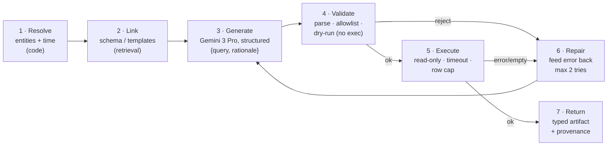

# Agent Internals, Capability Registry & Acceptance Tests

**Case Study: Multi-Agent Systems for Industrial Asset Analytics**
Scope: the **reference detail** the definitive design builds on — what the agent layer
inherits from the data layer, the **capability registry**, the **seven-stage agent
pipeline** (with the exact validators), and the **A1–A8 acceptance-test mapping**.

> **The orchestration model, memory/persistence, determinism, sandboxing, prompting,
> ADRs, and the build plan are defined in the definitive design:**
> **[08-langgraph-implementation.md](08-langgraph-implementation.md).** That doc supersedes
> this one's earlier orchestrator, model-config, repo-layout, and ADR sections (which have
> been removed). Memory concepts live in
> [07-memory-and-harness.md](07-memory-and-harness.md).
>
> **Source of truth:** [Problem.md](../../Problem.md). The data layer is complete and green
> (22/22 gates) — see [01-problem-analysis.md](../01-problem-analysis.md) §3–4,
> [02-data-design.md](../Data_design/02-data-design.md), and
> [04-data-story.md](../Data_design/04-data-story.md).

---

## 1. What the agent layer inherits from the data layer

The agents are *thin* because the data layer already did the hard grounding work.
Everything below is an existing, tested surface the agents build on:

| Inherited surface | Where | What the agent uses it for |
|---|---|---|
| Frozen `now_anchor`, window bounds, seed, currency | `run_metadata`; [`config.py`](../../src/mas/config.py) `Settings.anchor` | Resolve "yesterday"/"last 7 days" in **code**, never by the LLM |
| `sensor_catalog` (636 tags: name, family, unit, description, ranges, alarms) | Postgres table, mirror of Neo4j `Tag` | **Schema linking** — retrieve the ~15 relevant columns from 636 |
| Read-only role `mas_reader` (SELECT-only, read-only tx, 15 s timeout) | [`postgres.py`](../../src/mas/db/postgres.py) `setup_reader_role` | The SQL Agent's **only** DB entry point |
| `System.aliases` (`"BFP-A"`, `"Boiler Feed Pump A"`, …) | Neo4j + [`api.py`](../../src/mas/catalog/api.py) `SYSTEM_META` | **Entity resolution** in code — alias handling is *data* |
| `System.sql_table` / `Tag.sql_column` bridge | Neo4j properties | Resolve a graph answer → a Postgres target with **no hardcoded map** |
| `*_long` views (`ts, tag_name, value`) | Postgres per table | Let the Coder Agent pivot without wide-column gymnastics |
| Demo guarantees DG-1..DG-5 | gates G-13..G-19 | Every spec example query has a **guaranteed, interesting** answer |

The single most important inheritance: **the frozen anchor.** Because
`run_metadata.now_anchor` is pinned and read back by every process, the SQL Agent resolving
"yesterday" hours after seeding lands on the *same* window the data was built for. This
turns "deterministic system + LLM planner" from a contradiction into an engineering
property (AMB-3).

---

## 2. The capability registry — the routing contract

Every agent registers **capabilities**: typed leaf operations with Pydantic models on both
sides. The supervisor ([doc 08 §3](08-langgraph-implementation.md)) sees only this registry
and may route only to a registered capability. Adding a capability is a registration, not
an orchestrator edit — the property criterion 2 rewards.

```python
# shape only
class Capability(BaseModel):
    name: str                       # "sql.aggregate_stat"
    description: str                # one line the supervisor reads
    input_model: type[BaseModel]    # typed inputs (may contain $refs)
    output_model: type[BaseModel]   # typed result → becomes an artifact digest
    cost_hint: Literal["cheap","medium","expensive"]
    agent: str                      # which agent fulfills it
```

### 2.1 The registry (v1)

| Capability | Agent | Inputs (typed) | Output artifact | Serves |
|---|---|---|---|---|
| `sql.aggregate_stat` | SQL | system, tag, agg∈{max,min,avg,sum,count}, window | `ScalarArtifact` | A1 |
| `sql.compare_systems` | SQL | systems[], tag, agg, window | `TableArtifact` (small) | A2 |
| `sql.timeseries_window` | SQL | table, tags[], start_ts, end_ts | `TableArtifact` | A8 |
| `sql.tag_table` | SQL | system, tags[], window, downsample? | `TableArtifact` | A6/A7 |
| `graph.tag_count_for_system` | Graph | system | `ScalarArtifact` | A3 |
| `graph.latest_alert_for_system` | Graph | system, require_telemetry? | `RecordsArtifact` (alert_id, tag_name, start_ts, end_ts, threshold_value, sql_table) | A8 |
| `graph.alerts_in_window` | Graph | system, start_ts, end_ts | `RecordsArtifact` | composites |
| `graph.maintenance_rollup` | Graph | system, window? | `RecordsArtifact` (count, total_item_cost, total_cost) | A4 |
| `graph.top_consumed_items` | Graph | system, which∈{latest,by_wo}, limit | `RecordsArtifact` | A5 |
| `graph.freeform_cypher` | Graph | intent, entities | `RecordsArtifact` | fallback |
| `python.plot_timeseries` | Coder | data ref, annotate_threshold?, title | `FigureArtifact` | A8/A6 |
| `python.plot_correlation` | Coder | data ref, tags[] | `FigureArtifact` | A6 |
| `python.regression_fit` | Coder | data ref, x, y, model∈{ols,poly} | `FigureArtifact` + `RecordsArtifact` (coeffs) | A7 |
| `python.cluster_operating_regions` | Coder | data ref, features[], k | `FigureArtifact` + `RecordsArtifact` (labels, silhouette) | A7 |
| `python.freeform_analysis` | Coder | data ref(s), task | `FigureArtifact`/`RecordsArtifact` | fallback |

`data ref` is a symbolic handle (`$s2.artifact`) resolved in code — the Coder never
receives rows in its prompt (doc 07 §4).

### 2.2 Why capabilities, not free-form agents

- **Typed both ways** → the supervisor's `Decision` is structurally executable, validated
  against a Pydantic schema, not parsed with regex.
- **Two-tier fallback** → each family has narrow, template-backed capabilities *plus* a
  `freeform_*` escape hatch. Narrow ones are preferred (deterministic); free generation is
  graceful degradation.
- **Cost hints** let the supervisor (and a budget guard) prefer cheap paths.

---

## 3. The three agents — a shared seven-stage pipeline

Every agent runs the **same pipeline**; only the artifact kind and validator differ. This
uniformity keeps determinism and safety identical across agents. (In the definitive design,
stage 3 adds an LLM self-reflection ≤2, and the deterministic validator at stage 4 remains
the only hard gate — [doc 08 §5](08-langgraph-implementation.md).)



**Stage 1 (Resolve) is always code, never the model.** Aliases → `System.name` via
`SYSTEM_META.aliases`; "yesterday"/"last 7 days"/"during that alert" → a concrete
`[t0, t1)` against the frozen anchor. This removes the largest source of run-to-run
nondeterminism in any text-to-query system.

**Stage 4 (Validate) is the safety boundary.** Nothing generated reaches a driver until it
parses, is read-only, and every referenced object exists in the allowlist (§4).

### 3.1 SQL Agent

- **Schema linking** (stage 2): 636 columns won't fit usefully in a prompt. Retrieve
  candidate columns from `sensor_catalog` by lexical + embedding match on
  `tag_name`/`description`/`family`, keep top-k (~15) plus the resolved table(s). Cuts
  prompt tokens ~6× and *raises* small-model accuracy. The retrieval is a **SQL query
  against `sensor_catalog`**, not a prompt-engineering problem (doc 05 §2.2).
- **Generate** (stage 3): `{sql, tables_used, columns_used, rationale}` via structured
  output — never a bare string.
- **Validate** (stage 4, `sqlglot`): parses; exactly one statement; `SELECT`/CTE only; no
  DDL/DML/`COPY`/`pg_read_file`; every table ∈ {bfpa,bfpb,cepa,cepb,turbine,
  sensor_catalog, `*_long`, run_metadata}; every column ∈ the catalog for that table;
  inject `LIMIT` if absent; `EXPLAIN` as a dry run.
- **Execute** (stage 5): as `mas_reader` — SELECT-only, `default_transaction_read_only =
  on`, `statement_timeout = 15s` — plus a client-side row cap and wall-clock guard.
- **Return**: `TableArtifact`/`ScalarArtifact` + the exact SQL, timing, row count.

> **LangChain's SQL agent is deliberately not used** — it is a ReAct loop whose only
> guardrail is a prompt saying "don't do DML." Our `sqlglot`/AST validator is the real
> boundary ([doc 08 §13 ADR-1b](08-langgraph-implementation.md)).

### 3.2 Graph Agent — template-first, generation-second

Text2Cypher on a novel schema is the flakiest path (~30% execution-match on open
benchmarks). So the Graph Agent tries a **typed intent match against ~10 golden,
parameterized Cypher templates first**, and falls back to free generation only when no
template fits.

| Golden template | Spec query it answers |
|---|---|
| `tag_count(system)` | "how many sensors on BFP-A" |
| `latest_alert(system, require_telemetry)` | flagship: latest alert on BFP-A |
| `alerts_in_window(system, t0, t1)` | composites |
| `maintenance_rollup(system)` | "turbine maintenance count + total item cost" |
| `top_consumed_items(system, latest)` | "most consumed items in latest CEP-A WO" |
| `item_cost_by_category(system)` | composites |
| … (≈10 total) | |

> **Templating a leaf query, selected dynamically by the supervisor via the registry, is
> not the "hardcoded pathway" criterion 2 forbids.** The forbidden thing is a hardcoded
> *orchestrator route*. Leaf templating is exactly the deterministic execution criterion 3
> asks for.

- **Validate** (stage 4): reject `CREATE|MERGE|DELETE|SET|REMOVE|DROP|DETACH|LOAD CSV` and
  write-mode procedures; check every label / relationship type / property against the live
  schema (`db.labels()`, `db.relationshipTypes()`, `db.propertyKeys()`); verify
  relationship *direction*; `EXPLAIN` on the driver.
- **Execute**: read-only session (`default_access_mode=READ`) via
  [`neo4j.py`](../../src/mas/db/neo4j.py) `run_read`.
- **Return**: `RecordsArtifact` + the generated/selected Cypher.

### 3.3 Python Coder Agent

- **Input**: upstream artifacts are **pre-loaded into the execution namespace** by the
  harness (`df`, `alert_window`, `threshold`, …) so the model writes *analysis*, not I/O.
  It receives a task description, a **digest** of each input (schema + stats + sample rows —
  never the full data; doc 07 §3), and a library allowlist (`pandas`, `numpy`,
  `matplotlib`, `scipy`, `sklearn`, `statsmodels`).
- **Validate** (stage 4, AST walk): reject `import` outside the allowlist, `__import__`,
  `eval`, `exec`, `compile`, `open`, dunder `getattr`, attribute access into
  `os`/`sys`/`socket`/`subprocess`/`shutil`, and any network call.
- **Execute** (stage 5): a **separate subprocess** with `matplotlib.use("Agg")`, seeded
  `np.random`, CPU/memory rlimits, a hard timeout, cwd pinned to a per-run temp dir,
  figures saved as PNG → `FigureArtifact`. Production posture is a Docker sandbox
  ([doc 08 §8](08-langgraph-implementation.md)). **CPython is not a security boundary
  (PEP 551);** the AST allowlist is a correctness/accident guard, the container is the real
  boundary.
- **Analyses to have working** (A6/A7): line/bar/correlation charts; OLS/polynomial fit of
  head vs flow with the pump curve overlaid; KMeans on (load, efficiency,
  vibration_overall) labelling operating regions (MOD-04, gate G-18, silhouette ≥ 0.45);
  rolling-z-score anomaly overlay on an alert window.

---

## 4. Validator taxonomy (the safety boundary — all three, before execution)

- **SQL** (`sqlglot`): single statement · SELECT/CTE only · no DDL/DML/COPY/system
  functions · table allowlist · column-in-catalog · `LIMIT` injection · `EXPLAIN`.
- **Cypher**: no write clauses/procedures · label/rel-type/property existence · relationship
  direction · `EXPLAIN`.
- **Python** (AST): import allowlist · no `eval`/`exec`/`open`/`__import__` · no
  `os`/`sys`/`socket`/`subprocess` attribute access · no network.

The **safety demo** (notebook) fuzzes destructive and out-of-scope prompts and shows the
validator's rejection message — turning criterion 3 into a talking point.

---

## 5. Acceptance-test mapping (agent layer)

Each is binary and demonstrated in the notebook.

| # | Requirement | Capability path | Determinism/safety check |
|---|---|---|---|
| A1 | Single-system stat ("max bearing temp on bfpa yesterday") | `sql.aggregate_stat` | matches golden; hash stable ×5 on replay |
| A2 | Cross-system comparison (bfpa vs bfpb, 7 d avg) | `sql.compare_systems` | shared-core `bearing_temp_1`; DG-3 makes A>B |
| A3 | Structural count ("tags on bfpa") | `graph.tag_count_for_system` | == Postgres column count (G-15) |
| A4 | Aggregation over a path (turbine maint count + item cost) | `graph.maintenance_rollup` | == Σ `CONSUMED.line_cost` (G-16) |
| A5 | Ranking on a rel property (top items, latest CEP-A WO) | `graph.top_consumed_items` | ordered by `quantity`; DG-4 unique winner |
| A6 | Line/bar/correlation charts | `sql.tag_table` → `python.plot_*` | non-empty axes; deterministic given seed |
| A7 | Regression / clustering into operating regions | `python.regression_fit` / `python.cluster_operating_regions` | silhouette ≥ 0.45 (G-18) |
| A8 | Latest alert → plot alert window | `graph.latest_alert_for_system` → `sql.timeseries_window` → `python.plot_timeseries` | x-limits == alert window; series crosses threshold (DG-1/G-19) |
| X1 | Dynamic routing, no hardcoded paths | registry only | routing eval ≥95%; grep = 0 branches |
| X2 | Determinism | 3-tier (doc 08 §7) | replay hashes stable ×5 |
| X3 | Read-only safety | validators + `mas_reader` | destructive prompts blocked at validator |

---

*Orchestration, memory, determinism, sandboxing, prompting, ADRs, build plan:*
**[08-langgraph-implementation.md](08-langgraph-implementation.md)** ·
*memory concepts & digests:* **[07-memory-and-harness.md](07-memory-and-harness.md)** ·
*spec:* **[Problem.md](../../Problem.md)**.
