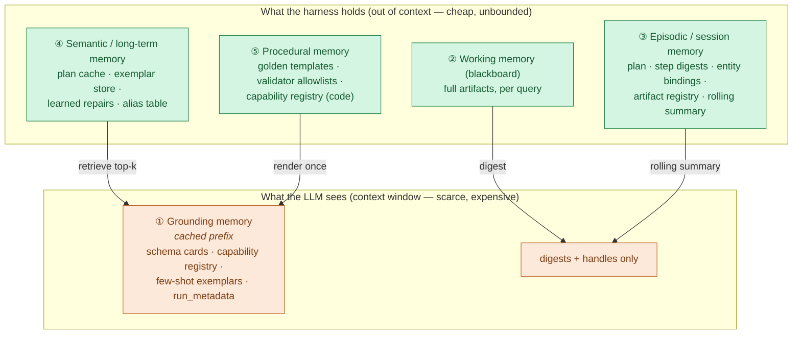
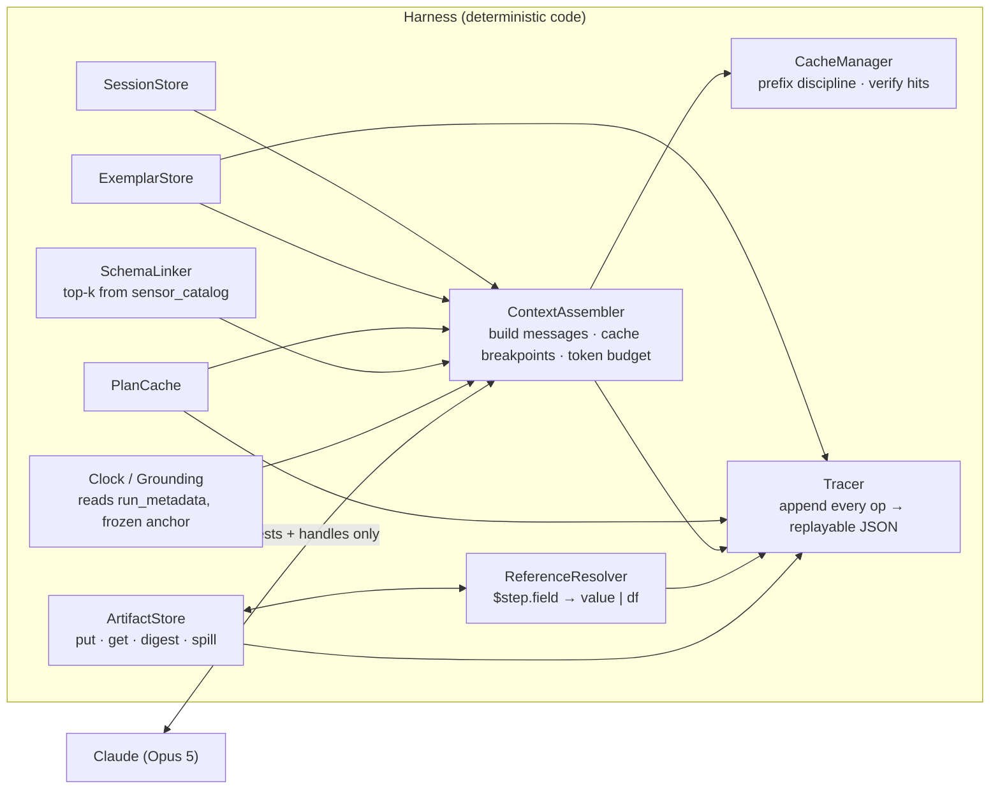
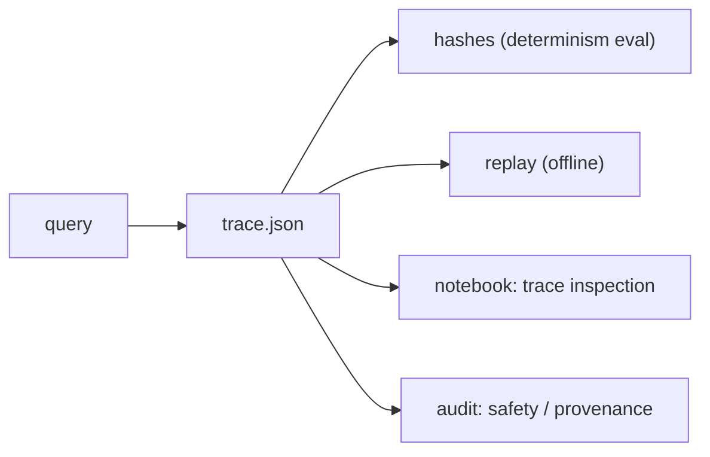

# Memory Management & the Agent Harness

**Case Study: Multi-Agent Systems for Industrial Asset Analytics**
Scope: how the agent layer **remembers** across calls — the **five memory tiers**, the
**artifact/digest** specifications, the **reference protocol**, and the **data-never-in-
prompt** rationale.

> **This is the memory-concepts reference.** The *implementation substrate* for all of it
> is LangGraph (checkpointer + store), specified in the definitive design:
> **[08-langgraph-implementation.md](08-langgraph-implementation.md) §6–§7.** Where §8–§9
> below describe a *hand-rolled* harness, read them as the conceptual decomposition; the
> concrete mapping to LangGraph primitives is in doc 08 §6. Agent internals and the
> capability registry are in
> [06-agentic-architecture.md](06-agentic-architecture.md).

---

## 0. The problem this document solves

A single telemetry window in the flagship query is ~4,320 rows (E1 spans 3 days at 60 s);
a wide-table pull for clustering can be tens of thousands of scalars. The whole dataset
is **27.5 M points across 636 columns**. Three facts follow:

1. **You cannot put the data in the prompt.** It is too large, it is expensive, its
   formatting is nondeterministic, and a tool result that flows through the model is a
   prompt-injection surface.
2. **You cannot re-fetch it on every call either.** Re-deriving an artifact each hop is
   slow and, if any clock or ordering leaks, nondeterministic.
3. **The LLM still has to reason about it** — enough to write the right SQL, the right
   Cypher, the right plot — using only a *description* of the data, not the data.

The resolution is a **memory hierarchy** where the LLM sees only small, bounded,
deterministic *descriptions* (handles + digests), while the **harness** holds the real
data out-of-context and resolves references in pure code. This is context engineering,
and it is the difference between a demo that runs in seconds and one that hits token
limits on the flagship query.

---

## 1. Five tiers of memory



| Tier | Lifetime | Lives in | Enters a prompt? | Purpose |
|---|---|---|---|---|
| **① Grounding** | session (stable) | cached prompt prefix | **yes**, cached once | Schema, tools, exemplars, frozen anchor — the shared context every call needs |
| **② Working (blackboard)** | one query | in-process store (+ Parquet spill) | **never** (only its digest) | The actual data artifacts steps hand each other |
| **③ Episodic (session)** | one conversation | `SessionStore` | only a rolling summary | Multi-turn continuity; reuse artifacts across follow-ups |
| **④ Semantic (long-term)** | cross-session | Postgres / JSON / vector index | retrieved top-k | Plan cache, exemplars, learned repairs — earned experience |
| **⑤ Procedural** | repo lifetime | source code | rendered into ① | Golden templates, allowlists, the registry — how the system *acts* |

The design rule: **the more volatile the memory, the further from the prompt it lives.**
Grounding (never changes within a session) is cached in the prefix; working memory (a new
DataFrame every step) never touches the prompt at all.

---

## 2. Working memory — the blackboard artifact store

The blackboard is an in-process store keyed by `artifact_id`. Every agent output lands
here; every downstream step reads from here by handle. **The store is the only thing that
ever holds a row of telemetry in the agent layer.**

### 2.1 Artifact types

```python
# shape only — illustrative, not the milestone's code
class Artifact(BaseModel):
    id: str                 # "s2.artifact"
    kind: Literal["scalar","table","records","figure","code"]
    provenance: Provenance  # {step_id, capability, query|code, timing, row_count}
    # payload lives beside the model, NOT serialized into any prompt:

ScalarArtifact  : value, unit                         # a max, a count, a timestamp
TableArtifact   : df (pandas), schema[cols+dtypes+units]   # telemetry windows
RecordsArtifact : rows (list[dict])                   # graph results
FigureArtifact  : png_path, caption, dims             # plots (bytes on disk)
CodeArtifact    : code, stdout_tail                   # the Coder's script
```

### 2.2 Storage & spill

- Small artifacts (scalars, records, small tables) stay in memory.
- A `TableArtifact` above a threshold (say >50k cells) **spills to Parquet** in the
  per-run temp dir; the store keeps a lazy handle. This keeps a big clustering pull off
  the heap without changing the reference API.
- Figures are always on disk (PNG); the artifact holds the path, never the bytes.
- Lifetime: the blackboard is created per query and dropped at query end — *except* its
  registry is promoted into session memory (tier ③) so follow-up turns can reuse
  artifacts without recomputing (§6).

### 2.3 The one rule

> **A payload is never serialized into an LLM request.** The model sees a *digest*
> (§3) or a *handle* (`$s2.artifact`). The harness enforces this at the context-assembly
> boundary — there is no code path that turns a `df` into prompt text.

---

## 3. Digests — how the LLM "sees" data it never reads

A **digest** is the small, bounded, deterministic description of an artifact that *is*
allowed into a prompt. It gives the model exactly what it needs to write the next query
or script, and nothing more.

| Artifact | Digest contents | ~tokens | Inlined vs referenced |
|---|---|---|---|
| `ScalarArtifact` | `{value, unit}` in full | ~10 | **inlined** — it *is* a parameter for the next step |
| `RecordsArtifact` | `{count, keys, ≤3 sample rows}` | ~150 | small ones inlined; the fields (e.g. `start_ts`) inlined |
| `TableArtifact` | `{id, columns:[{name,dtype,unit}], row_count, ts_range, per-col {min,max,mean,null_frac}, head(3)}` | ~300–500 | **referenced** by handle; digest describes it |
| `FigureArtifact` | `{caption, dims, path}` | ~30 | referenced; never the bytes |
| `CodeArtifact` | `{code (bounded), stdout_tail}` | ~200 | for repair/inspection only |

Digest discipline (this is what keeps it deterministic and bounded):

- **Fixed column order, fixed rounding** (e.g. stats to 4 sig figs) — so the same
  artifact always renders the same digest bytes.
- **Referenced-column pruning** — for a wide pull, the digest lists only the columns the
  schema-linker selected for this query, not all 636. A digest is never unbounded.
- **Sample rows are `head(n)`**, not a random sample — deterministic, and `n` is fixed
  (3 by default).
- **No wall-clock, no run-id, no object address** in a digest — all timestamps come from
  the data / `run_metadata`, so digests can safely sit inside the cached prefix region
  when stable.

Example digest for `s2` in the flagship query (what the Coder actually receives):

```json
{"id":"s2.artifact","kind":"table",
 "columns":[{"name":"ts","dtype":"datetime64[s]"},
            {"name":"bearing_temp_1","dtype":"float64","unit":"degC"}],
 "row_count":4320,
 "ts_range":["2026-09-01T00:00:00","2026-09-03T23:59:00"],
 "stats":{"bearing_temp_1":{"min":63.9,"max":105.7,"mean":78.4,"null_frac":0.0}},
 "head":[["2026-09-01T00:00:00",64.1],
         ["2026-09-01T00:01:00",64.0],
         ["2026-09-01T00:02:00",64.2]],
 "provenance":{"step":"s2","capability":"sql.timeseries_window",
               "sql":"SELECT ts, bearing_temp_1 FROM bfpa WHERE ts >= %s AND ts < %s ORDER BY ts"}}
```

~400 tokens describe a 4,320-row window well enough for the model to write a correct,
threshold-annotated plot — while the 4,320 rows stay on the blackboard.

---

## 4. Handling data across calls — the reference protocol

This is the mechanism that makes the whole thing work. Steps refer to prior outputs with
**symbolic handles**; the harness resolves them in **pure code** at execution time.

```mermaid
sequenceDiagram
    participant P as Planner (LLM)
    participant DAG as DAG Executor (code)
    participant BB as Blackboard (code)
    participant GA as Graph Agent
    participant SA as SQL Agent
    participant CA as Coder Agent (LLM writes code)
    participant NS as Sandbox namespace

    P->>DAG: Plan with $s1.result.start_ts, $s2.artifact
    DAG->>GA: run s1 (system=bfpa)
    GA->>BB: put RecordsArtifact s1 {start_ts,end_ts,threshold,sql_table}
    Note over DAG,BB: resolve $s1.* → scalars (code, not LLM)
    DAG->>SA: run s2 (table=bfpa, start_ts=…, end_ts=…)  ← scalars inlined
    SA->>BB: put TableArtifact s2 (4,320 rows)  ← stays here
    Note over DAG,BB: resolve $s2.artifact → the real df (code)
    DAG->>CA: run s3, prompt carries s2 DIGEST only (~400 tok)
    CA->>NS: generated code: df.plot(...); axvspan(...); axhline(threshold)
    DAG->>NS: inject df = BB.get("s2.artifact"), threshold=…  ← real data, no prompt
    NS->>BB: put FigureArtifact s3 (png path)
    DAG->>P: synthesize from digests
```

Two resolution paths, chosen by size, both **in code**:

1. **Scalars → inlined.** `$s1.result.start_ts` resolves to a concrete timestamp string
   and is written into the next step's typed inputs. Tiny; it *is* the parameter. The
   model never copies the number — the executor does.
2. **Tables/records → injected, not inlined.** `$s2.artifact` resolves to the actual
   `df`. The harness **injects it into the executor's namespace** (`df`, `alert_window`,
   `threshold`) before running the generated code. The Coder's prompt carries only the
   digest. The model writes `df.plot(...)` against a variable it never had to read.

Why this is the right design:

- **Token cost is flat in data size.** A 4,320-row hop and a 43,200-row hop cost the
  *same* prompt tokens — one digest — because neither carries rows.
- **Determinism.** References resolve identically every run (pure code, fixed store).
  The model can't fumble a copied number because it never sees the number to copy.
- **Safety.** Data can't carry instructions into the model, because data never reaches
  the model. Tool results are typed artifacts, not free text.
- **No re-fetch.** s2's data is computed once and reused by s3 (and by any later step or
  follow-up turn) straight from the blackboard.

---

## 5. Grounding memory & the prompt-cache prefix

Grounding memory is everything the model needs on *every* call that does **not** change
within a session: it is rendered once and pinned in the **cached prompt prefix**.

### 5.1 What goes in the prefix (stable → first), and what goes last (volatile)

```
┌─ tools  (deterministic order) ──────────────────────────────┐  ← cache region
│  capability registry as tool/JSON schemas                    │
├─ system  (frozen) ──────────────────────────────────────────┤
│  role + rules + determinism contract                         │
│  SCHEMA CARDS  (rendered from sensor_catalog + Neo4j schema) │
│  GRAPH SCHEMA  (labels, rel types + directions, properties)  │
│  FEW-SHOT EXEMPLARS  (retrieved, then frozen for the session)│
│  RUN GROUNDING  (now_anchor, window, currency from run_metadata)│
│  ⟵────────────────── cache_control breakpoint ──────────────⟶│
├─ messages  (volatile) ──────────────────────────────────────┤
│  the per-question text · the step's typed inputs · digests   │  ← NOT cached
└─────────────────────────────────────────────────────────────┘
```

Render order is `tools → system → messages` (current API). Keep stable content first,
put the volatile per-question text after the last `cache_control` breakpoint. The stable
prefix here is multi-thousand tokens (schema cards + graph schema + exemplars) reused by
the planner and every agent call — a large, repeated saving.

### 5.2 Schema cards — grounding without dumping 636 columns

The full catalog would blow the prompt. Two-level design:

- **Card level (in the prefix):** a compact per-system summary — table name, tag *count*,
  family histogram (from doc 04 §7), the shared universal/pump core, a few representative
  tags per family. Stable, cached.
- **Retrieved level (in the message):** for a specific query, the schema-linker pulls the
  top-k (~15) candidate columns from `sensor_catalog` and appends *only those* to the
  volatile message region. This is the schema-linking step (doc 06 §3.1) — it keeps the
  per-call schema small and is a `SELECT` against `sensor_catalog`, so it is itself
  deterministic and cacheable at the data layer.

### 5.3 Keeping the cache warm (and provably so)

- **Verify** with `usage.cache_read_input_tokens`. Zero across repeated requests ⇒ a
  volatile byte leaked into the prefix.
- **Common leaks to forbid:** `datetime.now()` anywhere in grounding (use the frozen
  `now_anchor`), unsorted `json.dumps` (sort keys), a varying tool set (freeze registry
  order), per-request UUIDs. The frozen anchor is what makes a clean prefix easy.
- **Exemplars are frozen per session:** retrieval happens once at session start; the
  chosen exemplars are pinned so the prefix bytes don't shift mid-session.

---

## 6. Episodic (session) memory — multi-turn continuity

A reviewer will ask a follow-up: *"now also plot BFP-B's bearing temp on the same axes."*
Without session memory the system recomputes everything; with it, the planner reuses
`s2` and adds one SQL + one Coder step.

`SessionStore` holds, per conversation:

- **The artifact registry** promoted from each query's blackboard — `{id → digest +
  location}` — so prior artifacts are addressable in later turns.
- **Entity bindings** — resolved aliases (`"it"`, `"that pump"` → `bfpa`) and the frozen
  anchor, so "the same window" means the same `[t0,t1)`.
- **A rolling summary** — a compact, bounded synopsis of prior turns (plan shapes,
  answers given), the *only* session content that enters a prompt, kept small so it
  never dominates the context.
- **Prior plans (digested)** — so the planner can extend rather than restart.

For very long conversations, the API's server-side **compaction** (beta) or
**context-editing** (clear old tool results) are available as escape hatches, but the
rolling-summary approach keeps most sessions well inside budget without them.

---

## 7. Semantic (long-term) memory — earned experience

Cross-session memory that makes the system faster and more accurate over time. All of it
is **append-only and versioned**, so a replay is reproducible.

| Store | Key | Value | Written when | Read when |
|---|---|---|---|---|
| **Plan cache** | `hash(normalized_q, plan_version, generator_version, now_anchor)` | validated `Plan` JSON | after a plan validates & executes clean | at intake — a hit skips the planner entirely (determinism + speed) |
| **Exemplar store** | embedding / lexical key of the question | `(question, capability, generated query)` | after a run passes validation (+ optional golden check) | schema-linking / few-shot retrieval |
| **Learned repairs** (optional) | error signature | fix hint | after a repair loop succeeds | fed into the repair prompt on a matching error |
| **Alias / entity table** | alias string | `System.name` | seeded from `SYSTEM_META.aliases`; extendable | entity resolution (stage 1) |

The **plan cache** is the load-bearing one for determinism: the same normalized question
returns byte-identical plan JSON without re-invoking the model, which is what makes the
"same query ×5 → identical hashes" proof trivial and cheap. Its key includes
`generator_version` and `now_anchor` so a re-seed with different data correctly
invalidates stale plans.

The **exemplar store** is how the system self-improves: successful, validated NL→query
pairs become few-shot material for future questions. It only grows from runs that passed
the validator (and, for the golden intents, matched the golden result), so it can't learn
a wrong query. Offline exemplar mining can run on the **Batch API** at 50% cost.

---

## 8. Why the memory is code-owned (not the model's memory tool)

> **Superseded framing → see [doc 08 §6, ADR-6](08-langgraph-implementation.md).** The
> conclusion is unchanged and *stronger* under LangGraph: memory of record lives in the
> LangGraph **checkpointer** (tiers ②③) and **store** (tier ④) — which are themselves
> code-owned, keyable, hashable, and replayable. The comparison below still holds.

The Claude API offers a server-side memory tool (`memory_20250818`), Managed Agents with
hosted state, and context-editing/compaction. We use **none of them for the system's
memory of record**. Rationale, stated as an ADR in doc 06 (ADR-6):

| Requirement | Code-owned harness | Model-managed memory |
|---|---|---|
| **Determinism** — same query ×5 → identical hashes | We hash the store, the plan cache, the digests | Model decides what to remember; not byte-reproducible |
| **Data separation** — no telemetry leaves Postgres into a prompt/store | Enforced at the context boundary; blackboard is local | Data could be summarized into model-side memory |
| **Replayability** — a full JSON trace re-runs the query | The harness owns every read/write; trace is complete | Opaque server-side state can't be replayed offline |
| **Auditability (criterion 3)** | Every memory op is our code, greppable | Not inspectable |

The server-side features remain useful as *conveniences* (compaction for a very long
chat, §6), never as the source of truth. Memory that the grade depends on must be
memory we can hash, diff, and replay.

---

## 9. The harness — the runtime that owns all of this

> **Superseded framing → see [doc 08 §2, §6](08-langgraph-implementation.md).** The
> components below are the conceptual decomposition; in the definitive design they map to
> LangGraph primitives: `ArtifactStore`→`StateGraph` state + reducers; `ReferenceResolver`→
> `resolve_refs` in `run_step`; `ContextAssembler`→`harness/context.py::assemble`;
> `CacheManager`→Anthropic `cache_control`; `PlanCache`/`SessionStore`→LangGraph
> store/checkpointer; `Tracer`→`get_state_history`. The guarantees are unchanged.

The **harness** is the deterministic, non-LLM machinery that maintains memory across
calls. It is where "efficiently maintaining the memory" actually lives. Components:



| Component | Owns | Guarantees |
|---|---|---|
| **Clock / Grounding** | the frozen anchor, window, currency (from `run_metadata`) | "now" never re-resolved; no wall-clock in any prompt |
| **ArtifactStore** | tier ② working memory | data never enters a prompt; spill for large tables |
| **ReferenceResolver** | `$ref` → scalar (inline) or df (inject) | resolution is pure code, deterministic |
| **ContextAssembler** | building each request | stable-first ordering; per-call **token budget**; digests capped |
| **CacheManager** | the cached prefix | prefix byte-stability; `cache_read_input_tokens` monitored |
| **SchemaLinker** | grounding retrieval | small, relevant schema per call |
| **PlanCache / ExemplarStore / SessionStore** | tiers ③–④ | append-only, versioned, replayable |
| **Tracer** | the audit log | every memory op recorded → full replay & hashing |

### 9.1 Token budget policy (per call)

The ContextAssembler enforces a budget so no single call can blow up:

- **Cached prefix:** schema cards + graph schema + exemplars + registry (stable, paid once).
- **Volatile region cap:** the per-question text + retrieved schema (top-k) + input
  digests, each digest capped (§3). If inputs exceed the cap, digests are truncated
  (fewer sample rows, pruned columns) — **never the data itself**, because the data was
  never a candidate for the prompt.
- **Effort tuned per role** (doc 08 §9): supervisor `high`, generators `medium`, synthesizer
  `low`/`medium` — the cheapest setting that holds accuracy on that step.

### 9.2 Lifecycle & eviction

| Tier | Created | Evicted |
|---|---|---|
| ② Working | per query | at query end (registry promoted to ③); Parquet spill deleted with the run temp dir |
| ③ Session | per conversation | at conversation end (or TTL) |
| ④ Semantic | first write | never auto-evicted; append-only, versioned; pruned only by an explicit maintenance pass |
| ① Grounding | session start | rebuilt if catalog/registry version changes |
| ⑤ Procedural | repo | on code change (bumps `plan_version` / registry version → invalidates dependent caches) |

---

## 10. Determinism of memory — the invariants

Everything above is engineered so a replay is byte-identical. The invariants the tracer
checks:

1. **No wall-clock in any cached or hashed content.** All time from `run_metadata`.
2. **Stable serialization.** Sorted keys, fixed float rounding, fixed column order in
   every digest and every cache-key input.
3. **Fixed retrieval.** Schema-linking and exemplar retrieval use a fixed index, fixed
   `k`, and a stable tie-break — same candidates every run.
4. **Versioned cache keys.** Plan-cache and exemplar keys carry `plan_version`,
   `registry_version`, `generator_version`, `now_anchor` — data or code changes
   invalidate correctly, identical inputs hit.
5. **Reference resolution is pure.** `$ref` → value depends only on the blackboard, which
   depends only on prior deterministic steps.

Result: the determinism proof in the notebook (same query ×5 → identical plan / query /
result hashes; doc 08 §7) is a property the memory design *gives you*, not something you
chase afterward.

---

## 11. The replayable trace

The Tracer appends one record per operation — plan, each step's resolved inputs,
generated query, validator verdict, execution timing, artifact digest, cache stats,
memory reads/writes. The trace is:

- **Complete** — it holds every input to every deterministic step, so a run can be
  replayed offline from the trace alone (no DB clock, no model needed for a cached plan).
- **Hashable** — the determinism eval hashes plan/query/result sections.
- **Inspectable** — one run's pretty-printed trace is a notebook section (doc 01 §6,
  item 11), and it is the audit artifact for criterion 3.



---

## 12. How this maps back to the spec criteria

| Criterion | What memory/harness contributes |
|---|---|
| **1 · Data quality** | Digests carry real stats (min/max/mean) computed from the actual artifact, so the answer is grounded in the data, not the prompt |
| **2 · Orchestrator sequencing** | The reference protocol (`$step.field`) *is* the dependency mechanism; step N provably consumes step N−1's output, resolved in code |
| **3 · Determinism & accuracy** | Frozen anchor, plan cache, pure-code reference resolution, versioned keys, replayable trace — determinism is designed in |
| **4 · Demo notebook** | Cached grounding + blackboard reuse make the notebook re-run in minutes; the trace section and determinism proof are direct notebook outputs |

---

## 13. Open decisions for you

1. **Exemplar backend** — lexical-only (zero deps, offline, deterministic) vs. embedding
   index (better paraphrase recall, needs a local embedder or `pgvector`). Default:
   **lexical first**, embeddings behind a flag (mirrors doc 06 decision 2).
2. **Plan-cache persistence** — in-memory per session (simplest) vs. persisted to Postgres
   (survives restarts, aids the determinism proof across processes). Default: **persist
   to Postgres**, keyed with the version tuple.
3. **Large-table spill format** — Parquet (columnar, compact) vs. Feather (faster
   round-trip). Default: **Parquet** in the run temp dir.
4. **Session memory for the demo** — the notebook can run stateless (each query fresh) or
   demonstrate one multi-turn follow-up to show artifact reuse. Default: **include one
   follow-up turn** as a showcase of tier ③.

---

*Architecture, orchestrator, agents, tools, capability registry, model config, and the
build plan:* **[06-agentic-architecture.md](06-agentic-architecture.md)**.
