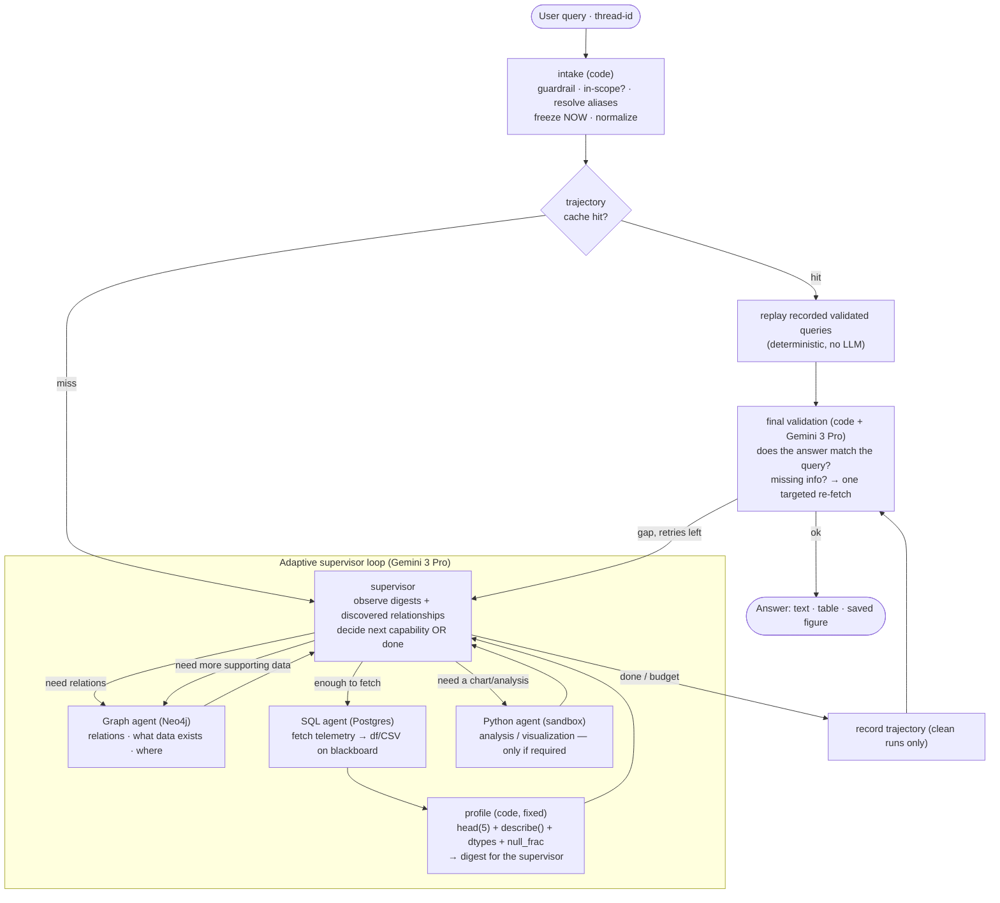
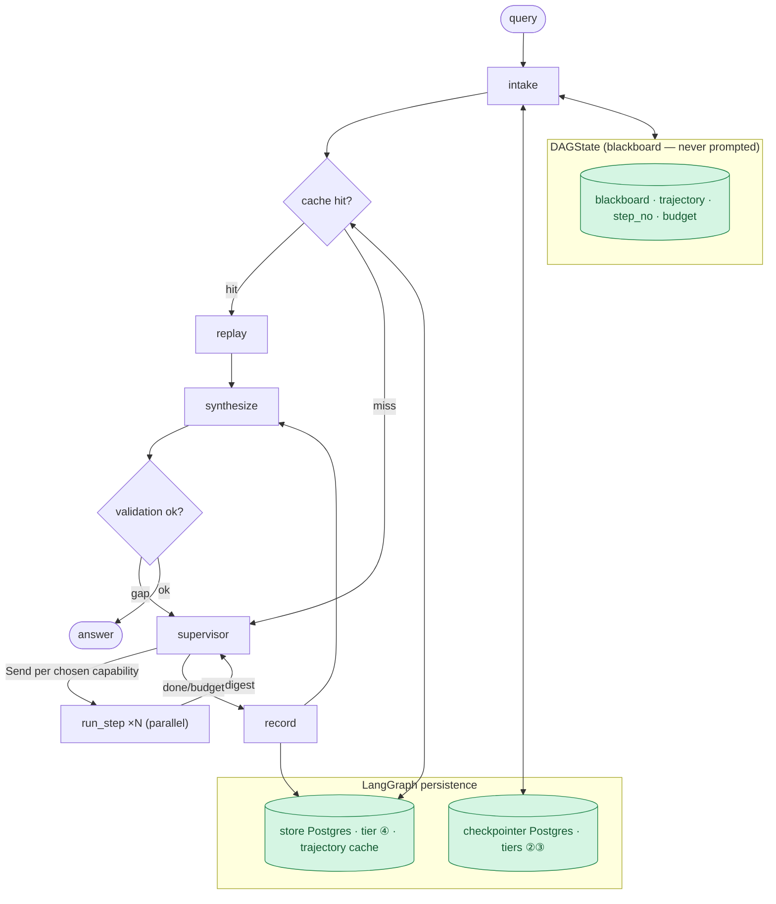
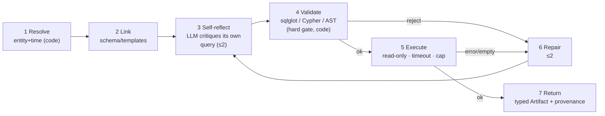
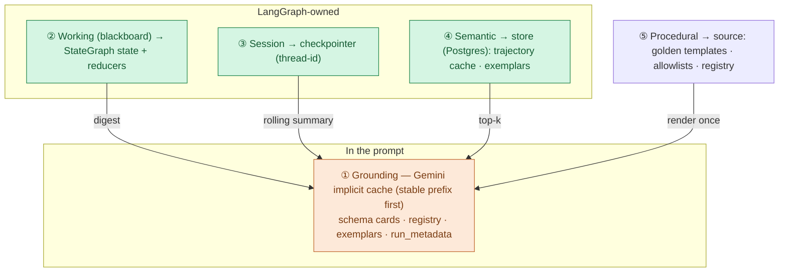
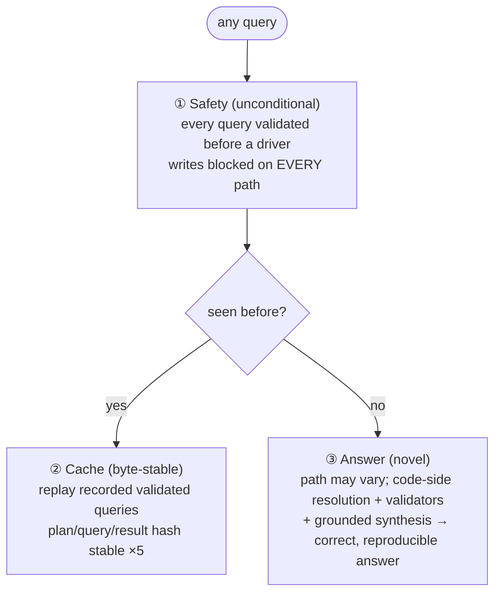
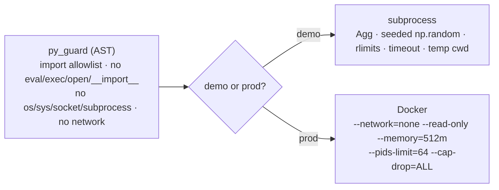

# Agentic System — Definitive Design (LangGraph)

**Case Study: Multi-Agent Systems for Industrial Asset Analytics**
This is the **authoritative design for the agent layer**. It defines the orchestration
model, the execution flow, memory, determinism, safety/sandboxing, prompting, the
edge-case/failure contract, and the build plan.

> **Reference companions (depth only, not orchestration):**
> [06-agentic-architecture.md](06-agentic-architecture.md) — the data-layer inheritance,
> the **capability registry**, the **seven-stage agent pipeline** with the exact
> validators, and the **A1–A8 acceptance tests**.
> [07-memory-and-harness.md](07-memory-and-harness.md) — the **five memory tiers**, the
> **artifact/digest** specifications, and the **data-never-in-prompt** rationale.
> Where those docs described a *hand-rolled* orchestrator or harness, **this doc
> supersedes them** (see §13 ADRs).
>
> **Source of truth for requirements:** [Problem.md](../../Problem.md). Gemini API facts
> reflect the current `google-genai` SDK / Gemini 3 docs; confirm model IDs via
> `client.models.list()` (the lineup moves monthly).

---

## 0. TL;DR

A **multi-agent orchestrator on LangGraph**. A **supervisor (Gemini 3 Pro)** understands the
user's intent and then, **hop by hop, delegates to specialized subagents** — Graph (Neo4j),
SQL (Postgres), Python (sandboxed) — **adapting to the relationships and sample data it
discovers**. It reasons only over **digests** (schema + `describe()` + 5 sample rows) and
**discovered scalars/relationships**; the bulk telemetry never enters a prompt and lives on
a **blackboard** in LangGraph state. A **deterministic cache fast-path** replays previously
seen queries byte-for-byte. Sessions persist on **thread-id**; a **final validation pass**
checks the answer against the original query before returning.

| Decision | Choice |
|---|---|
| Substrate | **LangGraph** (`StateGraph` + `Send` + `Command`) |
| Orchestration | **Hybrid: deterministic cache fast-path + adaptive supervisor loop** |
| Routing | **LLM supervisor per hop**, choosing only from the typed capability registry |
| Data to the LLM | **digests + discovered scalars/relationships only** (blackboard holds the rest) |
| Determinism | **3-tier**: safety (always) · cache replay (byte-stable) · answer (novel) |
| Session | **checkpointer + thread-id**; multi-turn continuity |
| Self-correction | per-agent self-reflection (≤2) → deterministic validator → repair (≤2); a **global budget** caps the whole run |
| Sandbox | subprocess+AST (demo) / Docker (prod) — **ours**, not a cloud sandbox |
| Rejected | `deepagents`, `langgraph-supervisor`, LangChain SQL agent (see §13) |

---

## 1. End-to-end execution flow

The **canonical happy path** (a composite query like the flagship), and how the supervisor
generalizes it. Graph-first is **not** hardcoded — the supervisor skips any stage a query
doesn't need (§10-B).



Reading the flow:

1. **Intake (code):** guardrail (in-scope? destructive?), alias resolution, **freeze the
   anchor**, normalize the question. Cache lookup on the normalized question.
2. **Supervisor decides which subagent solves the next unknown.** Typically: **Graph**
   first to learn *what exists and how it relates* (which table, which tag, which alert
   window), **then SQL** to fetch the telemetry onto the blackboard, **then** — only if the
   answer needs it — **Python** for a chart or a model.
3. **Profiling is code, not the LLM:** after any table lands, a **fixed** pandas profile
   (`head(5)` over a deterministic `ORDER BY`, `describe()`, dtypes, `null_frac`) becomes
   the digest the supervisor reads. The supervisor never sees the full data.
4. **Progressive discovery:** if what came back isn't enough, the supervisor goes **back to
   the Graph agent with the existing context** ("I have the alert window and table; I now
   need the tag→column mapping") and fetches more supporting information, then continues.
5. **Visualization only if required** (§10-G): a scalar answer stays text; a series or
   comparison gets a chart.
6. **Final validation** compares the assembled answer to the original query; on a gap, one
   targeted re-fetch (bounded). For a **figure** answer this includes a **multimodal check**
   — Gemini *sees* the PNG and confirms it shows what the query asked (threshold line, alert
   window, the crossing), re-plotting if not (§10-E).
7. **Session:** all of this is checkpointed under the **thread-id**, so a follow-up reuses
   prior artifacts and bindings (§6).

---

## 2. The engine graph on LangGraph

The dynamic loop above runs inside a small **static engine graph**.



- **intake, cache, replay, run_step's reference-resolution, profiling, final-validation
  (code parts)** are pure code → deterministic.
- **supervisor, the generators inside run_step, synthesize, final-validation (LLM part)**
  are the LLM calls.
- **The capability registry ([doc 06 §2](06-agentic-architecture.md)) is the only routing
  surface.** The supervisor may choose only a registered capability; `run_step` looks it
  up. Grep for query-string branching in `orchestrator/` returns zero — criterion 2.

---

## 3. Orchestration mechanism

### 3.1 Cache fast-path (deterministic)

A **trajectory** = the recorded `(capability, validated_query, input_template)` sequence
from a clean run. On a repeat, `replay` re-runs those **recorded validated queries** — no
LLM — re-resolving time/entity in code against the frozen anchor. Byte-identical, cheap.

Key: `(normalized_question, registry_version, generator_version, now_anchor)`; a re-seed
invalidates stale trajectories. Recorded **only after a clean run** (and a golden match for
named spec intents), so the cache can never learn a wrong path.

### 3.2 Adaptive supervisor loop (agentic)

```python
class CapabilityCall(BaseModel):
    id: str
    capability: str                 # must exist in REGISTRY (checked before dispatch)
    inputs: dict                    # may contain $refs to prior artifacts

class Decision(BaseModel):          # supervisor structured output (Gemini 3 Pro)
    reasoning: str
    done: bool
    actions: list[CapabilityCall] = []   # ≥1; parallel if independent

def supervisor(state: DAGState) -> Command:
    if over_budget(state):                                  # §11 global budget
        return Command(goto="record")
    digests = {k: a.digest() for k, a in state["blackboard"].items()}   # NOT payloads
    decision = decide(state["query"], digests, REGISTRY)   # Gemini 3 Pro, structured, cached prefix
    if decision.done or not decision.actions:
        return Command(goto="record")
    return Command(
        update={"trajectory": [decision], "step_no": state["step_no"] + 1},
        goto=[Send("run_step", {"call": c, "bb": state["blackboard"]}) for c in decision.actions],
    )

def run_step(payload: dict) -> dict:                        # ONE capability
    call = payload["call"]
    inputs   = resolve_refs(call.inputs, payload["bb"])     # $s1.result.x → value (code)
    artifact = REGISTRY[call.capability].run(inputs)        # 7-stage pipeline, validated
    return {"blackboard": {call.id: artifact}}
```

`run_step → supervisor` is the **observe-decide loop** — the supervisor sees each new
digest and adapts. `Send` per action keeps **parallel fan-out**. `over_budget` and the
LangGraph `recursion_limit` bound cost. `graph.get_graph().draw_mermaid_png()` renders the
engine for the notebook.

---

## 4. Blackboard & digests (data never enters a prompt)

- **Blackboard** = a `StateGraph` state key holding typed artifacts (doc 07 §2:
  `Scalar/Table/Records/Figure/Code`). Tables are kept as a typed **Parquet/df**; a **CSV**
  copy is written as the human-facing artifact. Large tables spill; state holds the handle.
- **Digest = the interface to the LLM**, built by **fixed code**, never by an LLM:
  `head(5)` over a **deterministic `ORDER BY ts`**, `describe()` (count/mean/std/min/
  quartiles/max), dtypes, `null_frac`, `row_count`, `ts_range`, fixed float rounding. This
  is your "top-5 rows + column description," made deterministic and injection-aware (§10-A).
- **The one rule is a lint:** only `harness/context.py::assemble` builds messages, and it
  takes digests — the greppable proof that no payload reaches a prompt.

---

## 5. The three subagents

Each is the same **seven-stage pipeline** ([doc 06 §3](06-agentic-architecture.md) for the
exact rules): resolve → link → **self-reflect (≤2)** → validate → execute → repair (≤2) →
return. Kept as plain functions / `@task`, not subgraphs.



- **Self-reflection (stage 3)** is an LLM self-critique *before* execution; the
  **deterministic validator (stage 4) remains the only hard gate** to a driver.
- **Graph (Neo4j):** template-first (~10 golden Cypher) → free-gen fallback; validate
  labels/rel-types/properties + direction + `EXPLAIN`; read session.
- **SQL (Postgres):** schema-link top-k from `sensor_catalog`; `sqlglot` validate
  (SELECT/CTE only, allowlist, `LIMIT` inject, `EXPLAIN`); execute as `mas_reader`.
- **Python (sandbox):** df **injected into the namespace** from the blackboard; AST
  allowlist; subprocess/Docker (§8). The df never enters the prompt.

---

## 6. Memory & persistence (five tiers → LangGraph)



- **Session (thread-id)** is the multi-turn contract you asked for: same `thread_id` →
  the checkpointer restores the blackboard's **artifact registry** and **entity/time
  bindings**, so a follow-up ("now add bfpb," "same window") reuses prior work instead of
  recomputing, and "the same day" reuses the *resolved* window, not a re-resolved one.
- **Trajectory cache (tier ④)** in the Postgres `store` drives the deterministic fast-path.
- Concepts and digest specs: [doc 07 §1–§7](07-memory-and-harness.md).

---

## 7. Determinism — three tiers

An adaptive supervisor can't promise an identical *path* for a novel query, and
[Problem.md](../../Problem.md) never asked for that (criterion 3 = *"correct, executable
queries"*). Determinism is delivered strongest-first:



Invariants (doc 07 §10): no wall-clock / UUID / unsorted `json.dumps` in hashed or cached
content; **deterministic `ORDER BY`** for every sample and result; **every LLM call pins
`temperature=0` + a fixed `seed`** (Gemini), tightening tier-③; `durability="sync"` for the
determinism eval, `"async"` for the live demo.

---

## 8. Safety & sandboxing

- **Validators are the hard gate**, path-independent: `sqlglot` (SQL), Cypher write-clause
  + schema + direction check, Python AST allowlist — before any driver/sandbox. The safety
  demo fuzzes destructive prompts and shows the rejection.
- **Untrusted data (§10-A):** sample rows shown to the supervisor are delimited as
  untrusted and carry no tool authority; the validator still gates every resulting query.
- **Sandbox is ours.** Framework sandboxes are all cloud (LangSmith/E2B/Modal/Daytona/…)
  and `langchain-sandbox` is archived — they break offline-repro and data-separation (we
  inject the df *locally*). CPython is not a security boundary (PEP 551).



---

## 9. Prompting & the LLM client (Gemini · `google-genai`)

Call the **Google Gen AI SDK (`google-genai`) directly inside nodes** to own the grounding
prefix and the structured-output schema. Model IDs move monthly — confirm against
`client.models.list()`.

| Role | Model | `thinking_level` |
|---|---|---|
| Supervisor (per-hop decision) + final validation | **Gemini 3 Pro** | `high` |
| SQL/Cypher/Python generation | **Gemini 3 Pro** | `medium`–`high` |
| Synthesizer / intake classifier | **Gemini 3 Flash** | `low`–`medium` |
| Self-reflection · eval-judge · exemplar mining | **Gemini 3 Flash / Flash-Lite** | `low` (Batch 50%) |

> Gemini 3 Flash now rivals prior Pro tiers — if evals hold, run generation on Flash and
> keep Pro only for the supervisor to cut cost sharply (Flash ≈ $0.75/$3.75 per M).

- **Structured outputs (native Pydantic):** pass the Pydantic model as `response_schema`
  (`response_mime_type="application/json"`) and read the typed object off `response.parsed`.
  Use an enum/`Literal` for the intake **scope classifier**. Cleaner than Claude's
  `output_config` — `Decision` and each agent's `{query, rationale}` return already typed.
- **Determinism levers (Claude lacked these):** pin **`temperature=0`**, fixed
  **`top_p`/`top_k`**, and a fixed **`seed`**. Not bit-guaranteed across backend versions,
  but it sharply cuts path variance → tier-③ answer determinism (§7) is *stronger* on Gemini.
- **Reasoning:** `thinking_level` (`low`/`medium`/`high`) per role — a clean 1:1 with the
  effort tiers. `max_output_tokens` bounds thinking+output combined, so size it for the
  Coder's scripts. (Gemini 2.5 used `thinking_budget` tokens; 3.x uses levels.)
- **Caching (a harness simplification):** Gemini 2.5+/3.x cache **implicitly** — keep the
  **stable grounding prefix first** and fire a session's hops close together (we do), and
  the multi-thousand-token prefix caches with **no cache-object/TTL lifecycle to manage**.
  Verify `usage.total_cached_tokens`. If the hit-rate is low, escalate to **explicit context
  caching** (`client.caches.create` → `CachedContent`, TTL) — a fallback, not the default.
- **Guard `finish_reason`** (`SAFETY`/`MAX_TOKENS`/`RECITATION`) before reading output; set
  `safety_settings` permissively for this trusted industrial domain (§10-A). On Gemini 3,
  **pass thought signatures back unchanged** in multi-turn tool loops (the SDK does this).
- **Supervisor prompt:** grounding prefix + query + current digests; prefer narrow
  capabilities over `freeform_*`; terminate explicitly (`done:true`), bounded by budget;
  reason over digests, never request raw data.

### 9.1 Gemini-specific enhancements

| Enhancement | What it buys |
|---|---|
| **Multimodal figure validation** | Gemini *sees* the Coder's PNG and confirms it answers the query — threshold line, alert window, the crossing — validating the *visualization*, not just that the code ran (§10-E) |
| **`temperature=0` + `seed`** | stronger answer-determinism; steadier novel-query paths (§7) |
| **Implicit caching** | grounding prefix caches automatically — no CacheManager/TTL lifecycle to build (§6) |
| **Flash cost tiering** | Flash for cheap roles, Flash-Lite for high-volume; Pro only where reasoning is critical |
| **Native Pydantic output** | typed `Decision`/IO off `response.parsed`; enum scope classifier |
| **Code execution tool (rejected)** | Gemini's hosted sandbox exists but breaks offline-repro + data-separation → keep local subprocess/Docker (§8) |

---

## 10. Edge cases & failure-handling contract

Every item below is a required behaviour, testable in `test_edge_cases.py`.

### A. Prompt injection via sample rows (introduced by showing top-5 rows)
Numeric telemetry is safe; **graph/maintenance text is not** — a `Tag.description`,
`Item.name`, or `MaintenanceLog` note could carry `"ignore instructions…"`. Sample rows
are wrapped as **untrusted data**, carry no authority; the **validator is the hard gate**.
Test: seed an injection string into a note, assert it's ignored and no unsafe query runs.

**Provider safety filters (Gemini):** industrial vocabulary ("trip", "failure",
"explosion", "abort") can trip Gemini's safety filters → a blocked prompt or
`finish_reason=SAFETY`. Set `safety_settings` to a permissive threshold for this trusted
domain and handle a block explicitly (one rephrase-and-retry, else surface honestly) —
**never treat a safety block as an empty-data result** and loop on it.

### B. Query shape
| Case | Behaviour |
|---|---|
| **Graph-only** (A3 tags count, A4 maint cost) | terminate after Graph; no SQL/CSV/Python |
| **SQL-only** (A1 max temp) | skip Graph entirely |
| **No-data / metadata** ("what systems exist?", "what can you do?") | answer from grounding/registry, zero DB hops |
| **Out-of-scope** ("weather?", non-existent asset) | guardrail + "no capability answers this" → decline honestly |
| **Ambiguous entity** ("the pump") | clarify (multi-turn) or state the assumed default |
| **Ambiguous time** ("recently") | default window + state it, or clarify |

### C. Data quality
| Case | Behaviour |
|---|---|
| **Empty result** | distinguish "empty is the answer" from "wrong query"; don't loop on a legitimately empty window |
| **Huge pull** (43,200-row month) | row cap + Parquet spill; coder downsamples for plots from `row_count` |
| **NULL-heavy column** | `null_frac` in the digest so the supervisor knows before planning a plot |
| **Non-deterministic head(5)** | sample requires explicit `ORDER BY ts` — else replay drifts |
| **Non-comparable cross-system tags** | only compare shared-core tags; flag mismatched semantics |

### D. Loop & budget (§11)
| Case | Behaviour |
|---|---|
| **Non-termination at budget** | degrade gracefully: best-effort answer + "couldn't fully resolve X" — never crash/silent-truncate |
| **Oscillation** (graph→sql→graph…) | progress check: each hop must add new blackboard info, else stop |
| **Partial parallel failure** | one `Send` branch fails, one succeeds → supervisor sees partial state and adapts |
| **Broken `$ref`** (upstream empty) | caught in code, returned as a typed error to the supervisor, not an exception |

### E. Correctness & final validation
| Case | Behaviour |
|---|---|
| **Validation loop** | cap re-fetches at 1; then return with an honest gap note |
| **LLM-judges-LLM** | back the validator with deterministic checks (asked for a max → is there an attributed scalar max?) |
| **Hallucinated numbers** | every number in the answer must trace to an artifact's provenance; reject un-attributed numbers |
| **Figure doesn't answer the query** | **multimodal check (Gemini vision):** feed the PNG back — "does this show [alert window + threshold crossing]?"; re-plot if not (Gemini-native; the Claude plan couldn't do this) |

### F. Session (thread-id)
| Case | Behaviour |
|---|---|
| **Follow-up reuses artifact** ("plot bfpb too") | reuse promoted artifact registry + prior window |
| **Anchor drift** ("same day" later) | reuse the resolved binding, don't re-resolve |
| **Intent change** ("actually cepa") | update bindings, don't blend |
| **Concurrent turns, one thread** | serialize per thread; checkpointer can't take two writers |
| **Stale cache after re-seed** | key includes `generator_version` + `now_anchor` → invalidates |

### G. Output policy
| Case | Behaviour |
|---|---|
| **When to visualize** | scalar → text; series/comparison/distribution → chart. "If and only if required." |
| **Misleading plot** | flagship needs threshold line + shaded alert window (deterministic plot spec) |
| **Oversized table** | cap inline rows; attach full CSV artifact |

---

## 11. Global budget & loop control

Three loop levels — supervisor hops, per-agent repair (≤2), per-agent self-reflect (≤2) —
**multiply**. A per-level cap is not enough. The run carries a **global budget** in state:

- `MAX_STEPS` supervisor hops (default **8**; flagship needs 3, composites ≤6),
- a **total-LLM-call** cap and a **wall-clock** cap,
- LangGraph `recursion_limit` as the backstop.

On exhaustion → **graceful degradation** (§10-D): synthesize the best answer from whatever
is on the blackboard and state the gap. Never crash, never silently truncate.

---

## 12. Clean-code standards & repo layout

- **Typing:** Pydantic for every capability I/O, artifact, and the `Decision`; `TypedDict`
  for `DAGState`; `Protocol` for `Agent`. No `dict[str, Any]` across module boundaries.
- **One routing surface** (registry) and **one message builder**
  (`harness/context.py::assemble`) — both greppable.
- **Digests are code-owned** (fixed pandas profile), never LLM-generated.
- **Determinism lints:** no `datetime.now()`/`uuid4()`/unsorted dumps in grounding or
  cache keys; a test asserts `total_cached_tokens>0` on the 2nd call and identical
  hashes on replay.

```
src/mas/
  catalog/ db/ datagen/ eval/ config.py     (exist)
  **llm/**            client.py · schemas.py (Decision, capability IO) · prompts/
  **harness/**        context.py (message builder) · cache.py · clock.py · digests.py (fixed profile)
  **memory/**         artifacts.py · trajectory_cache.py (store) · exemplars.py · session.py
  **tools/**          entity · timewin · schema_link · golden · {sql,cypher,py}_{guard,exec}
  **agents/**         base.py · sql_agent.py · graph_agent.py · coder_agent.py · registry.py
  **orchestrator/**   graph.py (StateGraph) · intake.py · supervisor.py · dag.py
                      (run_step/resolve_refs) · replay.py · validation.py · synthesizer.py
notebooks/ **demonstration.ipynb**
tests/  test_supervisor · test_cache · test_validators · test_agents · test_determinism · **test_edge_cases**
```

---

## 13. ADRs (definitive)

| ADR | Decision | Rationale |
|---|---|---|
| **ADR-1** | **LangGraph is the substrate.** | [Problem.md §4](../../Problem.md) grants design freedom; LangGraph runs adaptive supervisor loops with code-controlled safety; we delete plumbing, keep guarantees. |
| **ADR-2** | **Blackboard; data never enters a prompt** (digests only). | Cost, determinism, injection surface. |
| **ADR-3** | **Hybrid orchestration: cache fast-path + adaptive supervisor.** | Criterion 2 rewards *dynamic* routing; cache replay preserves criterion-3 determinism for graded queries. |
| **ADR-4** | **Template-first Graph/SQL, free-gen fallback.** | Text2Cypher on a novel schema is flaky; leaf templating ≠ hardcoded routing. |
| **ADR-5** | **3-tier determinism in the execution layer** (safety/cache/answer). | Reconciles adaptive routing with "correct, executable queries." |
| **ADR-6** | **Code-owned memory on LangGraph persistence** (checkpointer + store). | Determinism/replay need memory we key, hash, version. |
| **ADR-7** | **`google-genai` SDK in nodes; manual prompt + native Pydantic structured outputs.** | Own the grounding prefix and schema; LangChain `ChatGoogleGenerativeAI` is an accepted fallback. |
| **ADR-8** | **Sandbox is ours: subprocess+AST (demo) / Docker (prod).** | Framework sandboxes are cloud → break offline-repro + data-separation. |
| **ADR-9** | **Global budget + graceful degradation** across nested loops. | Nested caps multiply; a run must always terminate with a best-effort, honest answer. |
| **ADR-1b** | **Reject `deepagents`, `langgraph-supervisor`, LangChain SQL agent.** | Prebuilt ReAct helpers without a typed registry, validators, or data-separation. |

---

## 14. Build plan

| # | Deliverable | Depends on | Exit test |
|---|---|---|---|
| 0 | **Spike:** flagship query via the adaptive supervisor on `StateGraph`; df injected, digest-only prompts | data layer | supervisor discovers alert → adapts → pulls window → plots; **no telemetry in any prompt** (trace-checked) |
| 1 | `llm/` — client, `Decision` + capability IO schemas, cache prefix | 0 | structured `Decision` round-trips; `total_cached_tokens>0` on 2nd call |
| 2 | `harness/` + `memory/` — context assembler, **fixed-profile digests**, artifacts, **trajectory cache**, session | 1 | digests deterministic; `$ref` resolves; **record→replay byte-stable** |
| 3 | `tools/` — resolvers + 3 validators + 3 executors + golden templates | data layer | validators block the fuzz set; executors read-only |
| 4 | SQL agent | 2,3 | A1,A2 green; replay ×5 identical |
| 5 | Graph agent | 2,3 | A3–A5 green; direction/label validation |
| 6 | Python agent (AST + subprocess sandbox) | 2,3 | A6,A7 green; sandbox holds |
| 7 | Orchestrator (intake, cache, supervisor loop, synthesize, final validation) + **global budget** | 4,5,6 | A8 + composites; adapts; routing eval ≥95%; graph renders |
| 8 | `eval/` routing + determinism + **edge cases**; notebook; ADRs | all | notebook re-runs clean; safety + adaptivity + determinism + edge-case demos pass |

**Exit criterion:** clean clone → `make up && make seed && make validate` → `make demo`
runs one notebook showing A1–A8, an **adaptive** solve of a novel query, the **byte-stable
replay** proof, the routing eval, the **edge-case/safety** demos, and the rendered
LangGraph — in minutes.

---

## 15. Open decisions

1. **Supervisor granularity** — one capability/hop vs. parallel hops via `Send`. Default:
   **allow parallel**, one is the common case.
2. **`MAX_STEPS` / budget** — default **8 hops**, plus a total-LLM-call + wall-clock cap.
3. **Trajectory record policy** — record clean runs; **require golden match** for named
   spec intents.
4. **LLM call style** — **raw `google-genai` SDK** in nodes (default) vs. LangChain `ChatGoogleGenerativeAI`.
5. **Flagship Coder path** — implement **both**; demo the spec-literal (Coder → Postgres,
   [Problem.md §3.4](../../Problem.md)) flow, default to routed-via-SQL-agent.

---

*Deep reference — agent internals, registry, acceptance tests:*
**[06-agentic-architecture.md](06-agentic-architecture.md)** ·
*memory concepts & digests:* **[07-memory-and-harness.md](07-memory-and-harness.md)** ·
*spec:* **[Problem.md](../../Problem.md)**.
