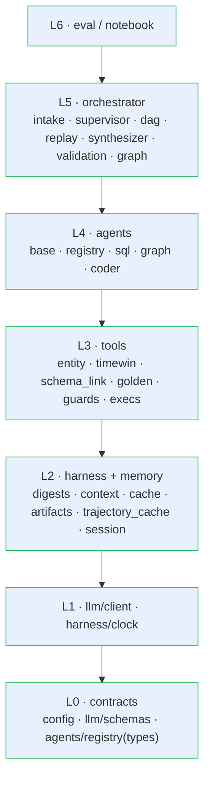

# Implementation Steps — Component Breakdown

**Case Study: Multi-Agent Systems for Industrial Asset Analytics**
Scope: the **definitive design ([08-langgraph-implementation.md](08-langgraph-implementation.md))
broken into small, single-responsibility pieces** — each independently buildable and
testable — with explicit separation of concerns and clean-code standards. This doc is the
build checklist; it defines *what each piece is, what it may not do, and when it's done*.

> Companions: architecture & flow — [08](08-langgraph-implementation.md); agent internals
> & registry — [06](06-agentic-architecture.md); memory concepts — [07](07-memory-and-harness.md).

---

## 1. Principles (every piece obeys these)

1. **Single Responsibility.** One module = one reason to change. If a file both *decides*
   and *executes*, split it.
2. **Typed boundaries.** Pydantic models / `Protocol` at every module edge. No
   `dict[str, Any]` crosses a boundary.
3. **Purity by default; isolate side effects.** The only side-effecting units are: the LLM
   client, DB executors, the sandbox, and the LangGraph store/checkpointer. Everything else
   is a pure function of its inputs.
4. **Dependency direction is one-way** (§2). A module imports only from strictly lower
   layers. No cycles.
5. **One doorway per concern** (§3): one message builder, one routing surface, one
   data→LLM path, one DB entry point per store.
6. **Determinism lints.** No `datetime.now()` / `uuid4()` / unsorted `json.dumps` in
   grounding, digests, or cache keys; every LLM call pins `temperature=0` + a fixed `seed`.
7. **Each piece ships with its test.** A step is not done until its Definition of Done
   (DoD) is green.

---

## 2. Layering & dependency direction

A module may import only from layers **below** it (plus `config` and `llm/schemas`, which
are global contracts). This is the backbone that keeps concerns separated.



---

## 3. Separation-of-concerns matrix (the hard boundaries)

Each capability belongs to exactly one place. A `✗` is a review-blocking violation.

| Concern | May call the LLM | May touch a DB driver | May build a prompt/message | May hold raw data |
|---|:--:|:--:|:--:|:--:|
| `orchestrator/supervisor`, `synthesizer`, `validation` (judge) | ✓ | ✗ | via `context.assemble` only | digests only |
| `agents/*` generate step | ✓ | ✗ | via `context.assemble` only | digests only |
| `tools/*_exec` (sql/cypher/py) | ✗ | ✓ (read-only role) | ✗ | ✓ (returns artifact) |
| `tools/*_guard`, resolvers, `schema_link`, `golden` | ✗ | ✗ (schema_link SELECTs catalog) | ✗ | ✗ |
| `harness/context.assemble` | ✗ | ✗ | ✓ (**the only one**) | takes digests |
| `harness/digests` | ✗ | ✗ | ✗ | ✓ (reads df → digest) |
| `memory/*`, `orchestrator/dag` (run_step/resolve_refs) | ✗ | ✗ | ✗ | ✓ (blackboard) |

Three doorways, each unique and greppable: **routing** → the registry; **prompt building**
→ `context.assemble`; **data→LLM** → `digests`.

---

## 4. The pieces

Each step: a module, its single responsibility, what it depends on, and its DoD. Key
interfaces are listed per phase. Build phases in order; steps within a phase can be
parallel unless a dependency says otherwise.

### Phase 0 — Contracts (L0)

```python
# llm/schemas.py
class Provenance(BaseModel): step_id: str; capability: str; query: str | None; timing_ms: int; row_count: int | None
Artifact = ScalarArtifact | TableArtifact | RecordsArtifact | FigureArtifact | CodeArtifact
class CapabilityCall(BaseModel): id: str; capability: str; inputs: dict
class Decision(BaseModel): reasoning: str; done: bool; actions: list[CapabilityCall] = []
# agents/registry.py
class Capability(BaseModel): name: str; description: str; input_model: type[BaseModel]; output_model: type[BaseModel]; cost_hint: Literal["cheap","medium","expensive"]; agent: str
def capability(spec: Capability): ...      # decorator → REGISTRY[name]
```

| Step | Module | Single responsibility | Depends | Done when |
|---|---|---|---|---|
| S0.1 | `llm/schemas.py` | The typed contracts: artifacts, `CapabilityCall`, `Decision`, `Provenance`, per-capability IO models | — | models validate; JSON round-trips |
| S0.2 | `config.py` (extend) | Add `registry_version`, `generator_version`, budgets, model IDs/effort | — | settings load; anchor frozen & read-back |
| S0.3 | `agents/registry.py` | `Capability` type + `REGISTRY` + `@capability` + `render_for_prompt()` | S0.1 | register/lookup dummy; renders stable, ordered tool schemas |

### Phase 1 — LLM & clock (L1)

```python
# llm/client.py
def complete_structured(schema: type[T], *, system, contents, thinking_level: str, seed: int = SEED) -> T: ...  # google-genai; response_schema → response.parsed; temperature=0; implicit cache; guards finish_reason (SAFETY/MAX_TOKENS)
# harness/clock.py
def now_anchor() -> datetime: ...
def resolve_window(expr: str, anchor: datetime) -> tuple[datetime, datetime]: ...   # "yesterday" → [t0,t1)
```

| Step | Module | Single responsibility | Depends | Done when |
|---|---|---|---|---|
| S1.1 | `llm/client.py` | The **only** Gemini (`google-genai`) call site: structured output + implicit-cache prefix + `temperature=0`/`seed` + `finish_reason` guard | S0.1 | `Decision` round-trips typed; `total_cached_tokens>0` on 2nd identical call |
| S1.2 | `harness/clock.py` | Frozen-anchor read + code-side relative-time resolution | S0.2 | "yesterday"/"7 d"/"that window" → correct, stable `[t0,t1)` |

### Phase 2 — Working memory, digests, context, cache (L2)

```python
# harness/digests.py
def profile(df: DataFrame, order_by: str = "ts") -> TableDigest: ...   # head(5) over ORDER BY + describe() + dtypes + null_frac; fixed rounding
# harness/context.py
def assemble(*, grounding: Grounding, question: str, digests: list[Digest]) -> Messages: ...  # THE message builder; delimits untrusted sample rows
# memory/trajectory_cache.py
def key(norm_q, registry_v, generator_v, anchor) -> str: ...
def get(key) -> Trajectory | None; def record(key, traj: Trajectory) -> None: ...   # LangGraph store
```

| Step | Module | Single responsibility | Depends | Done when |
|---|---|---|---|---|
| S2.1 | `memory/artifacts.py` | Artifact put/get over state; Parquet spill; CSV writer | S0.1 | put/get; >50k-cell table spills; CSV written |
| S2.2 | `harness/digests.py` | Fixed, code-owned profile → digest (the data→LLM doorway) | S2.1 | same df → **identical digest bytes**; `ORDER BY` enforced |
| S2.3 | `harness/context.py` | Build the cache prefix + inject digests; delimit untrusted data | S0.3, S2.2 | prefix byte-stable; sample rows in an untrusted block; only builder (grep) |
| S2.4 | `memory/trajectory_cache.py` + `harness/cache.py` | Trajectory key/record/lookup in the store | S0.1, S0.2 | record→lookup; re-seed (`generator_version`) invalidates |
| S2.5 | `memory/session.py` | thread-id continuity: promote artifact registry + bindings; rolling summary | S2.1 | follow-up reuses prior window/binding |

### Phase 3 — Tools (L3, deterministic)

| Step | Module | Single responsibility | Depends | Done when |
|---|---|---|---|---|
| S3.1 | `tools/entity.py` | alias → `System.name` (code) | S0.2 | aliases resolve; unknown → typed error |
| S3.2 | `tools/timewin.py` | relative time → `[t0,t1)` (wraps clock) | S1.2 | spec time expressions correct |
| S3.3 | `tools/schema_link.py` | top-k (~15) columns from `sensor_catalog` (SELECT) | S0.2 | relevant cols returned; deterministic tie-break |
| S3.4 | `tools/golden.py` | ~10 parameterized golden Cypher templates | S0.1 | each named intent → valid, parameterized Cypher |
| S3.5 | `tools/sql_guard.py` · `sql_exec.py` | validate (`sqlglot`) / execute as `mas_reader` | S0.1 | fuzz set blocked; read-only enforced |
| S3.6 | `tools/cypher_guard.py` · `cypher_exec.py` | validate writes/schema/direction / read session | S0.1 | write clauses blocked; direction checked |
| S3.7 | `tools/py_guard.py` · `py_exec.py` | AST allowlist / subprocess sandbox (Agg, rlimits, timeout) | S0.1 | disallowed import blocked; figure → PNG |

### Phase 4 — Agents (L4)

```python
# agents/base.py
class Agent(Protocol):
    def run(self, inputs: BaseModel) -> Artifact: ...    # resolve→link→self-reflect(≤2)→validate→execute→repair(≤2)→return
def run_pipeline(gen, guard, exec_, inputs) -> Artifact: ...   # shared 7-stage runner
```

| Step | Module | Single responsibility | Depends | Done when |
|---|---|---|---|---|
| S4.1 | `agents/base.py` | The shared 7-stage pipeline runner (self-reflect + repair bounded) | L3, S1.1, S2.2 | stages orchestrated; repair ≤2; validator is the hard gate |
| S4.2 | `agents/sql_agent.py` | `sql.*` capabilities | S4.1, S3.3/3.5 | A1, A2 green |
| S4.3 | `agents/graph_agent.py` | `graph.*` capabilities, template-first | S4.1, S3.4/3.6 | A3–A5 green |
| S4.4 | `agents/coder_agent.py` | `python.*` capabilities; df injected into namespace | S4.1, S3.7 | A6, A7 green; sandbox holds |

### Phase 5 — Orchestrator (L5)

```python
# orchestrator/dag.py
def run_step(payload: dict) -> dict: ...          # resolve_refs → REGISTRY[cap].run → {blackboard:{id:artifact}}
def resolve_refs(inputs: dict, bb: dict) -> dict: ...   # $s2.artifact → df/scalar (code); broken ref → typed error
# orchestrator/supervisor.py
def supervisor(state: DAGState) -> Command: ...   # observe digests → Decision → Send; budget + progress check
# orchestrator/graph.py
def build() -> CompiledStateGraph: ...            # wire nodes/edges; compile(checkpointer, store); global budget
```

| Step | Module | Single responsibility | Depends | Done when |
|---|---|---|---|---|
| S5.1 | `orchestrator/intake.py` | guardrail (scope/destructive), normalize, freeze anchor, cache lookup | S1.2, S2.4 | out-of-scope declined; destructive blocked pre-plan |
| S5.2 | `orchestrator/dag.py` | `run_step` + `resolve_refs` + reducers | S4.*, S2.1 | `$ref` resolves; broken ref → typed error, no crash |
| S5.3 | `orchestrator/supervisor.py` | per-hop `Decision` over the registry; budget + progress guards | S0.3, S1.1, S2.3 | adapts to digests; registry-only choices; budget caps hops |
| S5.4 | `orchestrator/replay.py` | deterministic trajectory replay (no LLM) | S2.4, S3.* | replay hashes stable ×5 |
| S5.5 | `orchestrator/synthesizer.py` | digests → NL answer; every number attributed | S1.1, S2.2 | no un-attributed number survives |
| S5.6 | `orchestrator/validation.py` | final answer-vs-query check (code + judge + **multimodal figure check, Gemini vision**); bounded re-fetch | S1.1 | catches a seeded gap; a wrong-looking figure is caught; re-fetch capped at 1 |
| S5.7 | `orchestrator/graph.py` | wire the `StateGraph`; global budget; graceful degradation | S5.1–S5.6 | flagship end-to-end; `draw_mermaid_png()` renders |

### Phase 6 — Evals & demo (L6)

| Step | Module | Single responsibility | Depends | Done when |
|---|---|---|---|---|
| S6.1 | `eval/routing_cases.py` | routing eval set + confusion matrix | S5.7 | routing accuracy ≥95% |
| S6.2 | `eval/determinism.py` | plan/query/result hashes ×5 via `get_state_history` | S5.4 | hashes identical ×5 |
| S6.3 | `tests/test_edge_cases.py` | the §10 failure contract (injection, empty, oscillation, budget, session) | S5.7 | each edge case asserts its behaviour |
| S6.4 | `notebooks/demonstration.ipynb` | A1–A8 + adaptive solve + determinism + safety demos | all | re-runs top-to-bottom clean |

---

## 5. Build order & critical path

**Spike first.** Before Phase 1, do **milestone 0** ([doc 08 §14](08-langgraph-implementation.md)):
a throwaway `StateGraph` that solves the flagship query with the supervisor discovering the
alert and adapting — proving the loop works and **no telemetry enters a prompt**. It
touches S0.1, S1.1, a stub SQL/Graph agent, and S5.7 in miniature; it de-risks the whole
architecture in ~80 lines, then is deleted.

Critical path (each depends on the prior): **S0.1 → S1.1 → S2.2/S2.3 → S3.5 → S4.1 → S4.2
→ S5.2 → S5.3 → S5.7.** Everything else hangs off this spine and can be built in parallel
by whoever is free. The three subagents (S4.2–S4.4) are independent once S4.1 exists.

---

## 6. Definition-of-Done checklist (per piece)

A piece is done only when **all** hold:

- [ ] Single responsibility; no concern from the §3 matrix leaked in.
- [ ] Typed public interface (Pydantic/`Protocol`); no `dict[str, Any]` at the edge.
- [ ] Imports only from lower layers (§2); no new cycle.
- [ ] Its unit test is green, including the failure/edge case it owns.
- [ ] Determinism lints pass (no wall-clock/UUID/unsorted dump in cached or hashed paths).
- [ ] If it can call the LLM, it does so **only** through `llm/client`; if it builds a
      message, **only** through `harness/context.assemble`; if it touches a driver, **only**
      through the read-only executor.

---

*Definitive design:* **[08-langgraph-implementation.md](08-langgraph-implementation.md)** ·
*agent internals & registry:* **[06-agentic-architecture.md](06-agentic-architecture.md)** ·
*memory concepts:* **[07-memory-and-harness.md](07-memory-and-harness.md)**.
